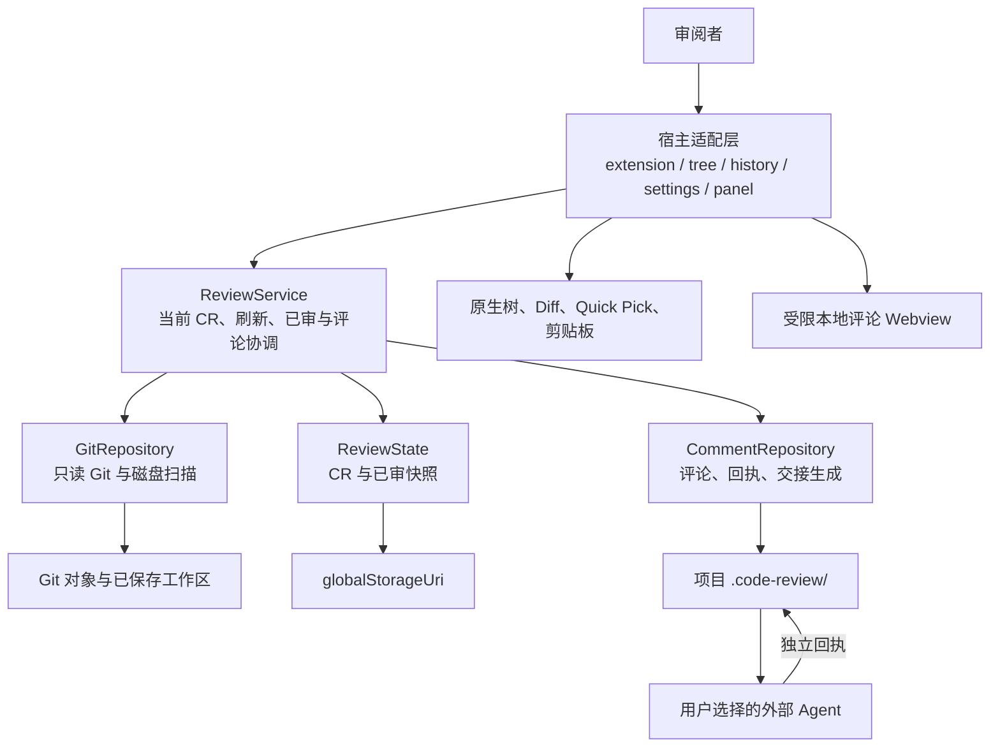

# 架构与核心边界

本文描述 ReviewSlate 1.0.1 的实现，供开发者定位入口、复用审阅逻辑和设计新宿主适配器。最后核查：2026-11-03，基于 `d7e6b0d`。字段、持久化、Agent 写入及恢复规则统一见[数据与 Agent 协议](data.md)。末节的核心抽取是后续方案，尚未实现为独立包或服务。

## 当前运行形态

ReviewSlate 是 TypeScript 编写的 VS Code 扩展，运行时仅使用 VS Code API 和 Node.js 内置模块。它在扩展宿主进程中调用本地 Git、读取磁盘和保存本地审阅资料；没有 HTTP/RPC 服务、常驻服务器、模型调用、联网上传或遥测。Remote SSH 中这些操作发生在远端扩展宿主。

[`package.json`](../package.json) 声明 `extensionKind: ["workspace"]`、入口 `dist/extension.js`、四个视图及 `codeReview.*` 命令；不支持不受信任或虚拟工作区。[`activate`](../src/extension.ts) 也检查工作区信任状态。扩展 ID `to-re.code-review`、命令前缀、`code-review` URI scheme 和 `.code-review/` 目录保持兼容。

Agent 通过用户交接的文件路径读写；点击“交给 Agent”只复制说明，不启动 Agent 或建立通信连接。项目内容与生成清单可能包含原代码、评论和绝对路径，是否交给外部服务由用户决定。

## 入口和调用链

[`ReviewExtension`](../src/extension.ts) 发现 workspace folders 与内置 Git 扩展可见仓库，使用 `GitRepository.open()` 获取真实根路径，再构造 `ReviewService(repo, context.globalStorageUri.fsPath)`。每个实例当前展示一个仓库；命令与刷新经 `enqueue()` 串行执行。保存文件、视图显示会触发刷新；文件树或记录树可见且队列空闲时，每 5 秒刷新一次。定时器属于扩展生命周期，`dispose()` 会清除。

| 用户动作 | 实际调用链 | 关键约束 |
| --- | --- | --- |
| 启动、重开仓库 | `selectRepository → service.start → state.resume → service.refresh` | 恢复当前分支最后使用的 CR；读取失败显示错误 |
| 选择分支作为基点 | `configure → repo.forkPoint → service.choose → state.select` | 先与 `HEAD` 求共同祖先，再固定完整 SHA |
| 从 SHA 或 Git 图形提交新建 | `pickCommit / fromCommit → repo.resolve → service.choose` | 直接固定提交，不再自动求共同祖先 |
| 刷新 | `service.refresh → state.active/sessions → comments.sync → state.records → repo.scan` | 过滤本轮评论；比对已审指纹；补回只有评论的路径 |
| 打开完整 Diff | `open → service.selection → showDiff → vscode.diff` | 左侧虚拟文档，右侧合格时使用真实工作区文件 |
| 标记已审 | `mark → service.mark → state.record → refresh` | 校验展示时 CR、内容指纹、目录成员与未保存文件 |
| 保存评论 | `panelAction → service.add / comments.update → publish → refresh` | 页面归属、当前分支/CR、评论版本、幂等请求 ID |
| 交给 Agent | `handoff → refresh → assertCurrent → handoffText → clipboard` | 清单固定到 `reviews/<CR ID>/`，不调用 Agent |
| 永久删除 CR | `purgeReview → state.purge → comments.invalidateReview / purge → refresh` | 先失效交接，再写删除标识并分阶段清理，可重试 |

`refresh()` 既读取也会更新已有评论目录中的派生清单和忽略规则，不是无副作用查询。新调用方不能将错误后的旧 `view` 当作可写状态：发生错误时文件列表会清空并设置 `view.error`。

## Git 读取和内容身份

[`GitRepository`](../src/git.ts) 通过 `execFile` 直接调用 Git，允许的子命令只有 `rev-parse`、`for-each-ref`、`merge-base`、`log`、`ls-tree`、`ls-files`、`cat-file`。调用关闭可选锁、fsmonitor、懒加载、替换对象和终端提示；不执行 fetch、checkout、add、commit、clean、textconv 或 external diff。每次 Git 调用超时 30 秒、输出上限 32 MiB；没有整轮扫描的总超时或公共取消 API。

扫描候选路径来自固定基点的树、索引、未被 Git 忽略的未跟踪文件，以及已有审阅记录。索引用于发现路径、类型和合并冲突，右侧内容始终取磁盘已保存字节，不单列暂存区版本。扫描前后检查 `HEAD`，服务层再检查分支与活动 CR。项目 `.code-review/` 始终排除。

[`model.ts`](../src/model.ts) 定义快照 `Snapshot { mode, data }` 和左右侧 `Pair`。内容身份包含文件模式和原始字节，不依赖当前 `HEAD`、mtime 或 Git 是否已提交。stage 或 commit 后字节与模式未变，已有审阅仍可匹配。未变化的大文件可通过流式 Git blob 摘要检查跳过；变化内容和扫描预算见[数据限制](data.md#容量与文件边界)。对象缓存有界，仅在进程中使用。

工作区符号链接只读取链接文本；父目录链接不会被跟随。普通 UTF-8 文件可显示文本，二进制、非 UTF-8 和仅模式变化显示摘要。子模块要求单独打开为仓库。工作区按原始磁盘字节比较，因此 Git LFS、换行转换和过滤器处理后的 Git 展示可能与本工具不同。

## CR、进度与评论

[`ReviewState`](../src/state.ts) 管理默认基点、CR 目录和已审内容。一个未归档 CR 对应一个分支身份与固定基点；同一组合再次选择会复用已有 CR。归档后可以新建同组合 CR，恢复旧记录时必须避免组合冲突。普通分支提交后身份不变，游离 `HEAD` 的身份包含提交 SHA。CR ID 是不透明标识，不能用分支和基点重新计算原 ID。

文件状态由本次左右快照与上次记录计算：无记录为 `pending`，相同为 `reviewed`，不同为 `changed`。取消已审只删除记录引用；已审文件回到当时内容后重新匹配。“查看上次审阅后的变化”比较上一份已审快照与当前快照。目录进度由文件树聚合，目录评论不改变文件进度。

[`CommentRepository`](../src/comments.ts) 保存评论、读取 Agent 回执、生成规则与待处理清单。评论按 `scope` 隔离到 CR；旧记录通过 `commentScopes` 别名接续。`replyMatches()` 只表达当前版本是否已有回执，不会把评论改成已解决。原评论的 `state` 由审阅者决定。

[`anchors.ts`](../src/anchors.ts) 保存原选区及前后文。快照一致时返回 `exact`；唯一片段及上下文匹配时返回 `moved`；两侧上下文唯一但中间内容改变时可返回 `changed`；其余无法可靠定位时返回 `unavailable`。它不提供 rename 检测或 AST 语义定位。路径不存在或变为同名其他类型时，原评论仍保留目标类型与范围。

## 宿主适配层不可省略的责任

当前业务模块没有导入 `vscode`，但完整交互约束并未全部下沉到它们：

| 边界 | 当前承担者 | 新适配器必须保留的行为 |
| --- | --- | --- |
| 未保存文档 | `extension.ts` 的 `dirtyFiles()` 与标记 guard | 标记前检查缓冲区；选区评论核对编辑器文本与磁盘，不把缓冲区当作已保存快照 |
| Diff 归属 | `extension.ts` 的文档映射、活动标签检查 | 旧 CR 的 Diff、普通 Git Diff、同一工作区 URI 不能借当前页面写入另一轮 CR |
| 评论消息 | `panel.ts` 输入过滤，`extension.ts` 的 key/ID/revision 与 guard | 只接受当前目标、CR 和版本；写锁内再次检查分支/活动 CR；失败保留草稿 |
| 已审请求 | `tree.ts → MarkRequest → service.mark` | 携带展示时 `session`、路径、指纹与勾选值；目录请求携带原列表，不能按最新列表无条件标记 |
| 可编辑文件 | `repo.editablePath()` 与 `workingDocument()` | 仅给内容仍匹配的普通 UTF-8 文件真实 URI；其他内容使用只读虚拟文档 |
| 删除与确认 | `extension.ts → service.purgeReview` | 人工确认永久删除；清除本宿主可识别的相关草稿 |

[`panel.ts`](../src/panel.ts) 加载本地 CSS/JS，以 nonce CSP 限制脚本和样式，`localResourceRoots` 为空。[`media/comments.js`](../media/comments.js) 将评论和回执作为文本渲染，维护草稿、请求 ID 和 ack；Webview 自身不读写 Git 或存储。树、菜单、设置和 Diff 使用原生 API，评论是独立 Webview。这些 UI 能力属于当前 VS Code 适配器，不表示其他宿主具备同样扩展点。

## 后续核心抽取方案

后续适配首先保证**每个应用内的连续审阅**：重开后恢复固定基点、进度和评论；代码变化后只让受影响内容需复审；旧页面和并发请求不能写错 CR。各应用独立保存数据，跨应用共享或迁移不作为首版前置条件。复用计算逻辑和类型不等于让两个应用共享同一份状态文件。

以下是代码现状上的拆分建议，尚无独立 Core 包、CLI 或 MCP 服务：

| 候选边界 | 现有模块 | 抽取时应处理的事项 |
| --- | --- | --- |
| 数据和纯计算 | `model.ts`、`anchors.ts`、`baselines.ts`、`handoff.ts` | 保留内容身份和格式；交接文本生成与传输分离 |
| 本地 I/O | `git.ts`、`filesystem.ts`、`ignore.ts` | 保留只读 Git、路径保护、限额和原子替换；明确 Node.js 与文件系统要求 |
| 审阅状态与评论 | `state.ts`、`comments.ts`、`review.ts` | 保留现有应用存储；集中当前 CR、归属和版本检查；新增宿主需可配置存储命名空间 |
| VS Code 适配器 | `extension.ts`、`tree.ts`、`history.ts`、`settings.ts`、`commit-picker.ts`、`panel.ts`、`media/comments.*` | 保留原生命令、文档、Diff、UI 草稿和信任检查 |

当前 `.code-review/` 路径在模型、评论、忽略规则和交接文本中固定，不能仅给 `ReviewService` 另一个 storage 参数就得到完全隔离的新宿主存储。未来 Codex 适配应使用自己的持久化空间和交接清单，不与 Trae 等现有扩展的项目评论混写；具体接入路径和宿主能力见 [Codex 集成设计](codex.md)。本方案不改变 1.0.1 的格式、位置或备份规则。

第一步可在仓库内整理模块导出与调用接口，让适配器显式传入仓库根路径、存储位置、展示时身份和宿主文档检查。`ReviewService` 接收 `Buffer`、`Map` 等进程内类型，并以异常字符串报告错误；这些目前不是稳定的远程协议。若需要跨进程调用，应另行定义可序列化请求、结果和错误分类，不能直接暴露类对象或用错误文案作为状态码。

所有适配器写入都必须执行同样的 CR、评论版本和持久化检查。直接导入 `CommentRepository.update()` 时，调用者仍要负责本轮目标归属并提供 `beforeWrite` guard；只传评论 ID 不等于获得本轮修改权限。也不能把一个现成 `Pair` 无条件交给 `state.record()` 来代替 `service.mark()` 的检查。

本地连续审阅不需要先增加数据库、后台服务器或消息系统；原扩展兼容与新宿主独立存储应分别验证。跨应用数据互通若以后启动，再设计身份映射与同步，而不提前改变现有数据。

## 验证入口

现有测试用临时合成仓库、真实 Git 和本地文件系统验证核心，并用模拟 VS Code API 与 DOM 验证适配行为。运行命令与真实宿主验证要求见[贡献指南](../CONTRIBUTING.md)。

| 契约 | 对应测试 |
| --- | --- |
| 原始字节、进度、损坏和路径保护 | [`review.test.cjs`](../test/review.test.cjs)、[`editable.test.cjs`](../test/editable.test.cjs) |
| 分支、CR、迁移及写锁内归属 | [`reviews.test.cjs`](../test/reviews.test.cjs) |
| 评论版本、锚点、删除恢复、目录目标 | [`comments.test.cjs`](../test/comments.test.cjs)、[`directories.test.cjs`](../test/directories.test.cjs) |
| 永久删除和大清单失败恢复 | [`purge.test.cjs`](../test/purge.test.cjs)、[`pending-size.test.cjs`](../test/pending-size.test.cjs) |
| 原生入口、旧 Diff、草稿与请求确认 | [`editor.test.cjs`](../test/editor.test.cjs)、[`editor-context.test.cjs`](../test/editor-context.test.cjs)、[`panel.test.cjs`](../test/panel.test.cjs) |

这些测试不能证明尚未开发的适配器可用，也不能替代目标宿主的实际界面验收。
