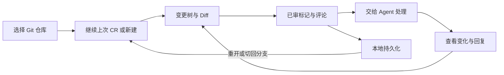
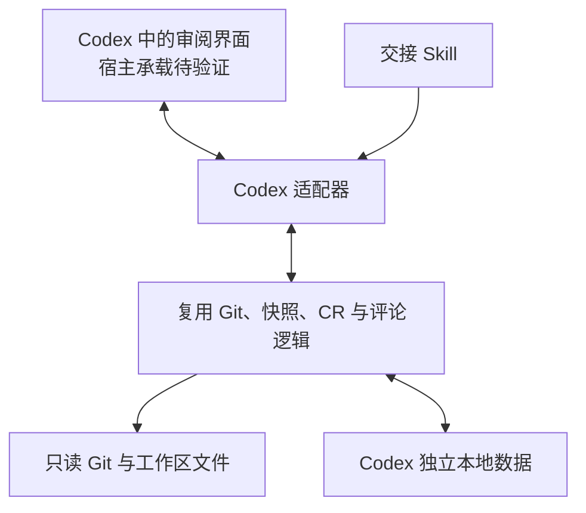

# Codex 集成设计

状态：**开发准备，尚未实现**。当前可安装版本仍是 VS Code 系扩展 1.0.1。本文明确产品目标、实现边界和首个原型的通过条件；宿主能力核查日期为 2026-11-03，实际可用性还需要在目标 Codex 桌面版验证。

## 要完成什么

让用户在 Codex 中持续审阅一个 Git 仓库：选定基点，看完整变更树和 Diff，标记已审，留下评论，再让 Agent 处理并由用户复核。关闭重开、切换分支或继续提交后，能接着上次审阅。

首版各应用独立保存进度。**不做 Trae、VS Code、Codex 之间的数据互通、同步或导入**，也不以共享存储改造作为开工前提。通用产品规则和验收编号见 [product.md](product.md)；当前代码能复用的部分见 [architecture.md](architecture.md)。

这项集成需要可交互的审阅工作区。只显示普通文件列表、自动给出审查意见，或提供读取评论的 Skill，都没有完成这个目标。

## 已确认的宿主能力与证据边界

| 事项 | 核查结果 | 对本项目的影响 |
| --- | --- | --- |
| 插件打包 | 官方支持打包 Skills 和可选 MCP 配置；当前推荐根 `plugin.json`，兼容 `.codex-plugin/plugin.json` | 可准备独立 Codex 适配器，不是把 VSIX 直接安装过去 |
| 本地开发分发 | 官方提供本地和仓库 marketplace，并说明桌面客户端的安装、刷新路径 | 先验证本地安装；GitHub 源码分发与官方目录上架分开验收 |
| 插件界面 | 官方把可选 UI 放在 MCP 集成中；manifest 的展示信息不能证明有原生文件树或侧栏注册 API | 不承诺替换 Codex 原生侧栏；界面和本地动作往返列入首个原型 |
| 本地执行 | 官方桌面插件文档提供 stdio 子进程方式 | 可验证由宿主管理的本地进程，不引入 HTTP 监听、后台守护或服务部署 |
| 官方目录发布 | 本地 MCP 提交目前要求 approved partner 资格 | 不能把本地安装成功写成能立即上架，也不能假设开源仓库具有该资格 |

打包、本地安装和 UI 所属关系依据 [Package your plugin](https://developers.openai.com/plugins/build/plugins)；本地执行与公开目录限制依据 [Submit desktop-only plugins](https://developers.openai.com/plugins/deploy/desktop-only)。

**尚未证明的关键组合**是：普通第三方插件能否在目标 Codex 桌面版本中显示可持续使用的审阅界面，并让界面动作访问获准的本地仓库、可靠保存状态。官方“有可选 UI”及已安装的内置插件不能单独证明这组能力。完整 UI 桥接契约和目标宿主实测必须在原型中补齐；当前不指定未经核实的 SDK 方法、内部工具或原生扩展点。

## 用户流程与连续性

审阅入口先确定一个 Git 根目录。当前聊天即使位于多个项目的共同父目录，也不把该目录下所有项目混成一轮 CR。发现多个仓库时让用户选定一个；没有仓库、没有提交或缺少访问权限时给出明确状态。



目标界面由同一审阅工作区承载，具体面板形态由宿主原型决定：

- 顶部显示仓库、当前分支、基点说明与可复制 SHA，并提供新建和切换 CR。仓库设置与文件操作分开。
- 左侧是变更树，保留展开状态，显示新增、修改、删除、已审、需复审，以及目录聚合的部分已审和评论数量。状态使用颜色、文字和图标共同表达。
- 主区显示基点与工作区 Diff；切文件复用主区，保持定位，避免不断创建标签。
- 评论区跟随目录、文件或代码选区；待处理概览可直接定位、编辑、删除和复核。

持久化包括 CR、已审内容快照、评论与回执，以及当前文件、目录展开、筛选和可恢复的定位。未提交评论草稿单独保存并提示状态；不能把草稿显示成已保存评论。恢复时先校验仓库和当前内容：文件已消失、选区不再唯一或权限变化时保留记录并说明原因，不能恢复到其他文件或静默新建空 CR。

切分支后载入该分支最后使用的 CR；切回后恢复原记录。固定基点不会随主分支或 `HEAD` 移动。stage 或 commit 只改变 Git 提交状态且内容未变时，已审记录不变；磁盘内容变化时按内容指纹重新计算需复审状态，评论继续保留。该规则沿用现有实现，不以“上次聊天”作为审阅身份。

Diff 内直接编辑是希望保留的体验，但需要宿主提供可靠保存和脏文件状态。原型先验证读取与评论；无法保证编辑安全时，明确提供打开编辑器、保存后刷新，不把只读预览标成可编辑工作区。

## 拟采用的轻量结构



代码复用和数据互通是两回事。先让现有 Git、内容身份、CR、锚点和持久化模块可由适配器调用，保留 VS Code 的原有入口与格式；不要为新宿主重写已有审阅算法。`extension.ts` 中的脏文件、陈旧 Diff 和写入归属检查也必须迁入适当边界，不能只搬走无 `vscode` import 的文件就认为已完成解耦。

优先使用宿主支持的界面到本地工具调用。若必须通过 MCP，候选是随插件打包、由宿主启动和回收的 stdio 子进程：没有网络端口、后台服务、登录系统或远端部署。运行时及依赖也须验证是否随包可用，不能让用户手工搭服务。若目标宿主只能接入远程 HTTPS 服务，或不能把 UI 动作交给本地工具，当前方案判定不满足约束，不自动改成云服务或 localhost 网站。

### 独立保存数据

建议首个原型将 Codex 数据限定在所选仓库的 **`.reviewslate/codex/`** 中，便于持久化、备份和让同一工作区内的 Agent 读取。该目录是待实现方案；1.0.1 不创建它。

```text
.reviewslate/codex/
  reviews/       # CR 目录、已审状态和内容快照
  comments/      # 评论及独立回执
  handoff/       # 指定 CR 的 Agent 清单
  ui/            # 导航状态与草稿
```

这只是逻辑布局，文件 schema 在实现前从现有类型确定。首次写入前校验工具标识和目录安全，并将 `/.reviewslate/` 纳入根忽略规则；扫描也应明确排除该工具数据。遇到同名未知数据应拒绝覆盖。

Codex 不读取或修改 Trae / VS Code 的扩展存储与现有 `.code-review/`；升级现有扩展也不迁移数据。两个应用可以查看同一个仓库，但各自管理自己的 CR 和评论，避免“独立进度”却共写评论造成串轮。移动仓库、克隆、跨机器同步和工作树间共享不在首版保证范围内。

目录和 JSON 能被用户或其他工具编辑，不是安全隔离区。保留现有原子写入、备份、锁、身份校验和防止陈旧写入恢复已删除记录的机制；读写失败、未知版本或损坏不能重建为空状态。交接时给出选中 CR 的绝对路径，由 Agent 重新核对当前上下文。跨机器场景不拼接本机路径去猜远端位置。

### 界面与 Agent 的操作边界

以下是拟定的语义接口，尚未实现，不是宿主 API 名称。首个原型只实现需要的一部分，其余随垂直功能补齐。

| 操作 | 必须绑定的输入 | 预期结果与错误 |
| --- | --- | --- |
| 打开或创建 CR | 已选仓库、当前分支、解析后的完整基点 | 同一组合复用；无效基点不改变当前 CR |
| 读取树或 Diff | CR 身份、仓库内相对路径 | 返回内容指纹和扫描版本；不把读取失败当空变化 |
| 标记已审 | CR 身份、界面看到的内容指纹 | 内容仍一致才保存；内容变化要求刷新复审 |
| 保存、编辑评论 | CR 身份、目标、原评论 revision / 选区证据 | 持久化成功才更新界面；陈旧、越界或歧义不猜测 |
| Agent 读取、回复 | 指定 CR、评论 ID、当前 revision | 独立回执；不能改写原评论或替用户解决 |
| 人工解决、删除 | CR、评论版本或目标 CR 及相应确认 | 只影响目标；失败可恢复，其他轮次保持原样 |

所有写操作重新校验仓库、分支、CR、版本以及当前内容；UI 传来的路径和身份不直接成为权限。连续点击、旧聊天中的面板、切分支、两个窗口同时写入和中断重试都要覆盖。界面只有收到持久化成功的结果才能显示“已保存”或“已审”。

审阅界面的查看动作只返回当前所需数据；不因打开面板就把全仓库、全部快照和所有评论放入模型上下文。用户发起“处理评论”后，Skill 才读取指定 CR 的相关材料，并按宿主已有权限处理代码。插件自身不另建上传通道；Codex 的模型处理仍适用其宿主数据政策，不能沿用编辑器扩展的“不联网”宣称覆盖整个 Codex 会话。

## 第一项开发任务：验证真实宿主闭环

用临时合成 Git 仓库制作可安装原型，不操作实际项目数据。原型验收必须给出目标客户端版本、安装方式、实际操作结果及失败项；这一步尚未执行。

1. **安装与入口。** 从本地来源安装后能发现 ReviewSlate，打开一个明确仓库的审阅界面；关闭后可以再次打开，不依赖未公开的内置插件权限。
2. **界面与读取。** 能看到固定 commit 到已保存工作区的变更树，打开至少一个真实 Diff，界面不需要每个动作都由用户发聊天指令代办。
3. **本地写入。** 在界面保存一条文件评论、一个已审标记；确认写入磁盘。取消授权、目录只读和写入失败都有明确状态。
4. **恢复。** 关闭面板并重启宿主后，恢复同一 CR、评论、已审状态与所选文件。已有评论草稿也可恢复且区别于已保存内容。
5. **内容变化。** 修改并保存一个已审文件，出现需复审；仅提交相同内容不重置进度。切到另一分支再切回能接续原 CR。
6. **轻量与隔离。** 无 HTTP 端口或常驻后台服务，未改写 `.code-review/` 或原编辑器存储；插件停用后不残留执行进程。

若 UI 或本地桥接不通过，记录具体缺失能力，暂停完整交互版的实现选择。可继续整理可复用核心和文件交接，但应明确这只是部分能力，不能把 Skill 或外部网页当成本目标的交付。首个原型通过后，再按产品 AC 补齐目录/选区评论、漂移定位、待处理列表、归档与永久删除、多窗口并发及真实主题验收。

## 后续文档与实现如何接续

产品负责人维护 [product.md](product.md) 的体验规则；宿主开发者在本文补充原型证据、确认后的接口和安装范围；核心开发者同步 [architecture.md](architecture.md) 与 [data.md](data.md)。测试入口和跨宿主验证要求统一放在 [CONTRIBUTING.md](../CONTRIBUTING.md)，阶段状态由[路线图](roadmap.md)跟踪。

首个原型完成前不新增“Codex 已支持”的安装说明，不承诺官方目录发布时间，也不修改已有扩展的数据版本。可继续开发的下一步已明确为上述原型，跨应用同步不再是前置问题。
