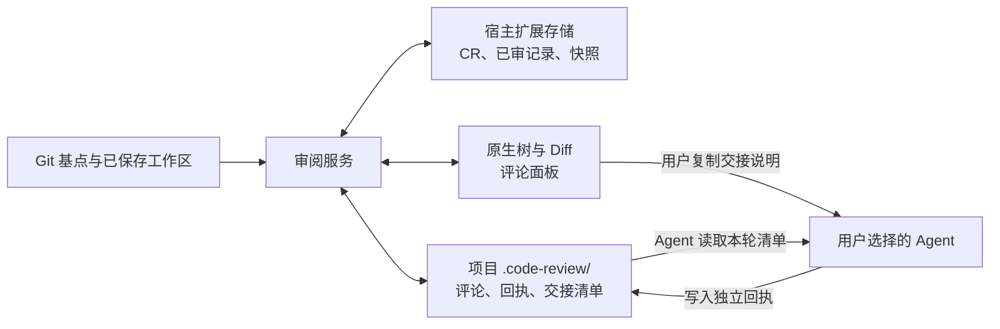

# 数据与架构

## 数据保存在哪里

ReviewSlate 使用两处文件存储，并由编辑器保存少量界面状态。文件未加密；评论片段、快照和交接文件应按代码资料保护。

| 位置 | 内容 | 用途 |
| --- | --- | --- |
| 宿主提供的 `globalStorageUri` | 仓库默认基点、CR 目录、已审记录与内容快照 | 恢复审阅进度与上次审阅内容 |
| 仓库根 `.code-review/` | 已保存评论、Agent 回执、恢复区与交接清单 | 人和 Agent 通过本地文件协作 |
| 编辑器 workspace / Webview 状态 | 当前仓库选择、评论草稿等 | 恢复界面，不属于交接数据 |

存储由扩展实际运行的宿主提供：本地工作区使用本地宿主，Remote SSH 使用远端宿主。不同编辑器或不同宿主有各自的扩展存储，不自动同步。



图中的 Agent 交接由用户发起，扩展不提供 Agent 通信服务。

### 扩展存储

仓库根路径通过 `realpath` 规范化后取 SHA-256，作为存储分区。它是位置身份，不是仓库内容指纹；移动仓库或换机器后不会自动找到原记录。

```text
<globalStorageUri>/
  <仓库路径哈希>/
    default-base.json
    reviews.json
    <CR ID>/
      state.json
      blobs/<快照哈希>
```

`reviews.json` 保存分支、固定基点、记录状态和各分支最后使用的 CR。`state.json` 保存文件左右两侧的内容引用；快照哈希同时包含模式与原始字节。快照不是 Git 对象，不写入项目的 `.git/`。

重要 JSON 写入保留 `.bak`，先写临时文件、同步落盘，再原子替换；写入锁防止同一存储的并发覆盖。备份不是多版本历史，也不会在损坏时静默接管：读取损坏或主文件缺失但备份存在时，扩展明确报错并保留原数据。

### 项目内评论

首次保存评论时创建目录；若 `.code-review/` 已有不属于本工具的数据或缺少有效工具标识，扩展会拒绝覆盖。

```text
.code-review/
  project.json
  README.md
  comments/<评论 ID>.json
  replies/<评论 ID>.json
  deleted/<评论 ID>.json
  reviews/<CR ID>/REVIEW.json
  reviews/<CR ID>/PENDING.md
  PENDING.md
  purged.json
```

`deleted/` 按需创建，保存可撤销删除的评论；`purged.json` 在永久删除后保留不含代码或正文的标识，用于阻止陈旧窗口重新写入。部分 JSON 还有 `.bak`。所有评论共用目录，通过 CR 标识过滤；已解决或归档的评论仍保留在存储中。

`PENDING.md` 是有界摘要，UTF-8 大小最多 4 MiB。它保留全部未解决评论的 ID、版本、状态及原 JSON 路径；长正文、选区和回复仅展示摘录，预算不足时省略摘录。Agent 必须读取原评论与回执 JSON 后再处理，原数据不会因此截断。旧版生成的超大清单会在刷新时重新生成。

评论格式以 [`src/comments.ts`](../src/comments.ts) 为准。每条评论包含稳定 `id` 和可变 `revision`；回执必须同时匹配二者。正文编辑、已解决评论重新打开会更新 `revision`。Agent 可写独立回复，不能据此宣称用户已解决评论。

首次保存评论与接续已有评论时，扩展会确保根 `.gitignore` 中有 `/.code-review/`，必要时追加到末尾以避免被后置反选规则覆盖。保留已有文本和换行，不修改索引；若该目录已被跟踪，忽略规则不会取消跟踪。扫描时也始终排除 `.code-review/` 自身。

## 备份与恢复

普通关闭与重启会恢复已保存数据。完整备份应在没有扩展宿主写入时，同时复制：

1. 当前宿主中 ReviewSlate 的整个 `globalStorageUri` 数据目录。
2. 对应仓库的整个 `.code-review/` 目录，包括备份及永久删除标识。

具体扩展存储路径取决于编辑器及远程宿主；按当前宿主的数据目录查找扩展 ID `to-re.code-review` 对应的存储，勿把扩展安装目录当作数据目录。未提交的评论草稿保存在编辑器 Webview 状态中，上述两处文件备份不保证包含它们。

恢复前保留现有文件副本，停止所有访问这些数据的扩展宿主，再恢复同一时点的两处数据。在相同宿主、相同仓库路径下重开并核对记录。移动目录、换编辑器或跨机器迁移没有自动映射或导入工具；只复制 `.code-review/` 不能恢复已审进度，也不保证新建 CR 能接续原评论归属。

遇到损坏错误时，不要通过删除状态文件强行启动。先备份主文件和 `.bak`，确认备份有效后再人工恢复；读错的文件路径会显示在错误中。若进程异常退出留下 `write.lock`，先确认没有其他窗口写入，再移除该残留锁目录并刷新。

CR 永久删除会清理该轮可识别的保存数据及其备份，保留防止复活的标识。它不清理用户另存的备份、编辑器历史缓存或无法识别归属的旧草稿，也不是磁盘安全擦除。归档和单条评论删除均不是永久清理。

## 限制与兼容

- 单侧变化文件最多 5 MiB；变化文件两侧字节累计最多 80 MiB。未变化的大文件流式校验后可跳过。
- `comments/` 与 `deleted/` 分别最多 2,000 条评论，计数跨 CR，已解决评论也计入。归档 CR 不释放此容量；需要清理时，先备份，再按需永久删除不再保留的 CR。
- 评论正文最多 20,000 个 JavaScript 字符单位，回执正文最多 50,000；代码选区最多 200 行，并保存各最多 3 行前后文。过大的选区或上下文会被拒绝。
- 工作区使用原始磁盘字节，Git LFS、换行转换和过滤器不会被执行。符号链接保存链接文本而不读取目标；二进制与非 UTF-8 文件展示指纹及大小摘要。子模块单独审阅。
- 路径、文件类型、并发变更和内容摘要都须通过检查。错误不会转成空进度或成功状态；有冲突时需先解决冲突。
- 显示名改为 ReviewSlate 后，扩展 ID `to-re.code-review`、`codeReview.*` 命令、`code-review` URI scheme 和 `.code-review/` 数据目录保持稳定。
- 预发布版本的旧记录可迁移；缺少分支身份的当前记录归入升级时的分支，其他记录在首次打开时归入当时分支。执行永久删除后，所有共享数据的扩展宿主需使用 0.10.0 或更新版本，避免旧版格式不兼容。

## 源码分工

| 模块 | 职责 |
| --- | --- |
| [`git.ts`](../src/git.ts)、[`baselines.ts`](../src/baselines.ts) | 只读 Git 调用、工作区扫描和基点选项 |
| [`model.ts`](../src/model.ts)、[`filesystem.ts`](../src/filesystem.ts) | 内容身份、限额、路径检查和安全持久化 |
| [`state.ts`](../src/state.ts) | CR 目录、分支归属、快照、迁移和永久删除 |
| [`comments.ts`](../src/comments.ts)、[`anchors.ts`](../src/anchors.ts) | 评论、版本匹配、代码定位与清单生成 |
| [`ignore.ts`](../src/ignore.ts)、[`handoff.ts`](../src/handoff.ts) | 忽略规则与 Agent 交接文本 |
| [`review.ts`](../src/review.ts) | 当前 CR、扫描、进度与评论之间的协调 |
| [`extension.ts`](../src/extension.ts)、[`tree.ts`](../src/tree.ts)、[`history.ts`](../src/history.ts)、[`panel.ts`](../src/panel.ts) | 编辑器命令、原生树、Diff 和评论面板 |

验证方法与贡献要求见 [CONTRIBUTING.md](../CONTRIBUTING.md)。
