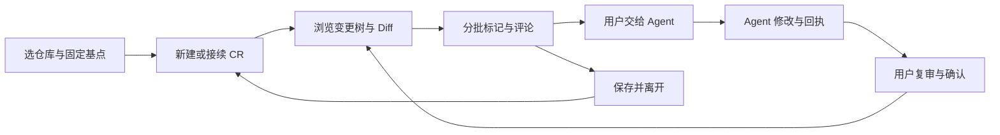

# 产品目标与验收

维护责任：产品；最后核查：2026-11-03。当前事实基线：ReviewSlate 1.0.1，提交 `d7e6b0d`。本文中的“当前”指编辑器扩展；“Codex 目标”指下一阶段需求，尚未实现或验收。操作细节以[使用指南](usage.md)为准，存储与兼容边界见[数据说明](data.md)。

## 要解决的问题

ReviewSlate 面向需要持续审阅 Git 项目的开发者：先选定比较起点，逐步查看变更、留下意见，在代码继续变化后找到需要复审的部分，并在 Agent 修改后亲自确认结果。审阅可能跨越多次提交、分支切换和工作会话，因此看过什么、评论属于哪一轮、回复对应哪个版本，都必须能够接续。

Codex 集成针对普通文件浏览难以完成完整 Git 审阅的使用问题，目标是在 Codex 桌面内完成上述人工审阅任务。自动生成审查报告、读取评论的 Skill、按单个文件回答问题可以辅助审阅，但单独交付这些能力不满足完整插件目标。

“整个 Git 项目”指以仓库根目录为范围，覆盖相对固定基点的全部可审阅变化，不局限于对话中附带的文件、当前打开文件或 Agent 自行挑选的文件。本阶段不建设通用全文件资源管理器，也不引入逐行或逐 hunk 的已审标记；“部分已审”沿用目录内部分文件已审的语义。

## 1.0.1 当前产品事实

| 能力 | 当前行为与边界 | 实现依据 |
| --- | --- | --- |
| 仓库与基点 | 顶部独立设置区选择仓库和默认基点。分支来源取与当前 `HEAD` 的共同祖先，提交来源直接取该提交；均固定成完整 SHA。完整或至少 7 位短 SHA 不受最近 150 条候选限制 | [基点选项](../src/baselines.ts)、[提交选择](../src/commit-picker.ts)、[设置](../src/settings.ts) |
| 比较范围 | 左侧固定基点，右侧磁盘上已保存的工作区最终内容；覆盖分支提交、暂存与未暂存改动、未忽略的未跟踪文件。暂存区不是独立比较侧 | [Git 读取与扫描](../src/git.ts) |
| 多轮审阅 | 每个仓库内，每个“分支 × 固定基点”至多有一条未归档 CR。同组合打开原记录；不同组合隔离进度、评论和草稿。每个分支接续最后使用的记录 | [CR 状态](../src/state.ts)、[审阅服务](../src/review.ts) |
| 变更树与部分审阅 | 展示变化文件及仍有评论的对象。文件区分待审、已审、需复审，并提示未保存或读取失败；目录汇总已审数量和未审、部分已审、已审完状态 | [文件树](../src/tree.ts) |
| Diff 与复审 | 完整 Diff 的普通 UTF-8 工作区文本可编辑保存；其他受限类型只读或显示摘要。已审判断按内容、类型和权限，单纯 stage 或 commit 不清除进度；可查看上次已审工作区快照到当前内容的变化 | [编辑器适配](../src/extension.ts)、[审阅服务](../src/review.ts) |
| 评论与定位 | 支持目录、文件、代码选区评论。选区保存原片段与上下文，支持唯一匹配后的移动定位；内容改变或无法唯一匹配时提示确认。无 Diff、路径删除时保留评论，改名不自动迁移 | [评论](../src/comments.ts)、[选区定位](../src/anchors.ts) |
| 聚合与复核 | 折叠目录仍汇总本目录和子树评论；待处理概览可编辑、解决、删除与定位。评论是否解决与文件是否已审相互独立 | [文件树](../src/tree.ts)、[评论面板](../src/panel.ts) |
| Agent 接续 | 用户复制指定 CR 的交接说明，自行交给 Agent。按评论 ID 和 `revision` 写回回执；匹配回复显示待复核，用户确认后解决评论。扩展不调用或启动 Agent | [交接说明](../src/handoff.ts)、[评论与回执](../src/comments.ts) |
| 数据保存 | CR、默认基点和快照在宿主扩展存储；评论、回执和交接文件在仓库 `.code-review/`；草稿使用编辑器状态。采用原子保存、备份和写入锁，读取损坏时明确失败而非重置进度 | [数据说明](data.md)、[持久化](../src/filesystem.ts) |

当前产物是面向 VS Code 兼容编辑器的 VSIX，尚无 Codex 专用人工审阅界面、插件安装包或自动 Agent 接入。不同编辑器的扩展存储不自动共享；同一仓库里存在 `.code-review/` 也不等于另一宿主能恢复完整 CR 和已审快照。

当前已保证按分支接续 CR 和已保存数据；普通树刷新保留手动展开状态。关闭重开后恢复此前选中的文件、目录和 Diff 定位上下文，尚未作为完整能力验收。该导航连续性属于下述 Codex 目标，不能与已有数据恢复能力混写。

1.0.1 的实机验证范围为 macOS Trae CN 3.4.11、内核 1.107.1 的安装、重载及所列入口；功能回归使用合成仓库与模拟编辑器。版本验证边界见[项目首页](../README.md)和[贡献指南](../CONTRIBUTING.md)。这些证据不能替代未来 Codex 版本的验收。

## Codex 的最小完整范围

首个完整版本必须让用户留在 Codex 桌面内走完审阅闭环，并保留当前的基点、CR、进度和评论语义。界面可以采用经核实的宿主扩展形式；本需求不预设能替换原生侧栏、复用原生 Diff 或直接控制宿主编辑器。

图示是目标任务流程，不是已实现的 Codex 界面或通信方案。用户可以全程自行审阅，无需先启动 Agent；交接由用户发起，复核仍由用户完成。

| 范围 | 本阶段取舍 |
| --- | --- |
| 完整版本必需 | 仓库与基点选择、明显的新建与历史入口、全仓变更树、目录部分已审与评论聚合、Diff 与复审、三类评论、Agent 接续和人工复核、可恢复的保存、错误与取消路径 |
| 优先复用 | 现有只读 Git 扫描、内容身份、CR 规则、评论定位、文件交接协议及对应测试。是否能直接复用模块由研发核查，不把已有代码自动视为宿主无关 |
| 单应用内连续审阅 | 按最新确认范围，每个应用独立持久化进度、评论与回执。保证在该应用内重启恢复、分支切走切回、同组合复用、提交不重置、仅受影响文件需复审，并恢复审阅导航上下文 |
| 能力核验后决定 | Codex 内界面承载、工作区文件访问与保存方式、选区来源、Agent 交接触发、安装分发、远程工作区支持。不能用占位界面或模拟宿主证明已具备能力 |
| 不纳入本阶段 | 跨应用共享、同步或迁移，通用文件资源管理器，逐行或逐 hunk 已审，云端协作与跨机器同步，PR 托管平台，自动批准或合并，无人值守审查循环，专用模型服务，DeepSeek Harness 实现 |

保持轻量：不新增常驻本地服务器、同步服务或独立管理后台。若能力核验只能交付评论交接工具，应明确称为交接能力或技术验证，保留完整人工审阅目标尚未满足的事实。宿主受限不自动构成把目标缩减为自动审查的决定。

Codex 集成当前处于开发准备。先通过最小原型形成可核查的宿主能力结论，再确定完整实现方案；本文不承诺排期、支持平台清单或已经可用的 UI API。

## 必须保持的业务规则

**审阅对象。** 用户始终能识别当前仓库、分支、CR 和固定基点。切仓库不混用默认设置；读取失败不能仍显示旧仓库为当前对象。默认基点只改变之后的选择，不能移动正在审阅的基点。没有提交、提交不存在或短 SHA 有歧义时，不得产生成功记录。

**记录身份。** 同一仓库的同分支同基点复用未归档记录；再次点击“新建”不清空进度。分支使用完整分支名，普通提交不另起 CR；游离 `HEAD` 按提交区分。切换 Git 分支由用户自行完成，工具不得暗中 checkout。打开其他分支记录时，应提示先切换分支。分支重命名和仓库搬移不应被宣称为自动迁移。

**已审含义。** 已审表示用户看过并确认某个版本的完整文件差异，不能仅因为打开文件、Agent 已回复或评论已解决而自动设置。目录的部分已审由其变化文件汇总，评论对象不混入文件数。读取失败、未保存、内容已变化或目录文件集合已变化时，旧页面不能认证新内容；只改一个文件应只影响该文件及其祖先的汇总状态。

**评论含义。** 目录意见针对目录及其子项整体，文件意见针对文件，选区意见同时记录左侧或右侧来源及原文。行号只作提示；无法可靠定位时保留原文并告知用户，不能把评论静默贴到猜测的位置。评论编辑保留 ID 并更新版本，解决、重新打开、删除和恢复都有明确结果；文件变化不自行删除意见。

**Agent 与用户的职责。** 交接必须固定仓库、CR、分支、基点和评论版本。Agent 读取原始评论与上下文，修改后给出处理和验证说明；遇到归属不符、记录归档或删除时停止该次处理并说明原因。Agent 回复不替代用户解决评论，也不证明文件已审。用户修改意见或重新打开意见后，旧版本回执不能显示为本次已处理。

**保存与恢复。** “保存成功”必须对应已完成的持久化；正常关闭并重新打开后能够恢复已保存的基点、进度、快照、评论和有效回执。损坏、缺失、权限失败或中断不能被当作空数据覆盖，失败要保留原数据并提供可重试或人工恢复路径。未提交草稿与已保存评论区分，明确其保存范围；不能把草稿恢复等同于跨机器备份。

**连续体验。** 用户在同一应用内返回一轮 CR 时，除了恢复数据，还应能接着上次的对象继续审阅：恢复选中的文件或目录、相关展开状态和 Diff 定位上下文。对象已删除、内容改变或不能可靠定位时，保留原上下文提示并引导到有效对象，不能把旧位置静默绑定到另一段代码。连续体验不要求另一应用显示相同进度。

**宿主隔离。** Codex 首版使用独立的持久化范围，不读取其他应用的状态来自动接管其 CR，不做共享、同步或迁移。复用评论格式或 Agent 交接约定，不代表必须共用原 `.code-review/` 写入位置；研发需选择互不干扰的存储范围，避免 Codex 与编辑器同时维护相同 CR 目录、清单或回执文件。应用内的数据位置与备份恢复边界应有说明，无需为首版设计跨宿主协同写入协议。

**删除边界。** 单条评论删除可撤销，CR 归档可恢复。归档当前 CR 不自动选中另一条；再次选择原组合可创建干净记录，恢复旧记录遇到同组合冲突时保留双方。永久删除必须显式确认对象及不可恢复范围；中断时可继续清理，不能误删其他 CR 或重新允许旧页面写回已删除数据。

## Codex 验收条件

以下是下一阶段的完成标准，**当前全部未在 Codex 实现上执行**。使用临时合成仓库和虚构评论，不依赖用户实际代码、审阅意见或账号数据。现有测试可复用业务样例，宿主相关部分仍需在声明支持的 Codex 桌面版本实测。

| ID | 条件 | 可观察的通过标准 |
| --- | --- | --- |
| AC-01 | 仓库范围与对象归属 | 从工作区子目录进入仍识别正确 Git 根目录；多仓库可选择且设置独立。界面明确当前仓库、分支和基点。切到读取失败的仓库时显示该仓库及失败状态；无仓库或无提交时有明确恢复指引 |
| AC-02 | 固定基点与 SHA 输入 | 分支来源取共同祖先，提交来源取提交本身；移动分支或 `HEAD` 不改变已选基点。用超过 150 个提交的仓库验证列表外完整和至少 7 位短 SHA；无效或歧义输入可改后重试，取消不改变当前 CR，修改默认不改当前基点 |
| AC-03 | CR 复用、隔离与接续 | 新建入口在已有记录时仍可找到。同组合重新选择后 ID、进度和评论保持；不同分支或基点分别保存。切回分支和重开项目接续最后使用的 CR；错误分支记录不会触发自动 checkout |
| AC-04 | 全仓变更树与目录部分已审 | 合成仓库含深层目录、分支提交、暂存、未暂存及未忽略新文件，树完整列出保存后的变化，排除被 Git 忽略的未跟踪文件及工具自身数据。勾选部分文件后祖先显示准确的部分已审数量；全部已审后才显示已审完；折叠和展开不丢进度 |
| AC-05 | 已审内容与复审 | stage 或 commit 但内容不变时保持已审；单文件内容、类型或权限改变只使对应文件需复审；恢复原内容可重新匹配。未保存、读取失败、陈旧页面或目录新增文件不能被误标为已审；取消标记只影响指定范围 |
| AC-06 | 完整 Diff 与审阅后增量 | 用户从树中进入明确标注两侧来源的完整 Diff；新增、删除和受限内容有可理解表示。看过并标记后再修改，能查看上次已审内容到当前内容的差异。保存方式须说明并验证，不能把未落盘文本当作已保存版本；是否支持 Diff 内直接编辑由宿主核验后决定 |
| AC-07 | 目录、文件与选区评论 | 在三类对象上分别保存意见并能重开查看；选区明确属于哪一侧，原片段可见。编辑保留原评论 ID，取消编辑不新增评论；删除可恢复，解决不改变文件已审状态。超出当前支持的选区或内容限制时明确失败且不丢已填内容 |
| AC-08 | 评论漂移定位与保留 | 在原片段前插入行后能定位到唯一匹配位置；代码改变、重复片段、路径删除或改名时保留原评论和片段并显示准确的定位状态。无法可靠定位时不提供错误的确定跳转；没有 Diff 的遗留评论仍可访问 |
| AC-09 | 评论聚合与人工解决 | 父目录折叠后仍计入本目录与所有子项评论，能区分未解决和已解决。目录评论不计作变化文件，待处理概览可跳到对象并处理；解决、删除、恢复后汇总及时一致，切换 CR 不残留另一轮计数 |
| AC-10 | Agent 接续与人工复核 | 用户从当前 CR 发起交接，接收方得到明确的仓库、CR、分支、基点和评论版本。匹配回执显示待复核，用户才能决定解决；修改或重新打开意见使旧回执失效。切换 CR 后原交接不转向另一轮，归属不符或记录失效时停止处理 |
| AC-11 | 已保存数据恢复与失败保护 | 保存成功后关闭并重开恢复基点、已审快照、评论和回执；模拟写入失败、中断、损坏及并发更新时不报告虚假成功、不覆盖原数据。错误修复后能够重试，恢复过程不要求先清空进度 |
| AC-12 | 草稿、导航与陈旧页面隔离 | 切换对象、CR、仓库或关闭重开后，返回本轮可接续原审阅对象、目录展开和 Diff 定位上下文；原对象失效时有准确提示及可用恢复入口。草稿按声明的保存范围恢复且不串对象，未提交状态明确。旧页面在分支或 CR 改变后不能向新记录保存或错误定位 |
| AC-13 | 归档恢复与删除边界 | 归档后原数据保留且可恢复；同组合的新旧记录冲突时双方都保留。永久删除前明确对象与影响，取消无变化；中断后显示可重试状态，完成后其他 CR、工作区代码和 Git 元数据保持，旧交接与旧页面不能复活被删数据 |
| AC-14 | 宿主独立持久化与隔离 | 在同一合成仓库分别用编辑器与 Codex 创建、标记和评论；两者各自重开能恢复自身状态，一端操作不改写另一端的 CR、快照、评论、清单或回执。Codex 不共同写入编辑器已有 `.code-review/` 数据范围，不宣称跨应用接续；无需实现共享、同步或迁移 |
| AC-15 | Git、权限与运行边界 | 审阅操作不执行 fetch、checkout、提交或索引写入，不触发仓库过滤器、external diff 或自动对象下载；不跟随存储符号链接。无访问权限时明确失败，用户可在宿主授权范围内恢复。无需新增常驻服务器；交给 Agent 时明确资料范围及执行位置 |
| AC-16 | Codex 内完整人工审阅任务 | 在真实 Codex 桌面安装后，从明显入口完成选仓库、固定基点、查看全仓变更、分批已审、三类评论、交给 Agent、读取回执、复审和关闭重开接续。核心人工审阅不要求跳到另一编辑器；仅 CLI 输出、自动审查报告、skill 读取评论或模拟界面不能判此项通过 |

AC-06 的直接编辑形式、AC-10 的接入触发和应用内的持久化位置应在实现前落定；这些选项不改变人工查看 Diff、可靠保存、明确交接和独立保存的完成要求。宿主未提供必要能力时，对应项保持未满足，记录具体差距并返回产品范围决策，不勾选“通过”。

## 开发前必须核查的事实

| 待决项 | 需要的证据与决定 | 影响 |
| --- | --- | --- |
| 桌面界面入口 | 官方支持的插件 UI 形式、实际入口与生命周期；最小实机样例能否承载变更树、Diff 和评论交互 | 决定完整审阅能否在 Codex 内完成，不预设原生侧栏扩展权限 |
| 本地 Git 与文件访问 | 所选宿主通道能否在授权项目范围读取 Git、保存状态、感知文件变化，并说明与界面进程的连接方式 | 决定比较范围、刷新、保存反馈和轻量部署能否同时成立 |
| 内容与选区 | 如何获得两侧代码、稳定选区和保存状态；宿主是否提供编辑能力，或需要插件自身展示只读 Diff | 决定选区评论、未保存提示及 AC-06 的编辑形式 |
| Agent 交接 | 用户如何发起、Agent 何处执行、怎样限定 CR 和读取版本回执；代码或评论会流向哪里 | 决定授权提示、接续协议及人工复核，不推定插件可自动启动或指挥任意会话 |
| 应用内持久化 | Codex 可使用的独立持久化位置、正常重启后的恢复方式，以及与现有编辑器数据目录的隔离 | 满足 AC-11、AC-12、AC-14；只决定独立存储与连续体验，不扩大为共享或迁移方案 |
| 支持环境与分发 | 实际可用的桌面版本、操作系统、安装方式，以及本地与远程工作区边界 | 形成首版声明的支持范围；未实测平台列为未验证，不继承 VSIX 的宿主兼容结论 |

这些事实由集成负责人依据官方资料与研发验证补齐，产品依据结果确认取舍；本文不以推测填入 API、技术栈或文件桥接方案。技术方案必须逐项说明如何满足验收条件，或明确哪些条件尚不具备。

## 如何判定交付

开发准备以当前事实、目标、验收条件和待核查项可被研发与测试共同使用为准，不把文档完成写成 Codex 插件完成。开发阶段先以合成仓库验证业务规则，再在同一候选版本的真实 Codex 桌面完成 AC-16；记录版本、环境、方法、结果和未覆盖项，分别给出 QA、适用设计与产品验收结论。

目前没有使用时长、任务成功率或效率改善的测量基线，不承诺量化收益。首版验证可让使用者在合成仓库完成一次上述闭环，记录是否需要人工补救、是否找得到下一步、是否恢复正确数据及失败原因；功能验收与“比原流程更方便”的用户效果分别判断，不自动安排长期监控或采集遥测。
