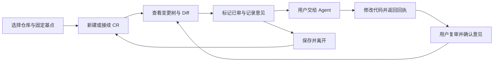

# ReviewSlate 产品

维护责任：产品负责人；状态：现行；最后核查：2026-11-03。适用范围：VSIX 1.0.1 的产品规则及 Codex 首个完整版本的需求。代码核查基线为 `689de24`，与发布实现 `d7e6b0d` 之间没有运行时代码变化；本轮仅重建文档，没有改变产品行为。

ReviewSlate 帮助开发者围绕一个固定 Git 提交持续审阅：看清当前分支与已保存工作区的全部变化，分批记住已审内容，留下意见，在代码继续变化和 Agent 处理后接着复审。当前可交付产品是 VS Code 系编辑器的 VSIX；Codex 目标是把这一完整人工审阅任务带入 Codex 桌面。

本目录是产品需求和业务预期的权威入口。需求依据本次用户已确认的范围；当前能力依据下列源码核查，验证和发布依据单独列出。实现、测试和目标之间有差距时保留差距，不以某一方覆盖另一方。

| 要判断的事 | 阅读位置 |
| --- | --- |
| 用户问题、完整范围、当前能力和下一步 | 本页 |
| CR 身份、已审状态、评论与 Agent 职责、异常恢复 | [业务规则](业务规则.md) |
| 怎样判定目标达成、AC-01 至 AC-16、当前产品验收边界 | [验收条件](验收条件.md) |
| 实际界面、模块、字段和操作 | [设计](../设计/README.md)、[本地审阅引擎](../客户端/本地审阅引擎.md)、[数据协议](../客户端/数据协议.md)、[客户端](../客户端/README.md)、[使用指南](../用户文档/使用指南.md) |
| 已执行验证及在途工作 | [测试与验收](../测试/README.md)、[验证记录](../测试/验证记录.md)、[项目状态](../项目状态.md) |

## 用户与要完成的任务

主要用户是正在审阅本地或受支持远程 Git 项目的开发者。审阅者可能也是代码作者，可能使用 Agent 改代码；产品不要求先启动 Agent。一次审阅往往跨越多次保存、提交、分支切换和工作会话，用户需要知道“看过哪个内容版本、剩下哪些文件、意见属于哪一轮、回复是否对应最新意见”。

现有 VSIX 已提供这一工作流。Codex 的产品问题是：单个文件浏览、对话中引用代码或自动生成审查报告，尚不能让用户在同一应用内完成全仓变更的人工审阅与接续。该问题来自已确认需求，没有用户访谈或效率数据作为量化基线。

“全仓”指以选定仓库根目录为范围，覆盖相对固定基点的全部可审阅变化。它不局限于当前打开的文件或 Agent 挑选的文件，也不要求建设通用全文件资源管理器。“部分已审”指目录内部分变化文件已审，不是逐行或逐 hunk 标记。

图中 Agent 路径是可选的；保存、退出、重开和切分支后仍能接续，是同一任务的一部分。Codex 中这条完整流程仍未实现，图示不代表当前探针已具备这些功能。

## 范围与优先级

首要结果是在**一个应用内连续审阅**。Codex 首个完整版本应保持既有基点、CR、已审内容和评论语义，并补齐导航接续；现有 VSIX 保持兼容。优先级表示实现依赖，不表示后面的必需能力可以从首版验收中删去。

| 范围 | 要交付的结果 | 完成要求 |
| --- | --- | --- |
| 接入前提 | 在目标 Codex 版本安装并打开界面，界面动作能够调用本地能力、可靠保存和重开读取 | 先取得真实宿主证据；合成探针通过只证明前提，不是完整产品交付 |
| 核心审阅 | 仓库和固定基点、明显的新建及历史入口、全仓变更树、目录部分已审、完整 Diff 和上次审阅后增量 | AC-01 至 AC-06 |
| 评论闭环 | 文件、目录和选区评论，评论漂移提示、子树聚合、Agent 回执与人工复核 | AC-07 至 AC-10 |
| 连续性与保护 | 已保存数据、草稿声明范围、导航接续，分支与 CR 隔离，归档、删除及失败恢复 | AC-11 至 AC-13 |
| 运行与完整任务 | 应用独立保存，轻量运行，真实 Codex 内完成整轮人工审阅 | AC-14 至 AC-16 |

首版不包含跨应用共享、同步或迁移，跨机器协同，云端审阅服务，PR 托管平台，自动批准或合并，逐行或逐 hunk 已审，无人值守循环，以及 DeepSeek Harness 实现。独立测试应用只供研发验证，不是另一个待发布产品。

已确认的约束如下：

- 不新增需要用户部署的 HTTP 服务、常驻本地服务器或独立管理后台。宿主管理的本地工具进程是否符合运行边界，由研发与 QA 实测生命周期。
- 正式插件不要求用户另开模型账号或配置 ReviewSlate 专属模型服务；已有宿主的正常使用条件与本插件新增要求分开说明。
- Codex 各自保存本应用的 CR、已审内容、评论与回执，不共同写入编辑器的既有数据范围。复用业务规则和格式，不等于共享文件。
- VSIX 的扩展 ID、命令、URI 与数据约定保持兼容。新增 Codex 入口不能破坏原用户继续审阅或恢复数据。
- 完整人工审阅不依赖跳到另一编辑器。宿主能力不足时报告具体缺口并交回范围决策，不能把交接工具或自动报告改称已完成的审阅插件。

## 当前产品能力与差距

下表的“已实现”来自源码静态核查，具体运行证据见[验证记录](../测试/验证记录.md)。它不表示本轮已对所有场景做实机验收。

| 能力 | VSIX 1.0.1 当前行为 | Codex 当前差距 |
| --- | --- | --- |
| 仓库、基点和 CR | 识别 Git 根目录；分支来源取共同祖先，提交来源取自身并固定完整 SHA；同分支同基点复用记录，各分支接续最后 CR | 正式仓库选择、基点和 CR 尚未实现 |
| 比较与树 | 比较基点与已保存工作区，覆盖分支提交、暂存、未暂存和未忽略的新文件；目录显示审阅数量与评论聚合 | 正式 Git 扫描与变更树尚未接入 |
| 已审与复审 | 内容、类型与权限共同决定已审版本；只做 stage 或 commit 不重置；可看上次已审快照到当前的变化 | 合成 checkbox 只有测试状态，不能视为文件已审或增量能力 |
| Diff 与保存 | 完整 Diff 使用原生编辑器；普通 UTF-8 工作区文本可直接编辑保存，受限类型只读或显示摘要 | 正式 Diff 尚未实现；是否支持直接编辑、如何识别保存状态尚待核实 |
| 评论与定位 | 文件、目录、选区评论；保留原片段，唯一匹配后定位，内容变化提示确认；路径消失后保留评论，改名不自动迁移 | 合成评论字段不是产品评论，没有三类对象、锚点或 CR 归属 |
| Agent 与复核 | 用户复制指定 CR 的本地交接说明；匹配评论版本的回执显示待复核，由用户解决 | 正式交接触发、回执和人工复核尚未实现 |
| 保存与恢复 | 宿主扩展存储保存 CR 和快照，仓库 `.code-review/` 保存评论等；已有恢复、陈旧写入保护、归档及永久删除实现 | 仅验证合成数据的局部读写；正式独立存储、完整恢复和删除尚未实现 |
| 导航连续性 | 普通刷新保留手动展开状态；关闭重开后恢复完整文件、目录及 Diff 定位上下文尚未作为完整能力验收 | 导航状态模型与真实宿主恢复仍需实现及验收 |
| 宿主交付 | 已公开 VSIX 1.0.1；目标兼容 VS Code API `^1.107.0` 的桌面扩展宿主 | 只有忽略目录内的本地接入探针及自有测试宿主，无可交付的 Git 审阅插件 |

VSIX 实现来源：[Git 与内容读取](../../src/git.ts)、[基点选项](../../src/baselines.ts)、[SHA 选择](../../src/commit-picker.ts)、[审阅服务](../../src/review.ts)、[CR 状态](../../src/state.ts)、[文件树](../../src/tree.ts)、[评论](../../src/comments.ts)、[定位](../../src/anchors.ts)、[编辑器与交接](../../src/extension.ts)。字段和存储协议以[数据协议](../客户端/数据协议.md)所指代码为准。

VSIX 仅在受信任的文件系统工作区启用，需要可运行 Git 且至少有一个提交；不支持浏览器版和虚拟工作区。发布基线的自动化使用真实 Git、合成仓库和模拟编辑器 API；已有实机证据只覆盖 macOS / Trae CN 3.4.11 的安装、重载、审阅设置、新建、SHA 输入及 Git 图形菜单。它没有覆盖完整人工任务，其他宿主与 Remote SSH 不能直接继承该实机结论。

Codex 已取得本地安装与工具调用的探针证据，独立测试应用也运行过合成数据读写与恢复。真实 Codex 的 iframe 显示、界面保存和宿主重启恢复尚未验收；探针与独立测试应用位于忽略目录，不随正常 checkout 提供。接入事实及未决技术条件见[Codex 接入](../客户端/Codex接入.md)，版本、哈希与实际验证范围见[验证记录](../测试/验证记录.md)。

## 接续时需要落定的事项

业务目标与 AC 编号已经确定，不需要重新从空白澄清。研发优先核实以下会影响产品兑现方式的事实，再由产品核对是否覆盖目标；这些事项不构成新增授权或排期承诺。

| 未决事实 | 要取得的结果 | 责任方向与影响 |
| --- | --- | --- |
| 真实桌面入口及生命周期 | 从可用入口显示页面，经页面保存后重开恢复，安装配置可复现 | 客户端、QA；决定能否进入完整实现，不能用工具调用代替界面证据 |
| Git、文件与选区访问 | 在授权项目内读取全仓变化；确定 Diff 展示、选区来源、保存及未保存提示方式 | 客户端研发；影响 AC-01、AC-04 至 AC-08 |
| 独立持久化与导航 | 确定本应用保存位置、备份范围、草稿范围、对象及 Diff 位置恢复方法 | 客户端研发、设计；影响 AC-11、AC-12、AC-14 |
| Agent 交接触发 | 明确用户如何发起、执行位置与数据流、限定 CR 的方式及回执刷新 | 客户端研发；影响 AC-10、AC-15，不预设可自动启动任意会话 |
| 首版支持范围 | 绑定实际桌面版本、操作系统、安装与运行依赖，决定远程工作区是否支持 | 客户端、QA、产品；未实测环境保持未验证，不继承 VSIX 的兼容目标 |

## 验收与效果判断

产品功能验收依据[AC-01 至 AC-16](验收条件.md)，在 QA 对同一候选版本完成相关检查后，产品角色实际完成完整用户任务并记录结果。当前 Codex 产品验收为**未执行**：尚无完整候选产品；接入探针的局部通过不能抵扣任何一条完整 AC。

尚无任务成功率、审阅耗时或效率改善的实测基线，也没有确认的数值目标。首版可用合成仓库的一次连续任务观察：用户能否找到下一步、是否需要手工重建进度、恢复对象是否正确、失败后是否能继续；如记录耗时，应同时注明仓库规模、改动数量、使用者和起止口径。功能通过与用户效果分别判断，不因文档完成或测试通过宣称效率提升，也不自动安排持续监控或遥测。
