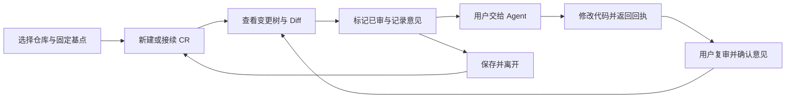

# ReviewSlate 产品

维护责任：产品负责人；状态：现行；最后核查：2026-11-03。适用范围：VSIX 1.0.1 的产品规则与 Codex 0.1.1 本地只读候选。当前核查基线为 `3dd7e30` 加正式客户端、系统文件夹选择器和核心适配的未提交改动；用户已确认以系统单文件夹选择和最近项目简化操作，并要求中英文界面及应用内连续审阅。本轮读取实际实现、QA 原始证据及设计整改；本地候选判断见[验收条件](验收条件.md#2026-11-03-只读候选产品核查)，真实 Codex 完整产品验收仍未执行。

ReviewSlate 帮助开发者围绕一个固定 Git 提交持续审阅：看清当前分支与已保存工作区的全部变化，分批记住已审内容，留下意见，在代码继续变化和 Agent 处理后接着复审。当前可交付产品是 VS Code 系编辑器的 VSIX；Codex 目标是把这一完整人工审阅任务带入 Codex 桌面。

本目录是产品需求和业务预期的权威入口。需求依据本次用户已确认的范围；当前能力依据下列源码核查，验证和发布依据单独列出。实现、测试和目标之间有差距时保留差距，不以某一方覆盖另一方。

| 要判断的事 | 阅读位置 |
| --- | --- |
| 用户问题、完整范围、首版取舍和开发顺序 | 本页 |
| CR 身份、已审状态、评论与 Agent 职责、异常恢复 | [业务规则](业务规则.md) |
| 怎样判定目标达成、AC-01 至 AC-17、当前产品验收边界 | [验收条件](验收条件.md) |
| 实际界面、模块、字段和操作 | [设计](../设计/README.md)、[本地审阅引擎](../客户端/本地审阅引擎.md)、[数据协议](../客户端/数据协议.md)、[客户端](../客户端/README.md)、[使用指南](../用户文档/使用指南.md) |
| 已执行验证及在途工作 | [测试与验收](../测试/README.md)、[验证记录](../测试/验证记录.md)、[项目状态](../项目状态.md) |

## 用户与要完成的任务

主要用户是正在审阅本地或受支持远程 Git 项目的开发者。审阅者可能也是代码作者，可能使用 Agent 改代码；产品不要求先启动 Agent。一次审阅往往跨越多次保存、提交、分支切换和工作会话，用户需要知道“看过哪个内容版本、剩下哪些文件、意见属于哪一轮、回复是否对应最新意见”。

现有 VSIX 已提供这一工作流。Codex 的产品问题是：单个文件浏览、对话中引用代码或自动生成审查报告，尚不能让用户在同一应用内完成全仓变更的人工审阅与接续。该问题来自已确认需求，没有用户访谈或效率数据作为量化基线。

“全仓”指以选定仓库根目录为范围，覆盖相对固定基点的全部可审阅变化。它不局限于当前打开的文件或 Agent 挑选的文件，也不要求建设通用全文件资源管理器。“部分已审”指目录内部分变化文件已审，不是逐行或逐 hunk 标记。

图中 Agent 路径是可选的；保存、退出、重开和切分支后仍能接续，是同一任务的一部分。Codex 已接通本地实现与所列合成仓库验证，真实宿主中的完整流程仍待验收。

## 范围与优先级

首要结果是**操作简单，并在一个应用内连续审阅**：常用项目从最近项目进入，新项目用系统窗口选择一个文件夹；取消、选错和切换回来仍能继续原任务，不要求重新建立进度或重写已保留草稿。Codex 首个完整版本应保持既有基点、CR、已审内容和评论语义，并补齐导航接续；现有 VSIX 保持兼容。优先级表示实现依赖，不表示后面的必需能力可以从首版验收中删去。

| 范围 | 要交付的结果 | 完成要求 |
| --- | --- | --- |
| 接入前提 | 在目标 Codex 版本安装并打开界面，界面动作能够调用本地能力、可靠保存和重开读取 | 先取得真实宿主证据；合成探针通过只证明前提，不是完整产品交付 |
| 核心审阅 | 明显的项目选择/切换、系统单文件夹选择与最近项目、备用手动路径、固定基点、明显的新建及历史入口、全仓变更树、目录部分已审、完整 Diff 和上次审阅后增量 | AC-01 至 AC-06 |
| 评论闭环 | 文件、目录和选区评论，评论漂移提示、子树聚合、Agent 回执与人工复核 | AC-07 至 AC-10 |
| 连续性与保护 | 已保存数据、草稿声明范围、导航接续，分支与 CR 隔离，归档、删除及失败恢复 | AC-11 至 AC-13 |
| 运行与完整任务 | 应用独立保存，轻量运行，真实 Codex 内完成整轮人工审阅 | AC-14 至 AC-16 |
| 首版语言 | 中文、英文界面；默认跟随宿主，可手动切换并本地记住，不改变审阅数据或草稿 | AC-17 |

首版不包含跨应用共享、同步或迁移，跨机器协同，云端审阅服务，PR 托管平台，自动批准或合并，逐行或逐 hunk 已审，无人值守循环，以及 DeepSeek Harness 实现。独立测试应用只供研发验证，不是另一个待发布产品。

已确认的约束如下：

- 不新增需要用户部署的 HTTP 服务、常驻本地服务器或独立管理后台。宿主管理的本地工具进程是否符合运行边界，由研发与 QA 实测生命周期。
- 正式插件不要求用户另开模型账号或配置 ReviewSlate 专属模型服务；已有宿主的正常使用条件与本插件新增要求分开说明。
- Codex 各自保存本应用的 CR、已审内容、评论与回执，不共同写入编辑器的既有数据范围。复用业务规则和格式，不等于共享文件。
- VSIX 的扩展 ID、命令、URI 与数据约定保持兼容。新增 Codex 入口不能破坏原用户继续审阅或恢复数据。
- 完整人工审阅不依赖跳到另一编辑器。宿主能力不足时报告具体缺口并交回范围决策，不能把交接工具或自动报告改称已完成的审阅插件。
- 用户确认了明显的项目选择/切换、访达式系统单文件夹选择、最近项目，以及首版中文和英文。取消和失败的保留规则、简体中文、语言回退及偏好范围见[业务规则](业务规则.md)；不扩展为目录扫描、远程仓库发现或用户内容翻译。

## Codex 首版的设计选择

**交付对象是 Codex 本地插件**：用户在 Codex 内打开 ReviewSlate 工作区，完成审阅、评论、复核与接续。业务目标以上述已确认范围为准；下表是产品、设计与客户端在该范围内作出的选择，当前实现与验证见下节，不表示用户另行确认了技术细节。

| 选择 | 首版如何处理 | 取舍与核验条件 |
| --- | --- | --- |
| 单一审阅工作区 | 固定呈现仓库、分支、CR 和基点；树、Diff、意见共享当前对象与状态 | 控件和宽窄布局由[设计](../设计/README.md)确定，不依赖替换 Codex 原生侧栏；真实入口仍待验证 |
| 明显的项目入口 | 首次无仓库时提供主入口，顶部持续可切换；最近项目直接打开，“选择文件夹…”进入系统单目录窗口，手动路径默认折叠 | 成功后沿原 CR 规则接续；取消或候选目录无效时可继续原审阅，真实保存失败仍保持保护。最近记录不等于授权；沿 AC-01 强化，不新增仓库管理系统 |
| 中文与英文 | 首版中文采用简体；默认跟随宿主 locale，中文 locale 使用简体中文，其他或缺失时回退 English；手动选择在本应用本地保存 | 偏好跨仓库生效；切换只改变界面，不翻译用户内容或丢弃草稿，详见[语言规则](业务规则.md#9-界面语言) |
| 本轮只读 Diff | 0.1.x 候选两侧只读，完整 Diff 和上次审阅后增量继续提供；代码修改保存后刷新查看 | 产品按 AC-06 条件范围接受只读候选。直接编辑及保存延后 E1，不能说已有编辑功能；只读不减免完整审阅和连续性 |
| 编辑恢复副本延后 | 当前没有代码编辑缓冲或代码恢复副本；以后启用编辑时与可靠保存一并实现，重开不自动写代码 | 不把评论草稿或已审快照称作代码恢复副本；此配套随 E1 延后，不影响本轮完整评论草稿要求 |
| 评论草稿与导航 | 新评论、原评论编辑、完整选区上下文均按本轮及对象保留；返回时接续对象、展开、视图和定位 | 正文恢复不等于选区恢复。内容失配保留原文与提示，不默默改成文件评论；规则见[业务规则](业务规则.md#6-保存草稿与应用内接续) |
| 同应用的 Agent 交接 | 预览本轮范围，复制固定交接说明，由用户在 Codex 会话发送；回到工作区刷新回执并人工复核 | 不依赖插件主动启动模型或任意会话；复制成功只表示交接准备完成，不表示 Agent 已接收或执行 |
| 一套独立本地数据 | Codex 的 CR、快照、评论、回执、草稿与导航放入本应用数据范围，具体位置由[数据协议](../客户端/数据协议.md)维护 | 不读写 VSIX 的 `.code-review/` 或扩展存储；初始化需说明存储及忽略规则，保留已有内容，不建立同步或迁移协议 |
| 首次验证范围 | 先以本地 Git 仓库、当前可测试的 Codex 桌面环境完成闭环，再列出实际验证版本与安装条件 | 远程工作区和其他操作系统保持未验证，不从 VSIX 兼容目标推导支持；无新增 ReviewSlate 账号或服务部署 |

**本轮受限范围决定：允许以只读人工审阅进入本地试用候选验证。** 依据是 AC-06 从未将直接编辑列为无条件必选，实际代码也未提供安全保存能力。完整 Diff、内容进度、评论、Agent 回执与接续构成人工审阅任务；代码变更由既有开发流程完成，插件读取已保存内容并支持复审。这一决定不宣称与 VSIX 的代码编辑能力完全相同，也不免除其他 AC。

真实工作区载体、最新 UI 或整轮连续任务未验证时，候选仍不能称为已交付的 Codex 插件。新界面须对同一包补验；真实宿主门槛仍是阻断项，不改交付为 Skill、外部网页或独立测试应用。具体分项结论见[候选产品核查](验收条件.md#2026-11-03-只读候选产品核查)。

## 开发顺序与阶段出口

阶段表示依赖和验证顺序，不是排期或可删减的首版范围。当前进度只由[项目状态](../项目状态.md)维护；以下阶段出口用于让设计、客户端和 QA 对同一个用户结果交接。

| 顺序 | 可交接的结果 | 阶段出口及对应验收 |
| --- | --- | --- |
| 1. 证实载体与权限 | 从真实 Codex 入口打开页面；页面动作读写合成状态并重开读取；确认获准仓库访问与工具生命周期 | 绑定实际宿主和安装配置，分别记录页面、工具、磁盘和重开证据。它是 AC-15、AC-16 的前提，合成探针不能判完整 AC 通过 |
| 2. 建立正确的审阅身份 | 明显的项目入口、系统目录选择/最近项目、固定基点、新建或复用 CR、分支接续、独立存储和写入归属校验形成一条可运行链路；同步接入语言偏好 | 用首次无仓库、取消、选错目录、跨仓库/CR 返回、同组合重开、异分支、无效 SHA、读取失败验证 AC-01 至 AC-03；从首个写入开始覆盖 AC-11、AC-14，按 AC-17 检查 locale 与手动偏好 |
| 3. 形成最小真实审阅闭环 | 全仓树、完整与审阅后增量 Diff、文件与目录已审；本轮读取已保存代码，以后启用编辑时另验显式保存 | 在合成 Git 仓库证明 stage / commit 保留、单文件变化复审、目录部分进度及适用的保存保护。覆盖 AC-04 至 AC-06；导航、草稿和恢复接口同步接入 |
| 4. 完成意见与复核任务 | 三类评论、唯一定位与失配提示、目录聚合、概览、固定 Agent 交接和版本匹配回执 | 连续完成评论→交接→代码变化→回执→人工复审，并故意修改评论版本，验证 AC-07 至 AC-10；评论草稿同时覆盖 AC-12 |
| 5. 以实际候选包验证整轮任务 | 分支切回、关闭重开、损坏与中断、归档与删除、双应用隔离、中英切换、可移植安装和退出 | QA 对同一候选包完成 AC-11 至 AC-17 及前述回归；产品按[完整任务](验收条件.md#完整任务如何验收)验收，设计核对成品，独立审核与发布沿已有授权边界执行 |

第一阶段未闭环时，可以在独立测试环境开发并验证本地能力，但不能把依赖真实宿主的阶段出口写成通过。第二至第四阶段每一步都带着保存、草稿、导航和失败保护开发；第五阶段负责验证它们组合后的完整任务，不承担事后补救架构缺口。

## 当前产品能力与差距

下表区分源码能力、独立测试应用证据和目标宿主缺口。具体版本与运行证据见[验证记录](../测试/验证记录.md)；独立 AppKit / WKWebView 测试应用加载实际客户端，但不能证明真实 Codex 面板已验收。

| 能力 | VSIX 1.0.1 当前行为 | Codex 0.1.1 候选与验证边界 |
| --- | --- | --- |
| 仓库、基点和 CR | 识别 Git 根目录；分支来源取共同祖先，提交来源取自身并固定完整 SHA；同分支同基点复用记录，各分支接续最后 CR | 系统单目录选择、最近项目、备用路径、固定基点与 CR 已接通；QA 有选择、取消、GoTo、空格路径及最近项目恢复证据。QA-PICKER-02 已关闭，非 Git 失败后关弹窗可直接继续原审阅 |
| 比较与树 | 比较基点与已保存工作区，覆盖分支提交、暂存、未暂存和未忽略的新文件；目录显示审阅数量与评论聚合 | 实际 Git 扫描和目录投影已接入；合成仓库验证文件集合及排除规则，独立应用验证展开/收起与进度保留；完整目录批量和真实宿主仍待验 |
| 已审与复审 | 内容、类型与权限共同决定已审版本；只做 stage 或 commit 不重置；可看上次已审快照到当前的变化 | 已接入共享引擎；QA 证明 stage/commit 保持、单文件复审及正确增量，真实界面完整操作仍待验 |
| Diff 与保存 | 完整 Diff 使用原生编辑器；普通 UTF-8 工作区文本可直接编辑保存，受限类型只读或显示摘要 | CodeMirror 两侧只读，完整/增量内容已接入；`editCode: false`，没有源码保存或代码恢复副本 |
| 评论与定位 | 文件、目录、选区评论；保留原片段，唯一匹配后定位，内容变化提示确认；路径消失后保留评论，改名不自动迁移 | 三类评论、原位编辑、删除恢复、锚点校验与定位已接入；实际选区、漂移提示和概览往返仍须同包界面证据 |
| Agent 与复核 | 用户复制指定 CR 的本地交接说明；匹配评论版本的回执显示待复核，由用户解决 | 固定批次、版本匹配与人工解决已实现；QA 验证批次不变及旧回复失效，实际用户发送和 Agent 处理闭环未验 |
| 保存与恢复 | 宿主扩展存储保存 CR 和快照，仓库 `.code-review/` 保存评论等；已有恢复、陈旧写入保护、归档及永久删除实现 | `.reviewslate/codex/` 独立存储、两类评论草稿、归档删除与未知操作恢复已实现；独立应用实际重开恢复评论、未提交草稿及进度，故障测试不等于全部中断场景通过 |
| 导航连续性 | 普通刷新保留手动展开状态；关闭重开后恢复完整文件、目录及 Diff 定位上下文尚未作为完整能力验收 | 独立应用重开后经最近项目恢复原对象、展开目录及草稿，新 view 的磁盘记录有对应证据；尚无多历史副本选择/合并 UI，未确认输入不保证关闭恢复。真实宿主连续任务待验 |
| 界面语言 | 本表不改变既有 VSIX 的语言范围 | auto/简体中文/English 及本地偏好已实现；独立应用验证设置切换、重开保持、英文基点弹窗和原文草稿不变，完整词条、输入法及真实宿主仍待验 |
| 宿主交付 | 已公开 VSIX 1.0.1；目标兼容 VS Code API `^1.107.0` 的桌面扩展宿主 | 0.1.0 已本地安装，0.1.1 尚未更新用户缓存；新包、stdio 与隔离 CLI 工具发现已有证据。真实 Codex 面板、权限与生命周期未验收，未公开发布 |

VSIX 实现来源：[Git 与内容读取](../../src/git.ts)、[基点选项](../../src/baselines.ts)、[SHA 选择](../../src/commit-picker.ts)、[审阅服务](../../src/review.ts)、[CR 状态](../../src/state.ts)、[文件树](../../src/tree.ts)、[评论](../../src/comments.ts)、[定位](../../src/anchors.ts)、[编辑器与交接](../../src/extension.ts)。字段和存储协议以[数据协议](../客户端/数据协议.md)所指代码为准。

VSIX 仅在受信任的文件系统工作区启用，需要可运行 Git 且至少有一个提交；不支持浏览器版和虚拟工作区。发布基线的自动化使用真实 Git、合成仓库和模拟编辑器 API；已有实机证据只覆盖 macOS / Trae CN 3.4.11 的安装、重载、审阅设置、新建、SHA 输入及 Git 图形菜单。它没有覆盖完整人工任务，其他宿主与 Remote SSH 不能直接继承该实机结论。

Codex 实现来源为 [controller.ts](../../src/codex/controller.ts)、[store.ts](../../web/codex/store.ts)、[app.ts](../../web/codex/app.ts)、[diff.ts](../../web/codex/diff.ts)与[文件夹选择器](../../src/codex/folder-picker.ts)。既有静态核查和本轮候选证据分别列在[验收条件](验收条件.md#2026-11-03-只读候选产品核查)；本轮没有亲自操作 GUI。真实 Codex 的页面、界面保存和宿主重启仍未验收，插件可被选择或 CLI 发现工具不能代替面板证据。接入事实见[Codex 接入](../客户端/Codex接入.md)，独立复验分别见[代码评审](../代码评审/README.md)和[安全](../安全/README.md)。

## 接续时需要落定的事项

业务目标与 AC 编号已经确定，不需要重新从空白澄清。研发优先核实以下会影响产品兑现方式的事实，再由产品核对是否覆盖目标；这些事项不构成新增授权或排期承诺。

| 未决事实 | 要取得的结果 | 责任方向与影响 |
| --- | --- | --- |
| 真实桌面入口及生命周期 | 从可用入口显示页面，经页面保存后重开恢复，安装配置可复现 | 客户端、QA；决定能否验收 Codex 交付，不能用工具调用或可选择插件代替界面证据 |
| Git、文件与选区访问 | 在真实宿主补验全仓读取、完整只读 Diff 与选区；E1 作为延后项单独记录，不混入已实现保存 | 客户端研发；影响 AC-01、AC-04 至 AC-08 |
| 独立持久化与导航 | 在最新同包界面验证本应用数据、完整评论草稿及对象/Diff 定位恢复；旧窗口失效后的显式保留应可完成 | 客户端研发、设计；影响 AC-11、AC-12、AC-14。代码恢复副本随编辑延后 |
| Agent 交接通道 | 验证同应用复制固定交接、完整读取和匹配回执；明确复制失败、无匹配回执和执行位置不符的结果 | 客户端研发；影响 AC-10、AC-15，不依赖自动启动会话 |
| 首版支持范围 | 绑定实际桌面版本、操作系统、安装与运行依赖，决定远程工作区是否支持 | 客户端、QA、产品；未实测环境保持未验证，不继承 VSIX 的兼容目标 |

## 验收与效果判断

产品功能验收依据[AC-01 至 AC-17](验收条件.md)。本轮对最终功能包 QA 的实际画面、交互记录与磁盘结果进行独立核查，**本地简单入口与连续性分项通过**：选择、取消、选错后继续、最近项目往返及已确认草稿重开恢复获得支持，QA-PICKER-02 已关闭。后续按钮颜色包仅改 CSS，产品核对脚本、服务及 helper 未变，功能证据继续适用，视觉复验由设计负责。真实 Codex 内的完整任务仍为**未执行**，AC-16 与其余完整目标宿主条件保持待验；接入探针、旧包记录和设计覆盖结论均不能抵扣。

尚无任务成功率、审阅耗时或效率改善的实测基线，也没有确认的数值目标。首版可用合成仓库的一次连续任务观察：用户能否找到下一步、是否需要手工重建进度、恢复对象是否正确、失败后是否能继续；如记录耗时，应同时注明仓库规模、改动数量、使用者和起止口径。功能通过与用户效果分别判断，不因文档完成或测试通过宣称效率提升，也不自动安排持续监控或遥测。
