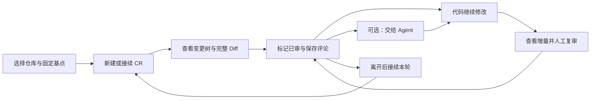

# ReviewSlate 产品

维护责任：产品负责人；状态：现行；最后核查：2026-11-03。适用范围：`main` 的 VS Code 系 VSIX。产品规则依据 `3dd7e30` 加本轮 1.0.2 修复候选；被检源码、产物与验证边界见[验收条件](验收条件.md)。

ReviewSlate 帮助开发者围绕固定 Git 提交持续审阅本地变化：查看完整 Diff，记住已审内容，留下意见，在后续修改和 Agent 处理后继续复审。审阅者可以是代码作者，也可以不用 Agent。当前维护范围是 VS Code、Trae、Trae CN 等兼容扩展宿主中的 VSIX；其他客户端的研发入口在 [`beta` 分支](https://github.com/To-Re/review-slate/tree/beta)，不属于本分支的产品验收范围。

本目录定义用户结果和业务预期；实现与证据有差距时保留差距。字段级契约以源码为准，安装和实际操作见[使用指南](../用户文档/使用指南.md)。

| 需要判断的事 | 权威入口 |
| --- | --- |
| 解决什么问题、范围和兼容边界 | 本页 |
| 固定基点、CR、已审、评论和恢复的含义 | [业务规则](业务规则.md) |
| 如何判断功能和性能是否达到本次要求 | [验收条件](验收条件.md) |
| 界面与实现、存储和错误处理 | [设计](../设计/README.md)、[客户端](../客户端/README.md)、[数据协议](../客户端/数据协议.md) |
| 实际测试、验收和交付状态 | [验证记录](../测试/验证记录.md)、[项目现状](../项目现状.md)、[项目状态](../项目状态.md) |

## 用户任务与当前问题

一次审阅往往跨越多次保存、提交、分支切换和工作会话。用户需要知道自己看过哪个内容版本、还有哪些文件未审、评论属于哪一轮，以及 Agent 回执是否回应了最新意见。产品以仓库根目录为范围，覆盖相对固定基点的全部可审阅变化；“部分已审”是目录内部分变化文件已审，不是逐行或逐 hunk 标记。

用户本次明确反馈两处等待：**新建审阅或选择基点后目录树展示慢，以及点击文件打开 Diff 慢**。本次修复采用批量对象读取、点击文件定向复读和保存刷新合并，仓库、CR、内容与导航归属继续校验。测试需要区分首次扫描、已有 CR 刷新、命令排队、扩展处理和真实编辑器显示，不能用其中一项代替其他项。

## 范围与取舍

| 范围 | 必须保留的用户结果 |
| --- | --- |
| 固定基点与多轮 CR | 分支来源取共同祖先，提交来源取自身；固定完整 SHA。同仓库、同分支、同基点接续未归档 CR，不同组合隔离 |
| 全部变化与已审进度 | 对比固定基点和磁盘工作区，覆盖提交、暂存、未暂存和未忽略新文件；内容未变的 stage / commit 不清空进度，内容变化需复审 |
| Diff 与编辑 | 原生完整 Diff 的普通 UTF-8 工作区文本可直接编辑保存；上次已审快照用于复审，未保存内容不能被认证为已审 |
| 评论与人工复核 | 文件、目录、选区评论，内容定位，目录聚合和待处理概览；Agent 回执与原评论分开，由人确认解决 |
| 持久化与恢复 | 保存后的 CR、快照、评论可接续；跨分支与陈旧页面不串写；归档、恢复和永久删除边界明确 |
| 本次性能修复 | 首次选基点到变更树、点击文件到 Diff 的同样本前后对比可复现；连续点击和内容变化仍正确，不削弱写入、归属或错误保护 |

本次不新增审阅功能，不改变存储协议，不引入跨宿主同步、迁移、服务端、账号系统、自动批准或合并，也不重构为新的客户端架构。没有确认的毫秒目标或提速比例；先对同一合成样本和环境测量基线与候选，依据实际差异判断改进，不把未经测量的承诺写成验收标准。

关闭重开后恢复全部文件选择、目录展开与 Diff 光标位置不属于当前已验收能力。普通刷新保留手动展开状态、按分支恢复 CR 与保存数据接续分别核对；本次性能修复不借此扩成完整导航恢复需求。

## 兼容与限制

| 环境或内容 | 当前边界 |
| --- | --- |
| 桌面编辑器 | `package.json` 要求 VS Code API `^1.107.0`，扩展 ID 保持 `to-re.code-review`。兼容目标包含 VS Code、Trae、Trae CN；声明兼容不等于每个宿主已实测 |
| 工作区 | 仅受信任的文件系统工作区，需要可运行 Git 且仓库至少有一个提交；不支持浏览器版和虚拟工作区 |
| 远程使用 | 扩展按 workspace 类型在工作区一侧运行；Remote SSH 的路径、存储和 Agent 执行位置属于远端，完整实机覆盖见 QA 记录 |
| 比较内容 | 读取磁盘原始字节，不运行 Git 过滤器、external diff 或自动对象下载；Git LFS、换行转换与未保存文本需按[业务规则](业务规则.md)理解 |
| 受限文件 | 单侧变化文件 5 MiB、单次变化两侧合计 80 MiB；二进制和非 UTF-8 展示摘要；链接不跟随，子模块单独作为仓库审阅 |
| 保存位置 | CR 和已审快照在宿主扩展存储，评论、回执和交接文件在仓库 `.code-review/`；只复制后一处不能恢复完整审阅 |
| 数据流 | 扩展运行时不联网、无遥测、不上传代码，无常驻本地服务器；用户自行把交接说明交给 Agent |

当前 `be7e00d5` 包已在 Trae CN 3.4.11（内核 1.107.1）的新宿主窗口通过连续切文件、评论对象同步及同标签焦点保持的定向 GUI 复验，预览替换引起的评论目标回退缺陷已关闭。具体场景见[设计验收](../设计/README.md#设计核查与成品证据)，未验证范围不延伸为其他宿主或完整流程通过。

## 验收与效果

本次采用 `VSIX-AC-*` 条件。产品已核对当前候选的源码、800 文件三轮性能数据、事件回归日志、包内模块及同包设计现场记录；本轮性能与导航修复在已测范围内通过产品验收。具体结论见[产品验收记录](验收条件.md#当前产品验收状态)，完整保存流程、全部主题、其他宿主和屏幕耗时仍未验证。

当前没有用户任务成功率、审阅总耗时或效率改善的实测基线。合成仓库的扩展处理耗时可以证明对应实现路径的变化，不能直接推导真实用户效率；本次不增加遥测或长期监控。
