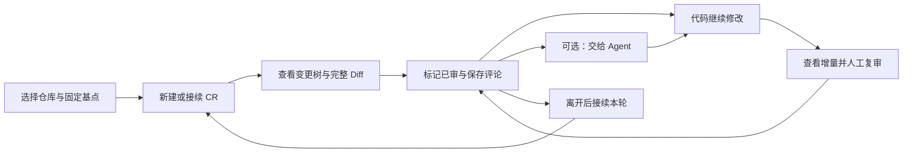

# ReviewSlate 产品

维护责任：产品负责人；状态：现行；最后核查：2026-11-04。适用范围：`main` 的 VS Code 系 VSIX，当前产品版本为 1.0.3。变更树筛选在自动化与 Trae CN 定向实机范围内通过产品验收；被检版本与未覆盖范围见[验收条件](验收条件.md)，实际发布状态见[项目现状](../项目现状.md)。

ReviewSlate 帮助开发者围绕固定 Git 提交持续审阅本地变化：查看完整 Diff，记住已审内容，留下意见，在后续修改和 Agent 处理后继续复审。审阅者可以是代码作者，也可以不用 Agent。当前维护范围是 VS Code、Trae、Trae CN 等兼容扩展宿主中的 VSIX；其他客户端的研发入口在 [`beta` 分支](https://github.com/To-Re/review-slate/tree/beta)，不属于本分支的产品验收范围。

本目录定义用户结果和业务预期；实现与证据有差距时保留差距。字段级契约以源码为准，安装和实际操作见[使用指南](../用户文档/使用指南.md)。

| 需要判断的事 | 权威入口 |
| --- | --- |
| 解决什么问题、范围和兼容边界 | 本页 |
| 固定基点、CR、已审、评论和恢复的含义 | [业务规则](业务规则.md) |
| 如何判断功能和性能是否达到本次要求 | [验收条件](验收条件.md) |
| 界面与实现、存储和错误处理 | [设计](../设计/README.md)、[客户端](../客户端/README.md)、[数据协议](../客户端/数据协议.md) |
| 实际测试、验收和交付状态 | [验证记录](../测试/验证记录.md)、[项目现状](../项目现状.md)、[项目状态](../项目状态.md) |

## 用户任务与当前问题

一次审阅往往跨越多次保存、提交、分支切换和工作会话。用户需要知道自己看过哪个内容版本、还有哪些文件未审、评论属于哪一轮，以及 Agent 回执是否回应了最新意见。产品以仓库根目录为范围，覆盖相对固定基点的全部可审阅变化；“部分已审”是目录内部分变化文件已审，不是逐行或逐 hunk 标记。

首次树和 Diff 打开路径已完成针对性改进。1.0.3 帮助用户在变更较多时聚焦剩余待审工作，或找到已有意见的文件与目录，减少在完整树中逐项寻找。通过一个筛选入口，互斥选择“全部”“未审核”“有评论”；完整规则见[变更树筛选](业务规则.md#10-变更树筛选)。

## 范围与取舍

| 范围 | 必须保留的用户结果 |
| --- | --- |
| 固定基点与多轮 CR | 分支来源取共同祖先，提交来源取自身；固定完整 SHA。同仓库、同分支、同基点接续未归档 CR，不同组合隔离 |
| 全部变化与已审进度 | 对比固定基点和磁盘工作区，覆盖提交、暂存、未暂存和未忽略新文件；内容未变的 stage / commit 不清空进度，内容变化需复审 |
| Diff 与编辑 | 原生完整 Diff 的普通 UTF-8 工作区文本可直接编辑保存；上次已审快照用于复审，未保存内容不能被认证为已审 |
| 评论与人工复核 | 文件、目录、选区评论，内容定位，目录聚合和待处理概览；Agent 回执与原评论分开，由人确认解决 |
| 持久化与恢复 | 保存后的 CR、快照、评论可接续；跨分支与陈旧页面不串写；归档、恢复和永久删除边界明确 |
| 本次变更树筛选 | 只展示未有效已审的变化文件，或有未删除评论的对象；保留祖先路径、全量统计和原有写入保护，可随时返回全部 |

本次只增加树的展示筛选，不增加组合条件、文字搜索、只看未解决评论或新的审阅状态。模式属于工作区偏好，切换 CR、仓库及重开同工作区后保留；不改变 CR、评论和已审存储协议。切模式使用已加载数据，不重新扫描 Git。筛选不缩小评论概览或交给 Agent 的范围。

为避免隐藏文件被批量修改，非“全部”模式禁用目录与整树的标记、取消已审；单文件操作保留，切回“全部”后沿用原有目录批量校验。这个取舍保持操作范围可辨认，不增加隐藏成员确认流程。

关闭重开后恢复全部文件选择、目录展开与 Diff 光标位置不属于当前已验收能力。普通刷新保留手动展开状态、按分支恢复 CR 与保存数据接续分别核对；筛选偏好恢复不扩展为完整导航恢复需求。

## 兼容与限制

| 环境或内容 | 当前边界 |
| --- | --- |
| 桌面编辑器 | `package.json` 要求 VS Code API `^1.107.0`，扩展 ID 保持 `to-re.code-review`。兼容目标包含 VS Code、Trae、Trae CN；声明兼容不等于每个宿主已实测 |
| 工作区 | 仅受信任的文件系统工作区，需要可运行 Git 且仓库至少有一个提交；不支持浏览器版和虚拟工作区 |
| 远程使用 | 扩展按 workspace 类型在工作区一侧运行；Remote SSH 的路径、存储和 Agent 执行位置属于远端，完整实机覆盖见 QA 记录 |
| 比较内容 | 读取磁盘原始字节，不运行 Git 过滤器、external diff 或自动对象下载；Git LFS、换行转换与未保存文本需按[业务规则](业务规则.md)理解 |
| 受限文件 | 单侧变化文件 5 MiB、单次变化两侧合计 80 MiB；二进制和非 UTF-8 展示摘要；链接不跟随，子模块单独作为仓库审阅 |
| 保存位置 | CR 和已审快照在宿主扩展存储，评论、回执和交接文件在仓库 `.code-review/`；只复制后一处不能恢复完整审阅 |
| 数据流 | 扩展运行时不联网、无遥测、不上传代码，无常驻本地服务器；用户自行把交接说明交给 Agent |

1.0.3 运行代码已在 Trae CN 3.4.14（内核 1.107.1）通过三模式筛选、目录批量禁用、单文件标记后的 Diff / 草稿保持、隐藏评论对象导航、窗口重载恢复偏好与未审核空态的定向 GUI 验收。具体版本和未测场景见[设计验收](../设计/README.md#103-文件树筛选的实机验收)，不代表其他宿主或全部人工流程通过。

## 验收与效果

本次 `VSIX-AC-16～22` 在已测自动化与定向实机范围内通过，未发现未解决的产品阻断。发布前单次全套为 142 项：141 通过、0 失败、1 项可选性能采样跳过；正式打包产物 `ad8ad2a3` 与实测包 `e90887eb` 的 16 个运行模块一致，仅 README 和 CHANGELOG 不同。产品回读了[QA 证据](../测试/验证记录.md)和设计实际记录，没有将重打包记为再次 GUI 验收。条件对应及未实测边界见[产品验收记录](验收条件.md#当前产品验收状态)。

当前没有用户任务成功率、审阅总耗时或效率改善的实测基线。合成仓库的扩展处理耗时可以证明对应实现路径的变化，不能直接推导真实用户效率；本次不增加遥测或长期监控。
