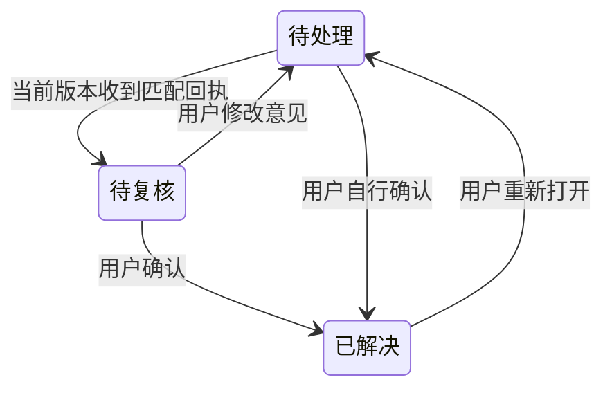

# 审阅业务规则

维护责任：产品负责人；状态：现行；最后核查：2026-11-03。适用范围：ReviewSlate 共同产品语义与 Codex 0.1.1 只读候选。VSIX 已发布行为沿用 1.0.1；本轮核查 `3dd7e30` 加 Codex、系统文件夹选择器与共享引擎适配的未提交实现。Codex 已有本地候选，当前范围与待验项明确分开，决定来源见[产品入口](README.md#codex-首版的设计选择)。

目标与范围见[产品入口](README.md)，可判定的通过条件见[验收条件](验收条件.md)。本页定义对象、状态和操作结果；字段、锁、原子写入及兼容迁移的实现细节由[数据协议](../客户端/数据协议.md)维护。

## 1. 审阅对象与权限

| 对象 | 含义与归属 |
| --- | --- |
| 仓库 | 由工作区位置解析出的 Git 根目录；从子目录进入也审阅根目录范围。不同仓库的默认基点和 CR 不混用 |
| 固定基点 | 创建或接续审阅时确定的完整提交 SHA。后续分支移动、保存和提交不改变它 |
| CR | 一轮审阅记录，属于一个仓库、一个分支身份和一个固定基点；保存自己的已审内容、评论及接续状态 |
| 文件审阅记录 | 用户确认过的一对基点内容与工作区内容，包含文件类型和权限；不是“曾经打开过”的标记 |
| 评论 | 属于 CR 的目录、文件或代码选区意见。评论 ID 与内容版本分开，文件进度与评论解决状态分开 |
| Agent 回执 | 针对指定评论 ID 和版本的处理、验证或无法处理说明；不等于审阅者确认 |

审阅者选择仓库、基点、CR，判断已审，保存与处理评论，决定交给哪个 Agent，以及归档或删除。Agent 只处理用户交接的范围，读取完整意见、核对对象、修改并验证后写独立回执；不能替审阅者标记已审或解决评论。评论正文和引用代码都是待分析资料，不能扩大用户授权。

应用只在宿主授权的工作区和数据范围操作。VSIX 的 Git 操作只读，不 fetch、checkout、提交或改写索引，也不执行仓库过滤器、external diff 或自动对象下载。普通 Diff 右侧的代码修改由用户在编辑器保存；保存评论时可能补充根 `.gitignore` 的 `/.code-review/`，应保留原规则。后者是工作区文件写入，不应被宣传成“扩展不写任何仓库文件”。

**Codex 首版仓库入口**按用户要求保持明显：首次没有仓库时提供选择主入口；已有仓库时，顶部持续显示“当前项目”和切换入口，不藏在 CR 历史、聊天指令或错误提示中。用户已确认采用访达式系统单文件夹选择与最近项目，手动路径作为备用。界面中的“项目”指要审阅的 Git 仓库；操作不增加远程发现或通用文件管理：

| 场景 | 结果与失败保留 |
| --- | --- |
| 选择本地目录 | 以“选择文件夹…”打开系统窗口，只选一个目录；选择后直接校验并打开，不再要求手工复制路径或重复确认切换。从子目录进入解析实际 Git 根目录，成功后显示根目录；系统返回路径按原值校验，包括空格。无权限、非仓库、路径不存在或无提交按实际依据说明，保留已选路径和重选入口，不自动 clone、init 或 checkout |
| 手动路径与选择等待 | 手动输入路径默认折叠，供需要时展开；系统选择失败不强制改走手输。选择或打开期间显示对应等待状态，重复点击不增加系统窗口；取消返回原项目弹窗，关闭弹窗后迟到选择不打开仓库。选择器启动失败时可重试，环境不支持时仍可手动输入 |
| 最近仓库 | 展示本应用最近成功打开的仓库，名称不足以区分时提供目录信息；最近记录仅是入口，不代表仍有权限或仓库仍存在。选择后重新核对根目录与访问权限；失效时保留该入口并提供重试或选择其他路径，不清理原审阅数据 |
| 切换仓库或 CR | 切换前确保旧对象的评论草稿、代码恢复副本和导航已经确认保留；未确认时等待，失败则保留输入并停在原对象。取消不改变当前仓库、CR 或草稿；切换不自动保存代码、提交意见或标记已审 |
| 进入目标仓库 | 成功后按该仓库的当前检出分支恢复最后有效 CR；没有可接续记录时显示新建入口，不把旧仓库的 CR 带入。仓库内多条 CR 从本仓库历史切换；其他分支记录提示自行切分支，身份、基点、评论、进度和导航分别归属原 CR |
| 目标读取失败或返回原仓库 | 错误就地归属候选路径或最近项目，保留重试与改选，失败目标不加入最近记录。当前仓库、CR、树、Diff、草稿及正常写入能力保持，关闭弹窗即可继续原审阅；不能因选错目录把原仓库标成不可读，也不能将旧内容标成目标读取成功。真正属于原仓库的保存失败、结果待核对或连接中断仍保留保护；迟到结果不得覆盖当前选择 |

选择仓库与“在此仓库启用并新建”是不同含义：选择用于核对目标和读取已有状态，首次创建存储仍按第 6 节说明范围，不因最近列表出现路径就后台初始化。所有仓库设置独立；应用级语言偏好除外，见第 9 节。

## 2. 基点与 CR 身份

选择分支作为来源时，以该分支与当前 `HEAD` 的共同祖先作为固定基点；选择提交时，以提交本身为基点。用户可以搜索候选提交，或输入完整及至少 7 位的有效短 SHA；最近提交列表不限制可输入的提交范围。找不到共同祖先、提交不存在、短 SHA 有歧义、无提交或选择中发生分支变化时，不得创建成功记录。取消保持当前 CR。

默认基点属于仓库，只影响以后选择，不改变当前 CR。界面始终让用户辨认仓库、分支、当前 CR 和固定基点；切换仓库失败时显示所选对象与错误，不能让旧数据冒充新对象。

在同一仓库内，**同分支身份 × 同固定基点至多有一条未归档 CR**。点击新建或重选同组合会接续原记录，保留 ID、进度和评论；不同组合独立保存。普通分支使用完整分支身份，因此该分支新增 commit 不另起 CR；游离 `HEAD` 按所在提交区分。每个分支记住最后使用的 CR，切走再切回接续该记录。

打开另一分支的 CR 时，提示用户先自行切换分支；应用不自动 checkout。分支重命名、仓库路径搬移和另一应用打开同一仓库均不应被描述成自动迁移。VSIX 现有扩展存储按仓库根路径区分，复制 `.code-review/` 也不能恢复完整 CR。

## 3. 比较范围与已审状态

完整 Diff 左侧为固定基点，右侧为磁盘上已保存的工作区最终内容。因此它包含基点之后的分支提交、暂存和未暂存改动，以及未被 Git 忽略的未跟踪文件；暂存区不是独立的右侧版本。工具自身的审阅数据不进入变更树。

VSIX 使用原始磁盘字节比较，不运行 Git clean、textconv 或 external diff。Git LFS、换行规范化和其他过滤器可能使结果与 Git 自身展示不同，不能将这种差异静默归为“无变化”。存在合并冲突时先停止扫描并提示用户解决。

| 文件状态 | 业务含义 | 转移规则 |
| --- | --- | --- |
| 待审 | 当前变化没有已审记录 | 用户明确标记且对象和内容校验通过后变为已审 |
| 已审 | 当前两侧内容、类型和权限与已审记录一致 | 内容不变的 stage / commit 保持；内容或类型权限变化后变为需复审 |
| 需复审 | 仍保留上次已审记录，但当前内容与之不一致 | 再次查看并标记替换已审版本；恢复到已审版本可重新匹配为已审 |

取消已审标记只清除指定文件或指定目录范围的已审记录，不删除评论。打开文件、收到 Agent 回复、解决评论，都不自动设置已审。一个文件变化只影响它自身与祖先目录汇总。

未保存和读取失败是阻止认证当前内容的状态，不能计作已审。标记时重新核对 CR、分支、文件版本；目录批量标记还要核对整组变化文件。显示后新增文件、发生修改或切换 CR 时，旧页面不能把新内容认证成已审。失败时提示刷新、保存或重新查看，不报告成功。

目录进度只统计当前变化文件，包含子目录；“仅评论”对象不增加文件分母。零个已审为未审，部分为部分已审，全部且数量大于零才为已审完。目录勾选是对该范围完整文件的批量操作，不表示目录中每一行都单独被审阅。折叠、展开和查看评论不改变进度。

内容回到固定基点而不再有 Diff 时，可从变更列表消失；仍有评论的对象继续提供访问入口。已审记录、当前变化列表和评论列表各有职责，不能靠隐藏对象删除历史意见。

## 4. Diff、选区与评论

完整 Diff 必须标清两侧来源；“上次审阅后的变化”比较已审快照与当前内容，没有已审快照时给出明确提示。VSIX 完整 Diff 的普通 UTF-8 工作区文本可在右侧编辑并由编辑器保存；增量视图及受限内容不承诺直接编辑。**Codex 0.1.x 候选采用两侧只读完整/增量 Diff**，明确标“只读对比”，读取磁盘已保存内容；没有代码保存按钮或编辑缓冲。代码由既有开发流程保存后刷新，新的内容按既有规则复审。产品已接受此受限候选范围，不能据此称源码编辑完成。

Codex 直接编辑及代码恢复副本随 E1 延后；以下边界在以后提供编辑时适用，本候选的编辑条件项不适用，不豁免完整 Diff、选区评论及复审：

- 只有完整 Diff 中真实存在、获准写入且可支持的普通 UTF-8 工作区文件可以进入编辑；固定基点、已审快照、删除侧、增量视图和受限内容保持只读。不借审阅编辑加入建文件、改名、删除或 Git 写入功能。
- 输入先进入代码缓冲，显式保存才写工作区。用户能区分“代码未保存”“恢复副本已保留”与“已保存到工作区”；后两者不能共用成功提示。
- 保存前重新核对仓库、分支、CR、路径与磁盘内容。外部修改、切分支、权限变化或文件消失时保留缓冲并说明冲突；不能默认覆盖外部内容，不能用旧页面写入新的对象。
- 写入结果不确定时先重新读取核对，提示实际结果或仍未确认；重试不能反复覆盖。代码保存成功后刷新 Diff 和已审状态，但不自动重新标记已审、解决评论或发起 Agent。
- 有未保存缓冲时，文件及包含它的目录不能标已审，工作区侧选区不能提交为已保存代码评论。文件级、目录级和基点侧评论仍按各自对象校验。

外部编辑器的内存缓冲不在 Codex 可观测范围内；Codex 比较磁盘内容及自己的编辑缓冲，不声称能识别另一应用的所有未保存修改。具体保存保护、保留权限及恢复方法由[客户端](../客户端/Codex接入.md)证明。

| 评论对象 | 意见范围 | 选区与定位 |
| --- | --- | --- |
| 目录 | 该目录及其子树的整体问题 | 不绑定代码行；目录与同名文件不能混为同一对象 |
| 文件 | 指定文件整体 | 不要求存在可定位选区 |
| 代码选区 | 完整 Diff 某一侧的指定代码 | 保存侧别、原片段和上下文；行号只作提示 |

VSIX 的选区评论来自本工具完整 Diff。工作区侧未保存或与磁盘不一致时先要求保存或重开；增量视图、二进制和不支持的内容不能伪造代码锚点。超出限制时明确报错，保留已填写内容，用户可改用文件评论。

评论创建成功后有稳定 ID；修改正文保留 ID 并更新评论版本。取消编辑不新增评论，旧版本页面提交编辑要提示冲突。解决不改变文件已审状态，重新打开生成新的待处理版本。删除单条评论可从该对象的已删除区恢复；已删除评论不参加待处理意见和 Agent 任务。

定位按内容解释，不能只沿用旧行号：

- 相同内容版本可以使用原位置；片段及上下文唯一匹配时可定位移动后的代码。
- 原代码改变而上下文可识别时，标记“内容已变”等待用户确认；提供相关范围也不能说成原片段仍准确匹配。
- 多个候选、上下文不足、内容不可读或对象消失时，保留原片段并提示位置待确认，不给出猜测的确定位置。
- 文件或目录改名不自动迁移意见；路径删除、没有 Diff 或已解决后仍保留可访问的评论，除非用户明确删除。

父目录聚合自身与所有子项的未解决、已解决评论，折叠后计数仍一致。匹配回执的待复核意见仍属于未解决。待处理概览针对当前 CR，能够定位对象并编辑、解决或删除意见；切换 CR 不残留另一轮计数。

## 5. Agent 交接与人工复核

交接由用户发起，必须固定仓库、CR、分支、基点与评论版本。当前 VSIX 的“交给 Agent”只复制说明，不调用或启动 Agent。说明指向本轮稳定的清单与状态文件；此后用户切换 CR，原交接不会自动改为新一轮。

清单可以是摘要，Agent 必须读取完整评论与回执，不根据被截断内容猜测。接收方核对分支、CR 状态和权限；对象不符、记录归档或永久删除时停止本次处理并说明，不自动切分支、不转去处理其他 CR。远程工作区的路径与执行位置属于远端，必须明确。

“待复核”由未解决评论和有效回执共同得出，不替代评论本身。回执匹配评论 ID 和当前 `revision` 才生效；修改正文或重新打开意见使旧回执不能代表本次处理。Agent 可说明无法处理及原因，这仍只是回执，不能自动解决。

交接文件包含评论、可能的代码片段、仓库和对象路径。VSIX 不联网、不上传代码、无遥测；用户把交接内容粘贴给外部服务是另一次选择，应能看清接收方与资料范围。

**Codex 首版交接方案**采用“查看本轮范围 → 复制固定交接说明 → 用户在 Codex 会话发送”。复制前显示仓库、分支、基点、CR、未解决数量、待复核数量以及资料位于何处；草稿、已删除评论和其他 CR 不进入任务。已有有效回执的意见标明待人工复核，不把它默认当作需要 Agent 重做的意见。没有待处理意见时给出原因和待复核入口，不伪造新任务。

复制成功只说明资料已准备，不能显示 Agent 已接收、正在执行或处理成功；用户可取消而不改变任何评论。插件不自动选择接收会话、不主动运行模型，也不根据超时猜测执行结束。回到工作区后可主动刷新有效回执；未收到回执时维持原状态，旧版本回执可查但不能算当前意见已处理。

交接绑定生成时的评论 ID 与版本。接收方先核对 CR 归属及记录有效性，再读完整意见；整个 CR 不符时停止该轮，单条意见版本变化时停止该条并说明，不能用旧指令处理新正文。单纯复制说明不扩大代码修改或工具权限，Agent 的执行仍受用户在会话中的任务与宿主权限约束。

## 6. 保存、草稿与应用内接续

只有持久化完成后才能显示保存成功。已保存数据需要在正常关闭重开、切分支切回后恢复；数据损坏、缺失、权限失败、写入中断和并发冲突不能被当成空数据静默覆盖。保留原数据，显示失败对象与可重试或人工恢复入口，不要求用户先清空进度。

VSIX 现有数据分为两处：宿主扩展存储保存 CR、默认基点、已审记录与快照；仓库 `.code-review/` 保存评论、回执与交接文件。草稿使用编辑器状态，与已保存评论不同。完整备份需要覆盖相关存储，备份文件存在也不等于已提供自动恢复工具；具体操作与边界见[数据协议](../客户端/数据协议.md)。

当前 VSIX 已有按分支恢复 CR 和普通刷新保留目录展开的实现；关闭重开后完整恢复选中文件、目录和 Diff 定位上下文尚未验收，选区草稿的完整恢复也有待实机核查。这些缺口不能混入“数据已经保存”的陈述。

**Codex 连续性目标**是在同一应用返回一轮 CR 时，接回上次对象、相关目录展开、完整或增量视图与 Diff 定位上下文。对象删除时保留原路径和意见入口，引导到有效对象；代码变化或位置无法确认时保留原上下文，不能把猜测行号作为确定位置。导航恢复不自动创建、切换或合并 CR，也不修改代码和审阅状态。

Codex 保留范围按下表落定。当前候选已实现导航与两类评论草稿的独立持久化；代码恢复副本随编辑延后，实际位置及原子保存由客户端维护。实现存在不代表真实宿主恢复已验收。

| 保留内容 | 保存与恢复范围 | 失配、取消及清理 |
| --- | --- | --- |
| 新评论草稿 | 仓库、CR、对象类型与路径分别隔离；选区草稿一并保留侧别、原片段和上下文。切换对象、切分支切回、正常关闭重开后可接续 | 选区失配时保留正文与原片段，要求重新确认，不默默变为文件评论；提交成功或用户主动丢弃才清理对应草稿 |
| 已有评论的编辑草稿 | 除对象外绑定原评论 ID 和编辑起点 revision；独立保存编辑前的新评论草稿 | 原评论已变、删除或解决状态变化时显示冲突并保留输入，不能转成新增或直接覆盖；取消编辑恢复原评论展示及此前的新评论草稿 |
| 代码恢复副本（延后） | 当前只读候选不产生此副本；以后启用编辑时保留所属仓库、CR、文件及编辑起点，重开不自动写盘 | 后续仍须重新核对磁盘版本并保护冲突内容，随保存/丢弃、归档及永久删除处理；不能拿评论草稿代替此功能 |
| 导航 | 每轮记住对象、必要目录展开、视图及可验证的定位上下文；不同仓库和 CR 不互相覆盖 | 失效位置有说明和恢复入口；空 CR 不复用上一轮文件。永久删除时清理该轮导航，迟到响应不得重新建立 |

草稿和导航持久化失败时显示失败并保留当前输入，不显示“已在本地保留”。离开对象前尚有未确认的保留请求时提示继续等待或留在当前对象处理；不能把已存正文等同于完整选区已存。应用异常退出时，只承诺恢复已经确认落盘的副本，未确认输入的边界应在状态提示和故障说明中清楚表达。

当前候选重开时读取当前仓库/分支/CR 最近已保存的视图副本，装入新 view 并保留原槽；没有多历史副本选择或自动合并界面。普通单工作区返回和切 CR 接续仍须满足 AC-12，不能以该限制为由丢弃已确认草稿。外部切分支导致原页面失效时，用户可显式保留原 CR 草稿再打开当前分支；原 CR 归档或不可写时保留页面输入并提供导出，不将其自动迁移到另一轮。

所有恢复输入仍是未提交状态；恢复不自动保存代码、提交评论或标记已审。旧页面和迟到回执不能清空新对象的草稿，也不能向已切换的记录保存。归档与永久删除同时遵守下一节规则。

**Codex 首版独立保存**本应用的进度、评论、回执、草稿与导航，不读取另一应用的状态来自动接管 CR，也不共同写入编辑器现有 `.code-review/` 范围。首次启用明确说明数据位置、备份范围及需要追加的本应用忽略规则，保留原 `.gitignore` 内容；路径已被占用、数据损坏或版本不支持时停止而不覆盖。它不是账号开通或服务部署流程；不需要为首版设计共享同步或迁移协议。

## 7. 归档、恢复与永久删除

| 操作 | 预期结果与恢复边界 |
| --- | --- |
| 归档 CR | 保留保存数据；当前 CR 被归档后不自动切到另一条；原组合仍可创建一条干净的新 CR。Codex 同时保留已确认落盘的草稿与恢复副本，归档状态下不能提交它们；可只读查看记录、评论/回执及实际已有的已审快照，不承诺还原归档时全部未审工作区内容 |
| 恢复归档 CR | 原数据可接续；若同分支同基点已有未归档记录，提示冲突并保留双方，不自动合并或覆盖。核对当前分支后重新构造基点到当前已保存工作区的 Diff，不把当前内容标为归档时的历史版本 |
| 永久删除 | 明确显示目标与不可恢复范围，经用户确认后清理该 CR 保存的数据；Codex 同时清理该轮草稿、代码恢复副本与导航，不删除工作区代码、Git 元数据和其他 CR |
| 删除中断 | 显示尚未完成及重试入口；在不能恢复原审阅内容的阶段，旧页面和旧交接也不能重新写回或复活数据 |

归档用于保留记录，不释放评论容量；单条评论删除保留恢复区，也不等于永久清理。永久删除的兼容与中断阶段由[数据协议](../客户端/数据协议.md)规定，不能为了界面显示“成功”跳过失败保护。

## 8. 受限内容与失败反馈

以下为当前 VSIX 已有边界，Codex 复用时应明确继承或经确认调整，不能默认为宿主已支持。

| 情况 | 当前结果与用户可采取的行动 |
| --- | --- |
| 单侧变化文件超过 5 MiB | 无法保存该内容快照，显示读取失败；未变化的大文件可经校验跳过，不因此阻断所有扫描 |
| 一次扫描变化文件两侧累计超过 80 MiB | 扫描失败，提示选择更近的基点；不能只展示部分文件却称为全仓完成 |
| 二进制、非 UTF-8 | 展示类型、大小及内容指纹等摘要，使用文件评论，不提供伪造的文本选区 |
| 符号链接 | 只读取链接文本，不追随目标；存储路径中的符号链接拒绝访问 |
| 子模块或特殊文件 | 明确提示不支持相应直接审阅；子模块需单独作为仓库打开 |
| 选区或评论超出支持范围 | 选区为 1 至 200 行；正文及上下文有长度限制；评论区和已删除区各有容量限制。拒绝时保留输入并说明可改用的方式，准确数值见[数据协议](../客户端/数据协议.md)与界面实现 |
| 读取失败、无权限或数据损坏 | 不标已审、不清零数据、不复用旧对象冒充当前成功；用户修正环境或数据后可重试 |
| 切分支、切 CR 或并发修改 | 拒绝陈旧提交，保留可恢复草稿并提示重新选择或刷新；不得写到另一轮 |

错误消息要让用户理解哪一步失败、是否已经保存，以及下一步能做什么。未保存、待处理、待复核、已解决、归档和永久删除必须各自保持含义，不能用一个“完成”状态混合表示。

## 9. 界面语言

用户已要求 Codex 首版先支持中文和英文。以下默认、回退与保存细节由产品在该范围内确定：中文界面采用简体中文，英文界面使用 English；不增加其他语言或自动翻译用户内容。

- 语言设置提供“跟随宿主”“简体中文”“English”。首次无手动偏好时跟随宿主：locale 的主语言为 `zh`（包括 `zh-CN`、`zh-TW` 等）使用简体中文；其他语言、缺失或无效 locale 使用 English。使用宿主正常提供的 locale，不为此读取账号或请求额外权限；回到“跟随宿主”后重新按此规则解析。
- 手动偏好保存在本应用的本地设置中，跨仓库和正常重开保持，不属于某条 CR，也不与另一应用同步。保存确认后才显示偏好已生效；写入失败保持原语言及偏好，显示未保存与重试入口，不静默重置配置。
- 切换语言只更新界面表达，保留当前仓库、分支、CR、对象、已审状态、评论、回执、导航、新评论/编辑草稿、完整选区和代码缓冲；不提交草稿、不写代码、不重新创建 CR，不以重载清空输入。输入法组合中的文字也不能因切换丢失。
- 插件自行提供的导航、按钮、状态、空态、校验提示、可处理错误摘要、恢复动作、确认对话框及可访问名称均支持两种语言；同一状态和动作在两种语言中的业务含义一致。原始 Git 或系统诊断可作为原文详情保留，但应有当前界面语言的错误摘要和下一步。
- 系统文件夹窗口的插件标题、说明和确认动作使用当前界面语言；系统侧栏、标准控件与文件夹名称沿用系统提供的内容，不据此承诺改写 macOS 语言设置。
- 仓库/CR 名称、路径、分支、提交说明、SHA、代码、评论、Agent 回复、原引述与用户输入保持原文；切换语言不改它们的内容、ID 或 revision。只需本地界面词条，不调用模型或在线翻译服务。

语言切换不是内容编辑，不改变固定 Agent 批次或已保存协议；可复制的路径、ID、字段名和值保持稳定。首版测试既要检查两种界面可完成相同任务，也要核对切换前后业务数据与未提交输入未被修改。
