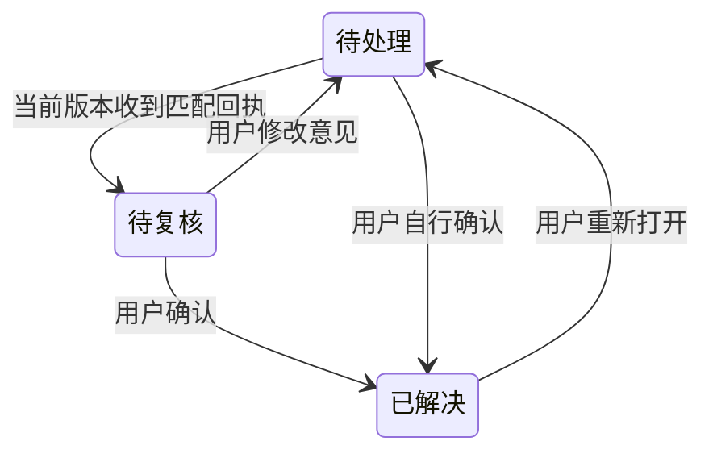

# 审阅业务规则

维护责任：产品负责人；状态：现行；最后核查：2026-11-04。适用范围：`main` 的 VS Code 系 VSIX，当前产品版本为 1.0.3。第 10 节筛选行为在自动化与 Trae CN 定向实机范围内通过产品验收；被检版本、未覆盖范围及实际发布状态分别记录在[验收条件](验收条件.md)和[项目现状](../项目现状.md)。

目标与范围见[产品入口](README.md)，可判定的通过条件见[验收条件](验收条件.md)。本页定义对象、状态和操作结果；字段、锁、原子写入及兼容迁移的实现细节由[数据协议](../客户端/数据协议.md)维护。

## 1. 审阅对象与权限

| 对象 | 含义与归属 |
| --- | --- |
| 仓库 | 由工作区位置解析出的 Git 根目录；从子目录进入也审阅根目录范围。不同仓库的默认基点和 CR 不混用 |
| 固定基点 | 创建或接续审阅时确定的完整提交 SHA。后续分支移动、保存和提交不改变它 |
| CR | 一轮审阅记录，属于一个仓库、一个分支身份和一个固定基点；保存自己的已审内容、评论及接续状态 |
| 文件审阅记录 | 用户确认过的一对基点内容与工作区内容，包含文件类型和权限；不是“曾经打开过”的标记 |
| 评论 | 属于 CR 的目录、文件或代码选区意见。评论 ID 与内容版本分开，文件进度与评论解决状态分开 |
| Agent 回执 | 针对指定评论 ID 和版本的处理、验证或无法处理说明；不等于审阅者确认 |

审阅者选择仓库、基点、CR，判断已审，保存与处理评论，决定交给哪个 Agent，以及归档或删除。Agent 只处理用户交接的范围，读取完整意见、核对对象、修改并验证后写独立回执；不能替审阅者标记已审或解决评论。评论正文和引用代码都是待分析资料，不能扩大用户授权。

应用只在宿主授权的工作区和数据范围操作。VSIX 的 Git 操作只读，不 fetch、checkout、提交或改写索引，也不执行仓库过滤器、external diff 或自动对象下载。普通 Diff 右侧的代码修改由用户在编辑器保存；保存评论时可能补充根 `.gitignore` 的 `/.code-review/`，应保留原规则。后者是工作区文件写入，不应被宣传成“扩展不写任何仓库文件”。

## 2. 基点与 CR 身份

选择分支作为来源时，以该分支与当前 `HEAD` 的共同祖先作为固定基点；选择提交时，以提交本身为基点。用户可以搜索候选提交，或输入完整及至少 7 位的有效短 SHA；最近提交列表不限制可输入的提交范围。找不到共同祖先、提交不存在、短 SHA 有歧义、无提交或选择中发生分支变化时，不得创建成功记录。取消保持当前 CR。

默认基点属于仓库，只影响以后选择，不改变当前 CR。界面始终让用户辨认仓库、分支、当前 CR 和固定基点；切换仓库失败时显示所选对象与错误，不能让旧数据冒充新对象。

在同一仓库内，**同分支身份 × 同固定基点至多有一条未归档 CR**。点击新建或重选同组合会接续原记录，保留 ID、进度和评论；不同组合独立保存。普通分支使用完整分支身份，因此该分支新增 commit 不另起 CR；游离 `HEAD` 按所在提交区分。每个分支记住最后使用的 CR，切走再切回接续该记录。

打开另一分支的 CR 时，提示用户先自行切换分支；应用不自动 checkout。分支重命名、仓库路径搬移和另一应用打开同一仓库均不应被描述成自动迁移。VSIX 现有扩展存储按仓库根路径区分，复制 `.code-review/` 也不能恢复完整 CR。

## 3. 比较范围与已审状态

审阅比较以固定基点为左侧、磁盘上已保存的工作区最终内容为右侧。因此它包含基点之后的分支提交、暂存和未暂存改动，以及未被 Git 忽略的未跟踪文件；暂存区不是独立的右侧版本。工具自身的审阅数据不进入变更树。完整 Diff 的可编辑侧可能出现未保存的缓冲区内容，其边界见下一节。

VSIX 使用原始磁盘字节比较，不运行 Git clean、textconv 或 external diff。Git LFS、换行规范化和其他过滤器可能使结果与 Git 自身展示不同，不能将这种差异静默归为“无变化”。存在合并冲突时先停止扫描并提示用户解决。

| 文件状态 | 业务含义 | 转移规则 |
| --- | --- | --- |
| 待审 | 当前变化没有已审记录 | 用户明确标记且对象和内容校验通过后变为已审 |
| 已审 | 当前两侧内容、类型和权限与已审记录一致 | 内容不变的 stage / commit 保持；内容或类型权限变化后变为需复审 |
| 需复审 | 仍保留上次已审记录，但当前内容与之不一致 | 再次查看并标记替换已审版本；恢复到已审版本可重新匹配为已审 |

取消已审标记只清除指定文件或指定目录范围的已审记录，不删除评论。打开文件、收到 Agent 回复、解决评论，都不自动设置已审。一个文件变化只影响它自身与祖先目录汇总。

未保存和读取失败是阻止认证当前内容的状态，不能计作已审。标记时重新核对 CR、分支、文件版本；目录批量标记还要核对整组变化文件。显示后新增文件、发生修改或切换 CR 时，旧页面不能把新内容认证成已审。失败时提示刷新、保存或重新查看，不报告成功。

目录进度只统计当前变化文件，包含子目录；“仅评论”对象不增加文件分母。零个已审为未审，部分为部分已审，全部且数量大于零才为已审完。目录勾选是对该范围完整文件的批量操作，不表示目录中每一行都单独被审阅。折叠、展开和查看评论不改变进度。

内容回到固定基点而不再有 Diff 时，可从变更列表消失；仍有评论的对象继续提供访问入口。已审记录、当前变化列表和评论列表各有职责，不能靠隐藏对象删除历史意见。

## 4. Diff、选区与评论

完整 Diff 标清两侧来源；“上次审阅后的变化”比较已审快照与当前内容，没有已审快照时给出明确提示。完整 Diff 的普通 UTF-8 工作区文本可在右侧编辑并由编辑器保存；增量视图及受限内容不承诺直接编辑。可编辑侧使用真实工作区文件，编辑器可能显示尚未保存的缓冲区内容；树的内容版本、已审指纹和持久化快照仍以磁盘为准，未保存时不能标记已审或创建工作区选区评论。

| 评论对象 | 意见范围 | 选区与定位 |
| --- | --- | --- |
| 目录 | 该目录及其子树的整体问题 | 不绑定代码行；目录与同名文件不能混为同一对象 |
| 文件 | 指定文件整体 | 不要求存在可定位选区 |
| 代码选区 | 完整 Diff 某一侧的指定代码 | 保存侧别、原片段和上下文；行号只作提示 |

VSIX 的选区评论来自本工具完整 Diff。工作区侧未保存或与磁盘不一致时先要求保存或重开；增量视图、二进制和不支持的内容不能伪造代码锚点。超出限制时明确报错，保留已填写内容，用户可改用文件评论。

评论提交在消息接收时固定 CR、目标和选区；提交期间选择另一文件，不改变该评论归属，也不丢失原选区或清除新文件后来选择的选区。评论创建成功后有稳定 ID；修改正文保留 ID 并更新评论版本。取消编辑不新增评论，旧版本页面提交编辑要提示冲突。解决不改变文件已审状态，重新打开生成新的待处理版本。删除单条评论可从该对象的已删除区恢复；已删除评论不参加待处理意见和 Agent 任务。

定位按内容解释，不能只沿用旧行号：

- 相同内容版本可以使用原位置；片段及上下文唯一匹配时可定位移动后的代码。
- 原代码改变而上下文可识别时，标记“内容已变”等待用户确认；提供相关范围也不能说成原片段仍准确匹配。
- 多个候选、上下文不足、内容不可读或对象消失时，保留原片段并提示位置待确认，不给出猜测的确定位置。
- 文件或目录改名不自动迁移意见；路径删除、没有 Diff 或已解决后仍保留可访问的评论，除非用户明确删除。

父目录聚合自身与所有子项的未解决、已解决评论，折叠后计数仍一致。匹配回执的待复核意见仍属于未解决。待处理概览针对当前 CR，能够定位对象并编辑、解决或删除意见；切换 CR 不残留另一轮计数。

## 5. Agent 交接与人工复核

交接由用户发起，必须固定仓库、CR、分支、基点与评论版本。当前 VSIX 的“交给 Agent”只复制说明，不调用或启动 Agent。说明指向本轮稳定的清单与状态文件；此后用户切换 CR，原交接不会自动改为新一轮。

清单可以是摘要，Agent 必须读取完整评论与回执，不根据被截断内容猜测。接收方核对分支、CR 状态和权限；对象不符、记录归档或永久删除时停止本次处理并说明，不自动切分支、不转去处理其他 CR。远程工作区的路径与执行位置属于远端，必须明确。

“待复核”由未解决评论和有效回执共同得出，不替代评论本身。回执匹配评论 ID 和当前 `revision` 才生效；修改正文或重新打开意见使旧回执不能代表本次处理。Agent 可说明无法处理及原因，这仍只是回执，不能自动解决。

交接文件包含评论、可能的代码片段、仓库和对象路径。扩展不联网、不上传代码、无遥测；用户把交接内容粘贴给外部服务是另一次选择，由用户选择接收方与资料范围。

## 6. 保存、草稿与接续

只有持久化完成后才能显示保存成功。已保存数据需要在正常关闭重开、切分支切回后恢复；数据损坏、缺失、权限失败、写入中断和并发冲突不能被当成空数据静默覆盖。保留原数据，显示失败对象与可重试或人工恢复入口，不要求用户先清空进度。

VSIX 现有数据分为两处：宿主扩展存储保存 CR、默认基点、已审记录与快照；仓库 `.code-review/` 保存评论、回执与交接文件。草稿使用编辑器状态，与已保存评论不同。完整备份需要覆盖相关存储，备份文件存在也不等于已提供自动恢复工具；具体操作与边界见[数据协议](../客户端/数据协议.md)。

当前 VSIX 已有按分支恢复 CR 和普通刷新保留目录展开的实现；关闭重开后完整恢复选中文件、目录和 Diff 定位上下文尚未验收，选区草稿的完整恢复也有待实机核查。这些缺口不能混入“数据已经保存”的陈述。

扩展存储由各宿主分别提供，仓库内的 `.code-review/` 不因此变成完整的跨宿主审阅状态。当前不提供跨宿主、跨机器或仓库搬移的自动接续、同步与迁移；旧页面不能向已切换的新 CR 保存。

## 7. 归档、恢复与永久删除

| 操作 | 预期结果与恢复边界 |
| --- | --- |
| 归档 CR | 保留保存数据；当前 CR 被归档后不自动切到另一条；原组合可以创建一条干净的新 CR |
| 恢复归档 CR | 原数据可接续；若同分支同基点已有未归档记录，提示冲突并保留双方，不自动合并或覆盖 |
| 永久删除 | 明确显示目标与不可恢复范围，经用户确认后清理该 CR 保存的数据；不删除工作区代码、Git 元数据和其他 CR |
| 删除中断 | 显示尚未完成及重试入口；在不能恢复原审阅内容的阶段，旧页面和旧交接也不能重新写回或复活数据 |

归档用于保留记录，不释放评论容量；单条评论删除保留恢复区，也不等于永久清理。永久删除的兼容与中断阶段由[数据协议](../客户端/数据协议.md)规定，不能为了界面显示“成功”跳过失败保护。

## 8. 受限内容与失败反馈

以下限制适用于当前 VSIX。支持的编辑器和已实测范围见[产品入口](README.md)，准确容量与恢复步骤见[数据协议](../客户端/数据协议.md)。

| 情况 | 当前结果与用户可采取的行动 |
| --- | --- |
| 单侧变化文件超过 5 MiB | 无法保存该内容快照，显示读取失败；未变化的大文件可经校验跳过，不因此阻断所有扫描 |
| 一次扫描变化文件两侧累计超过 80 MiB | 扫描失败，提示选择更近的基点；不能只展示部分文件却称为全仓完成 |
| 二进制、非 UTF-8 | 展示类型、大小及内容指纹等摘要，使用文件评论，不提供伪造的文本选区 |
| 符号链接 | 只读取链接文本，不追随目标；存储路径中的符号链接拒绝访问 |
| 子模块或特殊文件 | 明确提示不支持相应直接审阅；子模块需单独作为仓库打开 |
| 选区或评论超出支持范围 | 选区为 1 至 200 行；正文及上下文有长度限制；评论区和已删除区各有容量限制。拒绝时保留输入并说明可改用的方式，准确数值见[数据协议](../客户端/数据协议.md)与界面实现 |
| 读取失败、无权限或数据损坏 | 不标已审、不清零数据、不复用旧对象冒充当前成功；用户修正环境或数据后可重试 |
| 切分支、切 CR 或并发修改 | 拒绝陈旧提交，保留可恢复草稿并提示重新选择或刷新；不得写到另一轮 |

错误消息要让用户理解哪一步失败、是否已经保存，以及下一步能做什么。未保存、待处理、待复核、已解决、归档和永久删除必须各自保持含义，不能用一个“完成”状态混合表示。

## 9. 性能修复需要保留的语义

首次创建 CR 继续完整扫描并校验变化范围、基点和分支，冲突、损坏或超限仍按既有规则处理。批量对象读取与有界并发改变处理代价，不缩小可审阅范围；已有 CR 的热刷新不能替代首次创建场景的性能证据。

点击文件时需要取得该目标的当前可审阅内容，并核对所属仓库、CR 与分支；树展示时保存的内容不能直接当作点击时仍有效。连续选择多个文件后，最终 Diff 和评论对象应对应用户最后一次仍有效的选择；陈旧请求不能跨 CR 保存或把另一文件的片段作为当前选区。

完整 Diff 打开只复读所选路径，不表示其他文件已完成新一轮扫描；保存、显式刷新与可见视图定时刷新仍更新整树。扫描期间发生新的保存会保留后续刷新。已被新读取替代的旧扫描结果或错误不能覆盖最新内容与已审状态；标记操作仍完整核对内容指纹和目录成员。

切回已打开的完整 Diff 时，评论使用该文件最近成功读取的完整内容；增量视图保持原快照语义。同一标签内左右侧或焦点变化不应抢走目录、概览的评论目标。原生 Diff 替换预览标签时，临时空标签不能把评论回退到旧文件；过渡期间暂停选区评论，真正切换到其他标签仍使旧导航失效。切到外部或旧 CR 的 Diff 时不能沿用当前 CR 的评论上下文。真实标签与编辑器事件顺序需要单独实机核对。

处理耗时、原生界面显示和用户效率分开判断，具体口径见[性能验收](验收条件.md#首次变更树和点击-diff-的性能验收)。

## 10. 变更树筛选

本节定义 1.0.3 的筛选行为，实际覆盖见[产品验收状态](验收条件.md#当前产品验收状态)。筛选用于决定树中显示哪些对象，不改变比较范围、审阅状态或评论内容。

### 模式与命中

一个模式入口提供互斥的“全部”“未审核”“有评论”，默认“全部”，不组合筛选。取消选择保持原模式；非全部时明确显示当前模式，并提供一键“显示全部”。

| 模式 | 显示规则 |
| --- | --- |
| 全部 | 沿用完整变更树，保留当前变化文件、仅评论对象和已删除评论恢复入口 |
| 未审核 | 当前真实变化文件中，状态为待审或需复审，或者存在读取失败、未保存修改的文件。仅当当前版本有效已审且没有读取失败、未保存修改时隐藏；仅评论对象不因其默认状态为待审而命中 |
| 有评论 | 当前 CR 中至少有一条未删除评论的对象；文件评论和代码选区评论命中文件，目录评论命中该目录。未解决、待复核和已解决均计入；已删除评论及单独的 Agent 回执不使对象命中 |

筛选对象来自当前完整审阅结果，不额外扫描全工作区寻找未保存文件。没有变化且只有评论的文件、已不存在但仍保留评论的路径可在“有评论”中显示；只有已删除评论的对象要到“全部”中恢复。评论状态由未解决变为已解决不会使对象从“有评论”消失；删除最后一条未删除评论后不再命中，恢复后重新命中。

保留匹配对象的所有祖先目录，以便从树访问深层路径；没有自身命中或命中后代的目录隐藏。目录自身有评论只保留该目录，不因此放出没有评论的子文件；父目录仅作为祖先保留，也不等于它自身有评论。文件和同名目录按既有目标类型区分，不以字符串前缀混入相邻目录。

基点、未配置入口和整体读取失败不受筛选隐藏。无匹配结果使用对应筛选空态，并保留“显示全部”，不能将它说成整个 CR 无变化或读取成功。单文件错误在“未审核”中可见；“有评论”仍按评论匹配，不强行加入没有评论的错误文件，切回全部即可查看。

### 统计与操作范围

全局已审进度、目录的已审数 / 总数、评论数以及目录错误 / 未保存汇总继续按完整 CR 或完整子树计算，包含隐藏项。当前模式和统计说明需让用户辨认这一口径；不得将筛选后显示的文件数当成目录全部文件数。

非“全部”模式禁用目录及整树的“标记已审”和“取消已审”，包含复选框、行内 / 上下文菜单和无目标命令；陈旧目录节点或直接调用命令也不能绕过。提示用户切换到全部后批量操作。单文件仍按原规则标记、取消，读取失败或未保存时保留既有拒绝；服务的完整刷新、指纹、目录成员和 CR 校验不放宽。

批量请求在接收时、实际执行时，以及取得仓库和 CR 写锁后进入持久化前检查筛选状态。筛选期间发起的请求，不能因后来切回全部而获准；执行时或取得写锁后的检查时处于筛选模式，也拒绝请求，记录不变。通过最后检查并进入既有持久化过程后，后续切换筛选不承诺取消或撤销该操作。

目录点击、展开折叠、目录评论与文件 Diff 保持可用。筛选只作用于变更树，评论区、待处理概览、评论聚合与交给 Agent 的清单仍是原来的对象或整个 CR 范围；隐藏不等于删除、解决或不再交接。

### 偏好、刷新与定位

筛选是当前工作区的界面偏好，不属于某条 CR。同一工作区切换 CR、分支或仓库后保留模式，以新对象的数据重新计算；关闭重开同一工作区恢复，其他工作区默认全部。缺失或无法识别的旧偏好回到全部；不修改评论目录或审阅数据格式，不提供跨宿主同步。

模式保存成功后才更新显示；保存失败保留原显示并报告失败。连续选择按顺序处理，不能让先前的异步结果覆盖后来的选择。

切模式只重算已加载数据的显示，不发起 Git 调用或额外全仓扫描。正常刷新、已审操作、评论变更或未保存状态变化后重算命中。例如，在“未审核”标记成功后该文件消失；后来内容变化为需复审或有未保存修改时重新出现。在“有评论”解决意见后仍显示，删除最后一条意见后隐藏。

手动切模式或对象因状态变化而隐藏，不关闭已经打开的 Diff，不清除当前评论对象、选区和草稿，也不自动打开另一个文件。当前打开对象可以暂时不在树的筛选结果中。

用户从评论概览“打开位置”、评论“定位代码”等明确导航到被隐藏的有效对象时，先恢复“全部”，更新模式显示并说明为了显示目标已清除筛选，再按原逻辑打开和定位；新的全部模式作为工作区偏好保存。不建立临时绕过筛选的节点。导航对象失效、CR 已切换或锚点不能可靠定位时沿用既有校验与错误，不为了显示节点而放宽归属或猜测位置。单纯切换现有编辑器标签不自动清除筛选。

自动清除在排队执行时重新核对目标是否仍有效且仍被隐藏；等待偏好保存后再次核对。若用户已转向另一对象，或先前手动选择的模式已显示目标，旧导航不能再清除筛选或覆盖新选择。只有实际完成模式切换才显示成功提示；过期写入的偏好恢复失败时明确报错，不冒充恢复成功。

## 规则来源

[Git 读取与扫描](../../src/git.ts)、[基点选项](../../src/baselines.ts)、[SHA 选择](../../src/commit-picker.ts)、[审阅服务](../../src/review.ts)、[CR 与快照](../../src/state.ts)、[文件树](../../src/tree.ts)、[评论](../../src/comments.ts)、[代码锚点](../../src/anchors.ts)、[编辑器入口](../../src/extension.ts)定义当前行为。本文维护用户可观察的语义，字段、原子写入与兼容处理由[数据协议](../客户端/数据协议.md)链接到实现，避免维护第二份可写 schema。
