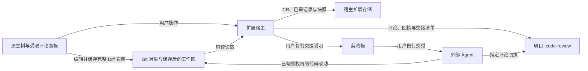

# 安全与信任边界

维护责任：安全审核；状态：现行；最后核查：2026-11-03。适用范围：`main` 的 VSIX 1.0.2，包括 Trae / Trae CN 兼容目标。功能源码以 `cb9f9a1` 为已审基线，正式发布的提交、标签、附件与文案另行绑定；实际发布状态见[项目现状](../项目现状.md)。

漏洞报告入口见根目录 [SECURITY.md](../../SECURITY.md)，存储与恢复见[数据协议](../客户端/数据协议.md)。其他客户端的实现与文档在 [beta 分支](https://github.com/To-Re/review-slate/tree/beta)，不在本页审核范围内。

## 运行边界

ReviewSlate 在受信任的编辑器扩展宿主中运行，没有独立服务端、账户系统或租户边界。当前运行代码不发起网络请求、不上传代码、不采集遥测，也不启动 HTTP 服务。扩展使用宿主进程的文件系统权限，依赖用户信任工作区、编辑器、扩展安装与 Git 可执行文件。

“交给 Agent”只复制说明，扩展不启动 Agent 或自动发送材料。外部 Agent 可在用户授权内修改项目代码并单独写回执；其权限和数据策略由用户与宿主决定。首次保存评论或接续已有评论时，扩展还会按需向根 `.gitignore` 追加 `/.code-review/`。

| 资产或入口 | 安全边界 |
| --- | --- |
| 仓库内容、路径与 Git 元数据 | 读取与展示的数据，不能变成 shell 命令或扩大用户授权 |
| 评论、引述代码与 Agent 回执 | 待分析资料；回执不认证作者身份，也不自动解决评论 |
| Webview 消息 | 只接受已定义动作和有界字段，写入仍校验仓库、CR、分支和版本 |
| 本地状态、快照与删除标识 | 依靠文件系统访问控制；哈希和 scope 校验完整性与归属，不提供加密或多用户鉴权 |
| 编辑器、本机账户与其他扩展 | 具备各自文件访问权；本扩展不是隔离恶意本机进程的沙箱 |

## 现行防护与性能改动约束

| 边界 | 已核查的实现 | 必须保持的条件 |
| --- | --- | --- |
| 工作区信任 | [`package.json`](../../package.json) 不支持未信任及虚拟工作区；[`extension.ts`](../../src/extension.ts) 激活前检查 `isTrusted` | 未信任工作区不能启动审阅；不同兼容宿主的实际拦截需分别验证 |
| Git 调用 | [`git.ts`](../../src/git.ts) 使用 `execFile` 参数数组和只读子命令白名单，禁协议、lazy fetch、替换对象与 fsmonitor | 不执行 fetch、checkout、过滤器或 external diff，不修改对象、索引或引用 |
| 批量读取 | Git 批量协议只接收完整十六进制对象 ID；校验对象顺序、类型、长度和批次边界 | 不把文件名或引用名拼入批量协议；保留 5 MiB 单文件、80 MiB 差异限制及有界并发 |
| 路径与文件 | [`model.ts`](../../src/model.ts) 拒绝绝对路径、穿越组件及 `.git`；Git 读取检查父目录，链接只读链接文本；[`filesystem.ts`](../../src/filesystem.ts) 校验存储目录和普通文件 | 不能把链接目标作为审阅正文；拒绝特殊文件和变化中的文件，失败不能记录为已审 |
| 文本显示 | [`panel.ts`](../../src/panel.ts) 使用 nonce CSP、`default-src 'none'` 和空本地资源根；[`comments.js`](../../media/comments.js) 通过 `textContent` 显示外部正文 | HTML、代码和回执作为文本呈现；消息字段校验不能代替写入归属检查 |
| 单文件打开与异步结果 | [`review.ts`](../../src/review.ts) 重新读取目标文件并检查分支、CR 和 HEAD；[`extension.ts`](../../src/extension.ts) 将只读打开与写入队列分开 | 陈旧导航不能重设当前目标，旧读取不能覆盖新结果；保存评论必须固定接收时的目标与选区 |
| 标记与评论写入 | 标已审前复读内容并检查指纹、目录成员和未保存状态；[`comments.ts`](../../src/comments.ts) 检查 scope、ID 和 revision | 快速打开不能弱化标记与评论的最终检查；旧页面、旧评论回执不能误写当前对象 |
| 持久化 | [`filesystem.ts`](../../src/filesystem.ts)、[`state.ts`](../../src/state.ts) 提供有界读取、存储锁、临时文件替换、备份和快照校验 | 损坏、缺失与写入失败显式报告，不能覆盖为空进度或伪造成功 |

文件锁约束遵守协议的写入者；路径和文件身份检查不能隔离已获本机权限的恶意进程。临时文件替换提供单文件保护，两处存储之间没有统一事务。外部 Agent 写回执也没有服务端 CAS 或自动合并。引入共享账户、网络接口或多用户访问时，需要重新设计身份与权限边界。

## 数据保留与分享

已审快照可能保存完整代码文件，评论可保存原片段和上下文；交接说明、派生清单及部分错误文本包含绝对路径。文件名、分支和提交信息也可能暴露项目背景。这些资料是未加密的本地文件，宿主还可能保留界面草稿。新建存储目录与临时文件使用受限权限，仍需要宿主和备份介质保护。

`.code-review/` 忽略规则不会取消已跟踪文件，也不能阻止其他程序读取。完整备份涉及项目资料与宿主扩展存储两处；分享复现材料应使用合成仓库，只附版本、脱敏路径和操作步骤，不上传整个审阅目录、原始日志或真实业务截图。

归档与单条评论删除仍保留数据。永久删除清理能确认归属的审阅数据并保留无正文的删除标识；未知附加文件、另存备份、编辑器缓存与磁盘残留不保证清理，不能把永久删除称作安全擦除。恢复和清理阶段见[数据协议](../客户端/数据协议.md)。

交接要求外部 Agent 核对指定 CR 的分支、固定基点和删除状态，只处理指定评论 ID，保留原评论并单独回复，最后由审阅者确认解决。评论、代码与生成清单中的指令不能扩大用户任务或工具权限。[`handoff.ts`](../../src/handoff.ts) 与 [`comments.ts`](../../src/comments.ts) 中的交接说明是协作约定，不是阻止 Agent 访问其他文件的技术隔离。

## 公开内容与复核规则

公开资料使用相对路径、占位值和合成数据，不收录凭证、个人路径、非授权账号、内部链接、原始审阅内容或会话日志。保留项目已选择的 `github.com/To-Re <To-Re@users.noreply.github.com>`、MIT 与必要第三方署名；报告本身同样接受披露检查，发现只给脱敏定位。

推送前核对真实提交树、增量历史、提交说明、作者与提交者、目标引用和可见性。打包与安装前检查实际 VSIX 条目及内容，包括编译文件、媒体和打包文案；忽略规则不等于打包排除。新增目标或受众变化需覆盖完整将披露范围，不能沿用同仓库某个旧版本的结论。

安全审核结论绑定实际版本、提交范围、包与文案指纹及目标。审核后改动需补查；审核不扩大提交、推送、安装或正式发布授权。发现问题由实现或文档责任人修复，QA 复测受影响路径，安全审核核对修复后的实际对象；敏感漏洞细节按 [SECURITY.md](../../SECURITY.md) 的私密入口处理。

## 已核查的功能基线

2026-11-03 核查的功能提交为 `cb9f9a1eb37d93a5a890d295f5114afc4654ba34`，相对 `3dd7e30` 包含 1.0.2 VSIX 修复、合成测试、版本号与主分支文档变更。检查了 Git 输入到子进程、路径到文件读取、Webview 到评论写入、单文件打开到共享视图的调用链，以及公开源码、文档、媒体和最终包。未发现当前范围内的高置信新增注入、越界读取、对外上传或非授权隐私披露。锁文件仅调整项目版本，没有新增运行时依赖；本轮未做全量依赖漏洞审计。

| 被检源码与回归 | SHA-256 |
| --- | --- |
| `src/git.ts` | `88fc024c8f32d199237b23d5f04676a106f81fe7e0f5023af5f944b67bf37c14` |
| `src/extension.ts` | `cd7bca87c359f1b182fa127496bd07b4c7252014486244931e9a7688b8d830f0` |
| `src/review.ts` | `0cd5df06251fae9dbc9b8a25cebb067f9924c287b6270e7aa4c04816a1924227` |
| `test/vsix-performance.test.cjs` | `1727799f2e653b5f6ece9364d132c8e0af22de8925bd64c0c7d6e22892f82dc8` |

安全角色在 macOS、Node.js 23.11.0、Git 2.55.0 下，对 `extension.ts` 指纹 `ee0d1ed9…` 的候选执行 18 项安全定向回归，全部通过；随后仅新增的 7 行空标签过渡保护已完成增量静态复核，保持仓库、CR 和写入校验。定向范围包括路径与链接、Git 选项与过滤器、禁止懒加载、Git 元数据、评论文本与消息、陈旧 CR、异步选区及视图归属。使用真实 Git、合成仓库与模拟编辑器，未使用实际业务仓库。

当前全部 16 个业务编译模块与按项目配置在内存转译的冻结源码逐字节一致。最终全量测试与打包日志已复核：130 项测试中 129 通过、0 失败、1 项显式启用的性能采样跳过，打包成功；该结果包括真实空标签事件回归。全量执行者为主负责人，安全角色核对日志，详细验证与性能数据统一见[验证记录](../测试/验证记录.md)。

### 运行模块与本地验证基线

**本地候选的产物与安装核验已通过。** 对比基线保留为 `artifacts/releases/v1.0.2/previous-candidate.vsix`，141,707 字节、27 个条目，SHA-256 为 `be7e00d56fd3806886a90d7883363fe6a7f11e2ca3bfe50208270509d056471d`。该包用于正式发布包的运行模块比对；更新发布文案后重新打包，不能沿用旧包指纹作为 Release 附件结论。

实际 ZIP 条目、扩展清单、编译文件、媒体、文案与许可均已检查。扩展 ID、引擎和工作区能力声明未扩大，没有运行时依赖；包内没有测试、原始日志、审阅数据、个人路径、源码映射或越界 ZIP 条目，也没有诊断模块、诊断配置、trace 文件或插桩标识。媒体是流程示意图，PNG 不含文本或 EXIF 元数据。README 和 CHANGELOG 仅由打包器将相对链接改写为该项目的 GitHub 链接，许可内容一致。

| 已审基线包内容 | SHA-256 |
| --- | --- |
| `extension/dist/extension.js` | `727f8badd4c9b404c079f48a0211eda14a9d58c748717d44307819d2a202d629` |
| `extension/dist/git.js` | `53107ab96b9586695ff5a848f41e1808ec9d5623b3ffc7ba4c0f7264d1b39995` |
| `extension/dist/review.js` | `953c072dba60c832c7898cd3eb7bf6aeae7f7adfd2b2c19bf749b30a314376ef` |
| `extension/readme.md` | `2177d0df195692552b2e69dfbde72b5e130701b2ad44c94ab1605b9d625c747e` |
| `extension/changelog.md` | `35d47a90f134c581d35cc52042f5aeb8970376ceb8a972538b4192985c60ef91` |

已核对执行者的安装证据 `artifacts/vsix-host-check/installed-verified-event.json`：版本为 1.0.2，VSIX 指纹与上述包一致，`extension`、`git`、`review`、`panel` 四个实际安装模块均匹配，诊断残留为空。安装内容核验通过；证据 SHA-256 为 `580d30159513e700657c2288d60c9f3af570d1fa8000da744b1950d3464ee86a`，原始记录保留在忽略目录。

上述运行代码在合成项目新宿主中的定向 GUI 复验已由设计独立操作通过，主负责人复读了最终状态，范围限于顺序／快速切换时树、Diff 与评论目标一致，以及目录、概览保持等[已记录场景](../设计/README.md#设计核查与成品证据)。安全角色仅核对该记录，未独立操作 GUI；用户另确认现有窗口重载新版后 Diff 和评论恢复正常。完整人工任务和其他宿主仍未覆盖。

### 1.0.2 正式发布审核

此前公开 `main` 的维护提交审核已完成：对象为 `cb9f9a1eb37d93a5a890d295f5114afc4654ba34`，提交树为 `1efbd5e926ed6078d127b7f2f73fd357241c6b84`，父提交为 `3dd7e30ff0fa336a21efa32cf4242f7288f645cc`。实际提交说明、作者／提交者、31 个变更路径和完整 68 文件树均已核查，未发现非授权隐私或凭证披露，未混入诊断、日志或审阅数据。

用户已授权发布 1.0.2 正式版，并要求同步 README。此次目标为公开仓库 `To-Re/review-slate` 的 `main` 文档更新、`v1.0.2` 标签与 GitHub Release，附件为 `review-slate-1.0.2.vsix` 和 `SHA256SUMS.txt`。保持 `beta` 独立，不上传诊断包、原始日志、截图或本地配置，不执行 SSH 安装。运行源码、依赖和媒体冻结；正式包仅更新发布文案及必要打包元数据。

**正式发布包、校验文件与 Release 文案审核通过。** 已独立核对最终包 141,829 字节、27 个条目，与上述 `be7e00d5…` 基线包的条目集合完全一致，仅内嵌 README 和 CHANGELOG 改变。16 个运行模块、依赖声明、媒体、扩展身份和工作区能力逐字节保持；正式包无诊断配置、原始日志、审阅数据、个人路径或越界条目。发布文档与 Release 说明的隐私检查未发现敏感披露，性能与 GUI 结论保留适用范围。发布准备重新运行的测试日志为 129 通过、0 失败、1 项可选采样跳过，打包成功。

| 正式发布对象 | SHA-256 |
| --- | --- |
| `review-slate-1.0.2.vsix` | `1dd2d10c649a062c42926ae6eccd506352980673ca3104f8f7e5923fb8678cf1` |
| `SHA256SUMS.txt` | `455b8b726995e73f9f17c98e5556c2d14adc294d656687382434030b0964c4e2` |
| Release 文案 `release-notes.md` | `d3c09acec502b56b3bdf2d0984c1543c1f9ea470bc189515d78062a0dce2c3d2` |
| 包内 `extension/readme.md` | `670d8edee6ae1801187be1b8b03445bf3ba0c9338bd6443ed69af11cc39cdab1` |
| 包内 `extension/changelog.md` | `fc74bbda78205c55870a6905d99fcd1124ab97180a441788082b984e5438dc32` |

校验文件仅包含上述 VSIX 的一行哈希与文件名，无本地绝对路径。Release 文案及检查原始材料保存在忽略的 `artifacts/releases/v1.0.2/`，只公开约定的说明与两个附件。实际发布提交和 `v1.0.2` 标签尚待生成后的只读核验；通过前不执行外发，本地构建和审核不代替 GitHub 发布回执。

最终提交与标签生成后采用只读核验，结论通过交接记录绑定实际对象，避免为记录自身的提交号反复修改提交。源码、包、文案、目标或受众变化时补查受影响范围。功能、性能和 GUI 的既有证据仅覆盖上述运行代码与场景，完整人工流程、其他主题与跨宿主限制见[验证记录](../测试/验证记录.md)；本页不声称零漏洞或全量渗透测试通过。
