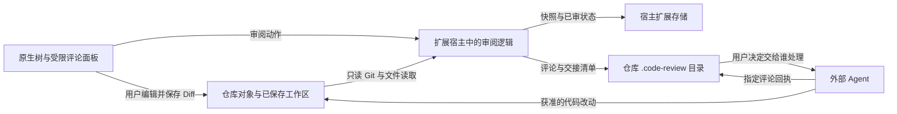

# 安全与信任边界

维护责任：安全审核；状态：现行；最后核查：2026-11-03。适用范围：VSIX 1.0.1 的既有边界、Codex 本地候选实现与包，以及 `beta` 源码公开审核。0.1.2 本地更新的审核与指纹保留在下文，不能代替源码披露检查。**本次 beta 源码内容审核通过，未发现高置信披露阻断项；执行绑定见文末。** 真实 Codex 整体验收仍未完成，本结论不覆盖 Codex 安装包公开分发或正式 Release。

用户报告漏洞请从根目录 [SECURITY.md](../../SECURITY.md) 进入。存储格式、备份和恢复以[数据协议](../客户端/数据协议.md)为准；本文维护信任前提、防护能力及其限制，不重复定义协议。

## 运行环境与数据流

ReviewSlate 的 VSIX 运行在编辑器扩展宿主中，没有独立服务端、账户系统或租户边界。扩展不发起网络请求、不上传代码、不采集遥测，也不启动 HTTP 服务。它使用宿主进程的文件系统权限；安全前提是用户信任工作区、编辑器、扩展安装和所使用的 Git 可执行文件。Codex 候选改为宿主管理的 stdio 子进程和 MCP App，其额外边界见下文。

扩展还会按需向根 `.gitignore` 追加 `/.code-review/`。图中的 Agent 是用户选择的外部执行者：“交给 Agent”只复制说明，不启动 Agent 或自动发送材料。宿主、其他扩展及接收材料的 Agent 有各自的数据策略，扩展的本地运行行为不能约束它们。

| 对象或入口 | 信任边界 |
| --- | --- |
| 编辑器与本机账户 | 拥有实际文件访问权；扩展不是对其他本机进程的沙箱 |
| 仓库内容、文件名、Git 元数据 | 读取和展示的数据；不因来自用户打开的仓库而成为命令或额外授权 |
| 评论、引述代码与 Agent 回执 | 需要校验归属和版本的数据；回执不证明作者身份，也不代表问题已解决 |
| Webview 消息 | 只接受已知动作和有界字段，敏感写入还要经过服务层校验；不能把 UI 中的可见状态当作最终事实 |
| 本地 JSON、快照与删除标识 | 依赖文件系统访问控制；哈希校验和 scope 用于完整性与归属，不提供加密或多用户鉴权 |

## VSIX 与共享引擎提供的防护

以下是已有 VSIX 与共享引擎的防护。本轮追踪了 Codex 到这些模块的调用和四个共享模块差异；没有以旧版测试代替新适配器验收。原 VSIX 的完整测试执行由 [QA 记录](../测试/验证记录.md)说明，本审核者实际执行的定向验证另列于下文。

| 边界 | 当前实现与来源 | 复核重点 |
| --- | --- | --- |
| 工作区信任 | [`package.json`](../../package.json) 声明不支持未受信任及虚拟工作区；[`extension.ts`](../../src/extension.ts) 激活前检查 `isTrusted` | 宿主拒绝未信任工作区时不能开始审阅；不把其他宿主的权限语义直接套用过来 |
| Git 与进程调用 | [`git.ts`](../../src/git.ts) 以 `execFile` 传参数，子命令白名单只读；禁止协议、lazy fetch、替换对象和 fsmonitor，不执行仓库过滤器或 external diff | 特殊引用名不能变成选项；缺失对象不能隐式联网或写 Git 对象、索引及引用 |
| 路径与文件读取 | [`model.ts`](../../src/model.ts) 拒绝绝对路径、穿越组件及 `.git`；[`git.ts`](../../src/git.ts) 检查父目录，符号链接只读链接文本；[`filesystem.ts`](../../src/filesystem.ts) 检查存储目录与普通文件 | 越界路径、符号链接、特殊文件、变化中的文件应被拒绝或明确报错，不能读出链接目标作为审阅正文 |
| 评论显示与消息 | [`panel.ts`](../../src/panel.ts) 使用 nonce CSP、`default-src 'none'` 和空本地资源根；[`comments.js`](../../media/comments.js) 用 `textContent` 展示外部正文 | HTML、代码和回执应作为文本显示；未知动作、超长字段和陈旧页面不能越过服务层写入 |
| CR 与内容归属 | [`review.ts`](../../src/review.ts)、[`extension.ts`](../../src/extension.ts) 检查当前仓库、CR、分支、内容指纹及未保存状态；[`comments.ts`](../../src/comments.ts) 校验 scope、ID 和 revision | 切分支、切 CR、内容变化和旧页面重试不能误写当前对象；旧回执不能标记新评论已处理 |
| 持久化与失败 | [`filesystem.ts`](../../src/filesystem.ts)、[`state.ts`](../../src/state.ts) 实现有界读取、存储锁、临时文件替换、备份与快照校验 | 损坏、缺失和写入失败不能变成空数据或已审成功；删除中断按已持久化阶段恢复或继续清理 |

现有相关回归入口包括 [`review.test.cjs`](../../test/review.test.cjs)、[`editable.test.cjs`](../../test/editable.test.cjs)、[`comments.test.cjs`](../../test/comments.test.cjs)、[`panel.test.cjs`](../../test/panel.test.cjs)、[`editor.test.cjs`](../../test/editor.test.cjs)、[`purge.test.cjs`](../../test/purge.test.cjs) 和 [`pending-size.test.cjs`](../../test/pending-size.test.cjs)。新增适配器必须复核自己到这些边界的调用路径，不能只因复用了一部分核心就沿用全部结论。

文件锁只约束遵守协议的写入者，文件身份检查也不构成对恶意本机进程的隔离。临时文件替换提供单文件保护，两处存储之间没有统一事务；外部 Agent 的回执写入没有服务端 CAS 或自动合并。实际部署若引入共享账户、网络接口或多用户访问，必须重新设计身份与权限边界。

## 敏感数据的产生、保留与分享

已审快照可能保存完整代码文件；评论可包含原片段和上下文；交接说明、派生清单和部分错误信息含绝对路径。CR 分支、提交和文件名也可能暴露项目背景。这些内容以普通本地文件保存，未加密；宿主还可能保存界面草稿。新建存储目录和临时文件使用受限权限，但不代替宿主及备份介质的访问控制。

`.code-review/` 的忽略规则仅降低误提交概率，不会取消已跟踪内容，也不限制其他程序读取。完整备份需要宿主扩展存储与仓库 `.code-review/` 的对应数据，不能把评论目录当作全部进度。对外提供复现材料时使用合成仓库；只附必要版本、脱敏路径和操作步骤，不上传整个审阅目录或原始日志。

归档与单条评论删除仍保留数据；永久删除清理可确认归属的审阅数据并保留无正文的删除标识。用户另存备份、编辑器缓存、未知附加文件和磁盘残留不保证被清理，永久删除不是安全擦除。清理与恢复的具体阶段及失败条件见[数据协议](../客户端/数据协议.md#归档评论删除与永久删除)。

## Agent 交接

当前交接协议要求先核对指定 CR 的分支、固定基点和删除状态，只处理其中的评论 ID，保留原评论并单独写回执，最终由审阅者确认解决。评论、引述代码、文件内容及生成清单中的正文都属于待分析材料，不能改变用户任务或扩大工具权限。原始评论和 JSON 即使可由本机读取，也不自动属于当前任务。

这些要求写在 [`handoff.ts`](../../src/handoff.ts) 和 [`comments.ts`](../../src/comments.ts) 的交接说明中，是协作约定。扩展不会替外部 Agent 执行权限检查，也不能阻止已获本机访问权的程序修改原评论或读取其他文件；不能把交接提示词宣传为技术隔离。

Codex 的实现保存固定批次清单，包含评论 ID 与 revision，再生成供用户复制的说明；页面没有调用消息发送或 Agent 执行接口。回执仍需人工复核，不自动解决评论。所谓固定批次是应用不主动改写原批次，不是防止本机账户篡改的签名或不可变存储。

## Codex 候选的权限与数据边界

已审核范围为 `src/codex/`、`web/codex/`，共享模块 `comments.ts`、`git.ts`、`ignore.ts`、`review.ts` 的差异，以及 `plugins/codex/`、Codex 构建与运行时准备脚本、独立测试宿主、依赖清单和候选包。实现入口见[客户端方案](../客户端/Codex客户端方案.md)。

| 边界 | 当前候选实现与限制 |
| --- | --- |
| 模型与应用 | `reviewslate_open` 只返回固定说明；其余工具声明 `visibility: ['app']`。路径、代码、评论、草稿和 capability 只放 `_meta.reviewslate`，不放 `content` 或 `structuredContent`。这证明服务器输出结构，真实 Codex 是否执行可见性与模型隔离仍未验收 |
| 仓库访问 | bootstrap 生成随机 capability 和 view ID，请求必须匹配；页面选择仓库后记录当前客户端的 workspace ID。`roots: false`，手动路径经 Git 和 realpath 确定根目录。该机制不是操作系统沙箱，权限仍取决于宿主进程；不能宣称只访问宿主预先授权的 roots |
| 系统目录选择 | 0.1.1 由页面明确点击启动包内短暂 AppKit helper；页面只提交选择 ID 和语言，不能指定可执行文件。选择结果留在内存并经 `_meta` 返回，后续仍走 `openWorkspace` 校验。取消、失联租约与退出负责回收 helper；详见本轮复核 |
| 输入与写入 | 严格动作 schema、相对路径校验、CR／分支／基点／版本检查和操作 ID 约束；没有任意 shell、任意文件写入或源码编辑工具，`editCode: false`。Git 仍走只读参数调用；回执每次读写先从仓库根验证目录组件，修复证据见 SEC-CODEX-01 |
| UI 与外部正文 | 消息仅接受嵌入父窗口来源；正文通过文本节点和只读 CodeMirror 展示。包内脚本哈希 CSP、无外部资源域和 `connect-src 'none'`；没有 HTML 渲染评论、自动发送交接或模型上下文更新调用 |
| 存储 | 仓库资料位于 `.reviewslate/codex/`，应用偏好另存于应用数据目录；后者包含最近仓库绝对路径。草稿、快照、评论和交接可含代码，普通本地文件未加密。忽略规则不撤销已跟踪资料，不阻止其他程序读取 |
| 并发读取与草稿 | 0.1.2 的 Diff 独立读取指定 CR 的内容与评论，并在返回前重验分支／CR／基点；后台 refresh 只读且不占工作区写锁。草稿保存绕过扫描队列，但继续持有工作区写锁，检查归属、视图 revision／sequence，并写入原有幂等回执。界面是否可点击不替代这些服务端检查 |
| 进程与网络 | 正式入口为宿主管理的 stdio，无 HTTP 监听代码；页面和审阅实现没有自建网络请求。运行时下载只在明确执行准备脚本时从固定 Node 官方 URL 发生。依赖中存在通用网络能力，不等于被该入口调用；本轮没有做真实 Codex 网络流量观测 |

### SEC-CODEX-01：旧操作重试可跟随回执父目录符号链接

状态：**已修复，独立复验通过**。原严重程度：中（P2）；原问题与修复证据置信度：高。位置：[`controller.ts`](../../src/codex/controller.ts) 的 `receipt()`、`saveReceipt()` 与 `mutate()`。修复版源码 SHA-256 为 `7a481badddb0ee902208c89bfe8dbd5d751d3f26b0948661e7db6a736d687599`。

旧候选的 `receipt()` 直接读取 `operations/<ID>.json`，没有先验证 `operations` 是普通目录；`mutate()` 对既有 pending 回执确认操作已应用后，直接调用 `saveJson()` 写回。底层 `O_NOFOLLOW` 只保护最后一个路径组件，无法阻止父目录链接。新操作路径稍后才执行的目录校验没有覆盖此分支。原复现绑定候选 manifest `0def7ca0a401198d9b0afe36c9937d7e87ee0684e844b1796055160f6562e44d`。

受控复现只使用临时合成仓库：让评论正常落盘，连续注入提交回执的 rename 失败，得到 unknown 结果和 pending 回执；将 `operations` 换成指向仓库外合成回执目录的链接；重试同一请求。实际结果为重试成功，外部同 ID JSON 从 pending 改为 committed，并写入外部 `.bak`。不需要竞争时序。前提是仓库数据目录可被本地写入者替换，且存在可重试的已应用操作；已验证影响是特定回执文件越过存储边界写入，不是任意代码执行。

修复已落实：`receipt()` 与统一的 `saveReceipt()` 每次从仓库根检查 `.reviewslate/codex/operations` 的目录组件，所有旧回执确认、成功、失败写回均改走该入口。未知 pending 操作遇到坏路径仍保留未知结果与原路由，不错误落成已拒绝；连接重建也不转移原 view 归属。

安全审核重新隔离编译，并确认编译结果与回归实际加载的 controller、storage、validation、contract、filesystem、review 模块逐字节一致后，执行 `recovery.test.cjs` 中 `security:`、`CR-01:` 和两个 `CR-02:` 场景，共 4 项通过。原故障注入路径再次得到 unknown；替换父目录后查询和重试均失败，外部目录逐字节不变；移除链接并恢复原目录后重试成功，评论没有重复。补验也确认原视图归属保留、跨分支／CR 的显式草稿保留，以及归档 CR 拒绝草稿保留。检查只证明本次路径防护，仍不把应用文件锁视为对恶意同账户进程的完整隔离。

### 0.1.0 基线的实际验证与候选指纹

环境为 macOS arm64；隔离编译后只使用临时合成仓库和应用数据，没有安装、更改真实用户配置或测试业务仓库。以下为原实现核查与修复阶段已实际执行的证据；最终视觉候选另列于后文，不把历史测试直接改称最终包测试。

- **通过**：`qa-stdio.test.cjs` 两项，核对 app-only 声明、模型可见正文不含合成私有数据、EOF 退出、新进程恢复和跨进程评论竞争。
- **通过**：`qa-integration.test.cjs` 的 AC-01/03/12、AC-10、AC-13、AC-14/15 四项，覆盖仓库／CR 隔离、固定交接、人工复核、永久删除、VSIX 数据隔离、存储链接与损坏偏好。
- **通过**：独立合成输入验证错误 capability／view、未选择仓库、绝对路径、穿越、`.git`、工具目录目标，以及工作区叶子和父目录链接不读出外部合成秘密。
- **旧候选失败、修复版通过**：SEC-CODEX-01 的未知结果重试；4 项修复定向验证见上文。首次检查的常规链接用例没有覆盖该恢复分支，不能用其历史通过代替复验。
- **通过（仅候选内容核对）**：30 个相关源码／配置文件和包文本未发现个人路径、凭证或内部域名候选；手动检查清单、启动器及构建来源，包无符号链接。不能把扫描无命中解释为完整公开披露审核。

本次还静态复核 `mcp.json` 的包内相对命令、启动器和新增 `check-codex-package.cjs`。标准根清单使用 `./bin/launch.sh` 与包根 cwd；启动器仍检查 Darwin，执行包内 Node，清理 Node 注入环境和固定 PATH。移除 `uname -m` 拒绝条件没有增加执行入口；实际二进制经 `file` 核对为 arm64 Mach-O。本审核者没有独立验证 Rosetta 或其他架构机器上的启动。

**通过**：独立执行 `npm run check:codex-package`，核对包内文件摘要、搬移至含空格路径后的包内 Node 启动、11 个工具及 UI 资源、app-only／`_meta` 输出结构、真实合成 Git 的 CR／评论／已审保存、英文偏好和新进程恢复。检查脚本 SHA-256 为 `7a704904e82e04593da1f0ac0536d98b3e7af1fa0bdb9a8167649011d0b99d66`。另独立核对 ZIP 的 29 个文件与候选目录清单及字节完全一致，无符号链接；包文本隐私候选扫描无命中。

### 0.1.0 最终视觉候选补查

相对前次候选 manifest `4a9b10f4d0f95670be736b8eec8dd671f748faf5968da5cfffb99634c42758c5`，本次重新检查 `web/codex/` 的 app、store、bridge、diff、model、CSS、静态 SVG 图标和新增 clipboard 帮助函数，以及构建器的插件版本注入。回执缺陷修复的 controller 指纹保持不变。

仓库名、路径、Git 元数据、评论、回执、选区和导出草稿仍写入文本节点或输入框 value；图标只使用代码内固定的 SVG path，没有动态 HTML、外部图标引用或远程资源。仓库切换与设置仍使用原工具契约，最近记录不增加访问权限。复制失败展示只读 input 供手动复制完整 SHA，交接与草稿导出展示只读 textarea；没有自动下载、消息发送或 Agent 执行。直接编辑保持关闭。恢复后的 `rebindWorkspace()` 会核对仓库、CR、基点、分支与 context，确认后才保留后续输入。

本次独立执行结果：

- **通过**：最终包的 `npm run check:codex-package`，覆盖前述搬移、真实合成 Git、工具／资源、数据保存和新进程恢复。
- **通过**：`ui.test.cjs` 中剪贴板拒绝、语言失败保留、仓库切换、未知操作查询／不自动重放、父窗口消息来源与超时的 7 项定向测试；均为无 GUI 的逻辑验证。
- **通过**：最终 HTML 只有一个内联脚本，其实际 SHA-256 与 CSP 完全匹配，仍为 `connect-src 'none'`。构建版本常量已消除，包内 `appInfo.version` 与插件版本同为 `0.1.0`。
- **通过**：最终 ZIP 的 29 个文件与 manifest 及解压目录逐字节一致，无额外文件和符号链接，启动器与 Node 的执行位保留；源码哈希、产物哈希均匹配。最终包文本未检出个人路径、凭证或内部域名候选。

此次没有启动或控制测试宿主 GUI。视觉、真实交互与实际安装结果由 QA、设计和集成负责人维护，不能由静态补查代替。

候选包为本地 `artifacts/reviewslate-codex-0.1.0-darwin-arm64.zip`，未公开发布。以下哈希绑定本次已授权本地安装前检查的最终视觉候选，**不覆盖其后的任何源码、产物或清单修改**：

| 对象 | SHA-256 |
| --- | --- |
| `build-manifest.json` | `0e1154f13a40604c08f78ff86d549ba9f1b959bb8d93f506a014095d19f63815` |
| Codex 0.1.0 候选 ZIP | `6c908a5648007b3f4afbb93c6b8f4addfb895c1f5ec381014bda856cc84b1458` |
| Node 22.23.4 darwin-arm64 归档 | `c9e1dbc748b33ed2d14f42445191ecaf14c56259c7a9a26d0042c49ec2b66428` |

前次未覆盖的 store 改动现已纳入本候选；其 SHA-256 为 `70398af311ea3a80792461eb69166c5ae47e4eeb1a5be179c2594001f13c2ce3`，全部构建来源以本次 manifest 的 `sourceHashes` 为准。包内 Node 二进制与 LICENSE 逐字节对应固定归档，归档摘要此前已独立读取 [Node 官方 SHA-256 清单](https://nodejs.org/dist/v22.23.4/SHASUMS256.txt)核对。20 个实际捆绑依赖的版本、许可声明和许可文本与本地锁定依赖一致，涵盖 MIT、ISC 与 BSD-3-Clause，Node 完整通知另行保留。许可证存在和摘要匹配不代表已完成全量依赖漏洞审计。

**未完成**：真实 Codex 的 app-only、`_meta`、界面操作、仓库授权和生命周期验收；系统隔离行为；完整依赖公告适用性审计。独立测试宿主的源码已静态检查，本审核者没有运行其 GUI。隔离 CLI 安装和工具发现由集成负责人及 QA 单独维护，本页只记录本审核者实际执行的直接 stdio 包验证，不替代真实宿主验收、产品交付或公开发布结论。

客户端研发统一负责本地逻辑、Git、存储、桥接和宿主生命周期；QA 验证实际候选版本，安全审核复核修复及相同版本的产物。当前没有独立后端服务或相应部署责任。

### 0.1.1 系统目录选择与品牌包复核

结论：**通过本次已授权本地安装的安全门槛；无新增高置信安全发现。** 审核日期为 2026-11-03，审核者为独立 security_reviewer，环境为 macOS arm64。目标是同一用户本机安装的私有候选，不包含公开上传或推送。增量基线为上文已核对的 0.1.0 ZIP；本轮覆盖 `native/codex-folder-picker/`、picker 到 controller／server／schema 的调用链、UI／store 生命周期、品牌资源、插件清单、构建与包检查脚本，以及实际 0.1.1 ZIP。CR-06／CR-07 修复后的源码已纳入冻结包，完整源码快照以该包 `sourceHashes` 为准。

目录选择的边界已核对如下：

- **执行与输入**：helper 用绝对路径及 `spawn(..., { shell: false })` 启动，参数只包含受限语言、超时和服务端派生的初始目录；页面 schema 不接受命令或可执行文件。helper 文件及父目录链接经 `lstat`／`realpath` 拒绝。构造选项和 `REVIEW_SLATE_FOLDER_PICKER` 属于可信启动配置，拥有修改该环境或包文件能力的本机程序仍可替换执行内容，不能据此宣称操作系统隔离。
- **环境与结果**：子进程明确设置 PATH、LANG，并保留启动环境中的 HOME、TMPDIR；不透传其他父进程环境。stdout 限制为 16 KiB，目录限 4096 字符、绝对路径且无 NUL；异常输出不打开仓库。选择阶段不对用户卷做目录 `stat`，返回后仍经现有 Git／realpath 校验；文件路径、非仓库或失效目录不能因选择成功获得仓库授权。目录可能通过进程参数对本机同账户程序可见，不作为隐藏路径的机制。
- **归属与生命周期**：capability 与 view 先验证；选择记录由其 owner 隔离，同 ID 重试不重复启动，其他视图不能查询或取消。picker 请求独立于业务队列，避免慢 Git／保存阻断续租；取消和关闭使晚到结果失效。120 秒总超时、15 秒无查询租约及关闭回收限制 helper 生命周期，先 SIGTERM，再按需 SIGKILL 并等待退出。选择与取消不写操作回执或最近项目，不改变现有草稿／保存未知态。
- **native lock**：静态核对固定的用户临时目录 lock 使用 `O_NOFOLLOW`，并检查普通文件、当前 UID 与单一硬链接，再用非阻塞 `flock`。文件不保存选择内容，允许留下空 lock 文件；进程退出释放锁。该锁用于协作互斥，不隔离恶意同账户进程；本轮未自动启动真实 AppKit 窗口测试 lock 或系统面板行为。
- **模型与外发**：新增工具仍声明 app-only；成功路径、错误细节和 capability 仅在 `_meta.reviewslate`，模型可见正文是固定说明。UI 以文本节点显示选中路径，无新增消息发送、网络入口或自动 Agent 执行。真实 Codex 是否强制 app-only 和 `_meta` 隔离仍须宿主验收，页面“明确点击”与工具说明本身不是宿主技术授权证明。

本审核者在原 0.1.1 候选（manifest `e1babff36a2a10a84cfcc0cdaedbfd6257962e0b3e7a1bd99889d8e3b8a499cb`、ZIP `88d24a0e0abcf3bee030cc5dc5f60aa8564a99789a60077344f4669dd086cf86`）实际执行以下验证。随后 native 退出条件修正的增量复核另列于表后；不把原包测试改称新包测试。

| 检查 | 结果与证据边界 |
| --- | --- |
| 独立编译与回归版本核对 | 隔离目录编译通过，全部生成 JS 与测试加载的 `dist/` 逐字节一致；未修改业务实现 |
| `node --test test/codex/folder-picker.test.cjs` | 10 项通过；合成子进程覆盖幂等、跨视图拒绝、取消先到、用户卷无 `stat`、租约／超时、关闭、Git 子目录校验、业务队列绕过、异常结果与 stdio EOF 回收 |
| `node --test test/codex/ui-picker.test.cjs` | 10 项通过；覆盖取消／页面关闭／手动导航丢弃晚到结果、连接中断显式接续，以及审阅状态不受 picker 失败影响；属于无 GUI 逻辑测试 |
| 独立受控补验 | 元字符与中文目录作为单一参数原样传递；合成环境标记和 NODE_OPTIONS 未传入子进程；忽略 SIGTERM 的合成 helper 被强制回收；availability 等待期间取消不启动；错误 capability／view／workspace 和额外 executable／非法 locale 均拒绝 |
| 原候选包真实 stdio 补验 | 合成 helper 返回选中目录后，路径与 capability 仅在 `_meta`，`content` 无该数据且没有 `structuredContent`；选择没有创建应用数据目录 |
| `npm run check:codex-package` | 通过；搬移到含空格目录后发现 helper、校验签名与版本，12 个工具声明正确，真实合成 Git 的评论／已审／语言保存和新进程恢复通过；不安装插件或启动 GUI |
| 实际 ZIP 与包目录 | 35 个文件（34 个资产及 manifest）与目录、清单及字节完全一致，无额外文件、符号链接或路径穿越；启动器、Node 与 helper 的执行位保留；全部源码哈希匹配冻结清单 |
| UI、品牌与隐私 | 内联脚本实际 SHA-256 与 CSP 匹配，保持 `connect-src 'none'`。SVG 无脚本／外部资源，PNG 只有 IHDR／IDAT／IEND 块；查看 logo 未见身份或路径。新增源码、包文本及 helper 二进制未检出个人路径、内部域名或凭证候选；扫描不是零泄漏保证 |
| native 与依赖 | helper 的 `codesign --verify --strict` 通过；签名为 ad-hoc、无 TeamIdentifier，最低系统版本为 13.0，仅链接系统框架／库，无 LC_RPATH。20 个捆绑依赖版本未变化，22 个 Node／许可文件与已审 0.1.0 包逐字节相同；无新增第三方素材依赖 |

环境补验初次把子进程环境名限定为四项，因实际多出 `__CF_USER_TEXT_ENCODING` 而失败；按 macOS 实际环境修正检查预期后通过，未改动产品。此补验只证明测试注入值没有继承，不声称控制系统补充的环境。品牌来源按[设计记录](../设计/客户端体验整改.md#品牌资产与小尺寸检查)为本地原创，保留项目 MIT 与既有第三方许可；本次没有重做完整依赖漏洞公告审计。

**native 退出条件修正后的补查：通过。** QA 的真实 GUI 检查发现 Go to Folder 子窗口确认后，helper 提前以空 stdout 退出；研发将 `applicationShouldTerminateAfterLastWindowClosed` 从 `YES` 改为 `NO`。安全审核把新源码反向替换该条件并移除新增三行注释，所得 SHA-256 与前次已审源码 `5b47beafc039a26b3aad5e43b687bfe93b57bfd9f201ff9020dccdd28e60038b` 完全一致，确认 native 没有其他改动。此修正停止依赖“最后窗口关闭”自动退出；源码仍通过面板完成回调、显式取消、超时和父进程检测进入带 `completed` 防重的 `finish()`，输出结果后调用 `terminate`。运行时的失联租约、总超时及 SIGTERM／SIGKILL 回收未变，没有新增权限、输入或网络入口。

补查独立核对了新 helper 源码／二进制指纹、`codesign --verify --strict`、实际 ZIP 的全部 35 个文件、执行位、无符号链接／路径穿越、目录字节及全部构建来源摘要，均通过；该次 manifest 为 `6c297f3450f7be2dcbfde47e2a41b43e007412f8d8e6785e64c722febea80a73`，ZIP 为 `dffb9b80f5d05a7c3eec229650d47597c04d10d3699f576d5403d4dc1218e515`，37,653,095 字节。新二进制仍是 ad-hoc 签名且无 TeamIdentifier，新增源码和二进制隐私候选扫描无命中。原 picker、UI picker 与包检查脚本哈希未变，未重复无变化的整套测试。新包 Go to Folder、选择和取消的 GUI 验收由 QA／客户端维护；本审核者未启动或控制窗口。另行调整的 recovery 测试不进入安装包，其执行结果以 QA 记录为准。

**CR-09 候选仓库错误局部处理补查：通过。** 本次仅复核 `web/codex/store.ts` 的 `open()` 与 `app.ts` 仓库弹窗的错误呈现，不扩大为全量重审。候选明确被拒绝，且非初始化、根路径不同、不要求重连、没有 unknown 时，错误留在本次弹窗；失败不调用 `apply()`、不覆盖当前视图或最近项目，也不清除已有 `stale`／全局错误。旧草稿先 flush，失败仍阻止打开；初始化、重开当前根、partial／unknown、断连和重连错误继续沿用全局保护。只有成功采用新视图后才改变 generation，旧 Diff 的错误仍可使当前审阅失效。该改动没有改变服务端 capability／view／workspace 校验或存储归属检查；前端的可写状态不构成新的仓库授权。

本审核者独立执行 `ui.test.cjs` 中与 candidate、current root、old-review flush、successful workspace adoption 对应的 6 项，以及 `recovery.test.cjs` 的 `rejected non-Git candidate` 1 项，**7 项通过，0 失败**。后者使用真实 Store／Controller 和临时合成 Git，确认非 Git 候选失败后原项目、草稿和后续保存仍可用；测试加载的服务端 JS 与前次独立编译结果逐字节一致。弹窗直接消费本次 `RequestFailure` 并用文本节点展示固定文案，未增加 HTML 或消息发送入口。

CR-09 新包的全部源码摘要、35 个 ZIP 文件与包目录／清单逐字节核对通过，ZIP 为 37,653,217 字节，无符号链接或路径穿越；该次 manifest 为 `a3bf4a5bfe78c6c13c303c96278e4ad9e1ed98003474bd84186f665a2c413b69`，ZIP 为 `a753d44a03239b75bbdc4c3695cc95305d81a6a9bed67f943b1269c6aca01f06`。helper 源码和二进制仍匹配上次补查指纹。变化后的 UI 仅含一个内联脚本，实际摘要与 CSP 匹配，保持 `connect-src 'none'`；新增源码与 UI 隐私候选扫描无命中。本轮未重复 native、未变化依赖或整套包运行测试，未操作 GUI／安装；真实宿主与本地安装证据由集成负责人、QA 分别记录。

**主按钮 hover／focus 样式补查：通过。** 最后调整在 `web/codex/workspace.css` 增加主按钮 hover／focus 的背景、文字和边框颜色规则，仅使用既有主题变量；没有 URL、`@import` 或新的资源入口。独立核对新包全部源码摘要、35 个 ZIP 文件与目录／清单字节、无符号链接／路径穿越及执行位，均通过；ZIP 为 37,653,224 字节。Store、app、native 源码及 helper 二进制仍匹配上次指纹。CSS 正确内联；单个 UI 脚本的实际摘要与 CSP 匹配，策略仍限制为原有脚本哈希、内联样式与 data 图片，`connect-src 'none'` 等限制未扩大。CSS 隐私候选扫描无命中，未重复无变化的功能测试；最终视觉效果由设计在实际界面复验，本审核者未操作 GUI。下表为此次已授权本地安装的最终绑定。

本轮冻结指纹如下；审核后任何源码、产物或目标变化须补查：

| 对象 | SHA-256 |
| --- | --- |
| 0.1.1 `build-manifest.json` | `25e39e5096c6d2d891342c3a78cfbf5916fe9703a1a2299f67f185411377b452` |
| `artifacts/reviewslate-codex-0.1.1-darwin-arm64.zip` | `49cb45d66b578b43ce37cf1a65dd21c4f6600704eb650a6772f98d72ed7ff013` |
| `web/codex/workspace.css` | `3d15a9e5768a00ac57ed92ddb888b51b376ff38828d08d1a0fa8f949415e3f1f` |
| `web/codex/store.ts` | `f2cd4a23319d96ac2b590d25c863763457b50a1e1f6c7917f87ec9c2feceacb4` |
| `web/codex/app.ts` | `12ff839b978952922f6e625214af27c3ee7bf8b236f4608d2a654cbbb261c776` |
| `native/codex-folder-picker/main.m` | `ce1b5b33980c2217938ffb4d7f8bc3283c53d3cc7ee6a5fa0d3bbd49f113043e` |
| 包内 `ReviewSlateFolderPicker` 二进制 | `46c587dcddb854165d59065a837f7205744fdbddf09da14fbffb5487fd73828a` |
| `scripts/check-codex-package.cjs` | `0a9e3a66a2d79b63c453af0b61dd582c3ab22facc9bc5f754b3547b9592bbab4` |
| `test/codex/folder-picker.test.cjs` | `d2cfd01c230657751ecf6ded9ba619d0f9a5a124b9f53213cce7b2f3fed609ec` |
| `test/codex/ui-picker.test.cjs` | `c6638d9723a3e676f8af48add6dd698b06e391aeb912cdd6cf4a2c10f19438ab` |
| `test/codex/ui.test.cjs`（CR-09 定向执行） | `18703a2935d4e7780a84c88dfd8e7fd7aefe69e2ac93bb09c28c9010fa827df0` |
| `test/codex/recovery.test.cjs`（CR-09 定向执行） | `462e6b9bcf0d785a3b5d085cebee3c94b98db35c444f1b6f9f72c7121b79bf8f` |

**未完成／未覆盖**：真实 Codex 的 app-only／`_meta`、面板交互、系统目录授权与生命周期；实际安装；不同系统／架构；公开下载带 quarantine 后的启动及签名／公证兼容性；完整依赖公告适用性审计。ad-hoc 签名与本机包检查不证明公开分发兼容。此次未操作 Codex 主应用、安装或发布；AppKit GUI、设计与产品验收由相应角色提供实际证据。本节不能替代完整产品验收或公开发布审核。

### 0.1.2 性能改动的独立安全复核

目标为已授权的 macOS arm64 本地更新，不公开发布或外传审阅数据。本轮对比 `artifacts/codex-performance/baseline/` 中的 `git.ts`、`controller.ts` 与当前源码，并追踪其调用的路径校验、存储归属、快照读取及草稿回执；最终包相对已审 0.1.1 的实际输入增量另包含 `web/codex/` 的 app、store、model、CSS 和插件版本。没有重新审计无变化的全仓历史。

**源码结论：通过，未发现本轮新增的高置信安全阻断项。** Git 批读仍使用 `execFile` 的固定参数；stdin 仅接受完整十六进制对象 ID。批次元数据检查顺序、类型和大小，正文按预期长度解析并核对头部、终止换行和总长度；路径不能成为批协议输入。单文件 5 MiB、每批 16 MiB／512 个对象、扫描结果 80 MiB 的限制保留。8 路工作区读取仍调用原有父目录、链接文本、`O_NOFOLLOW` 与文件身份检查，所有读取完成后才结束扫描。这些限制不是进程总内存上限，也不构成对恶意同账户进程的隔离。

Diff 与 saveView 的旁路入口仍先检查 capability、view 和已选择的 workspace。普通 Diff 前后重验当前分支／CR／基点，归档 Diff 再验归档与清除状态；评论和快照按同一 session 读取。saveView 不再依赖全仓扫描，但持久写入仍受工作区锁、CR 归属、CAS、序号和原有回执约束。显式 `retainInactive` 只保留原 CR 草稿，不能转写新 CR 或已归档／永久删除的 CR。refresh 的 Codex 配置使用 `comments.read`，没有新增持久写入。

安全审核者在 macOS、Node.js 23.11.0 下隔离编译后，实际执行了以下 **9 项定向验证，全部通过**。隔离目录首次运行因未找到既有 `zod` 而没有进入用例；指定仓库现有依赖解析路径后重新执行通过，未修改产品或安装依赖。

- [`qa-performance.test.cjs`](../../test/codex/qa-performance.test.cjs) 的 QA-PERF-02、04、06、07：旧分支与跨客户端切 CR 拒绝、显式原 CR 保留、并发草稿 CAS 与幂等重试、读取中切分支后拒绝。
- [`qa-integration.test.cjs`](../../test/codex/qa-integration.test.cjs) 的 AC-14/15：独立存储与链接拒绝。
- [`recovery.test.cjs`](../../test/codex/recovery.test.cjs) 的 CR-01 和 `security:`：未知回执重连仍保留原 view；替换 operations 父目录为链接后，查询／重试拒绝且外部合成字节不变。执行前核对其加载的 Git／Controller 与隔离编译一致。
- 两项临时合成补验：畸形对象 ID、批次顺序、类型、大小、截断、终止符和额外尾部；以及错误 capability／view／workspace、穿越／绝对路径／存储目录拒绝，叶子／父目录链接不返回外部合成正文，存储目录不能作为草稿目标。未读取或测试真实业务内容。

已核对的服务端源码 SHA-256：`src/git.ts` 为 `bf8e688ff273f41f0112b9c84d2fd722449d59b1aa84c5d2e6170ecef2e9656b`；`src/codex/controller.ts` 为 `ce65600f93a0e117ec5b4af356ab454650ea7c5a0133a3be54715b57f4b612c9`。基线对应摘要分别为 `218ece2c80c1087dea4be8f1ef63734517177354e7cedbd7788f97e0d318a4b8` 与 `ecda994b7f3ee70350b67183190e0a10ed300d1724550aab7a0c9e13f1bb4ecf`。

最终 0.1.2 包的 36 项源码摘要和 35 个 ZIP 文件已独立核对，包与目录／清单字节一致，无新增文件、符号链接或路径穿越，执行位保留。安全审核者另行无落盘构建服务端与 UI，输出与包内对应内容逐字节一致。UI 性能增量涉及树索引／DOM 复用、Diff 与刷新去重及迟到响应处理；外部正文仍通过文本节点和只读编辑器显示，单脚本实际摘要匹配 CSP，`connect-src 'none'` 未放宽。Node、20 个依赖及许可与已审 0.1.1 一致；native 源码与构建器未变，版本替换后重新生成的 helper 通过 `codesign --verify --strict`，仍为 arm64、macOS 13+、ad-hoc、无 TeamIdentifier、无 LC_RPATH，仅链接系统库。解析 Mach-O 的 `LC_CODE_SIGNATURE` 并排除签名字节后，与 0.1.1 可执行文件逐字节相同。新增源码及包内容隐私候选扫描无命中，扫描不保证零泄漏。

**目录热区补查及最终产物绑定：通过。** 后续变化仅扩大树箭头与勾选区域、保留焦点、使用关联 checkbox 的 label 并补充 hover／focus／高对比样式；没有新增资源、动态 HTML 或工具入口。disabled 状态仍落在原 checkbox，写操作继续走既有服务端校验。已补查最终脚本／CSS、全部包文件、CSP、native 签名及源码摘要；store、model、Git 与 Controller 保持前述被检版本。实际边缘点击与布局效果由设计验收，本审核者未操作 GUI。

**checkbox 焦点恢复补查：通过。** 相对已审热区包，本次实际源码增量只有 `web/codex/app.ts`，产物增量只有 UI 和构建清单。新增监听仅递增内存活动计数，不记录按键或指针内容、不持久化或发送数据；保存仍调用原有 `mark`。恢复焦点要求发起控件原本拥有焦点、期间没有其他交互或滚动、页面可见且未退出／打开弹窗、仓库／CR／选择未改变，并且目标 checkbox 未禁用；恢复只调用 `focus({ preventScroll: true })`，不触发点击或写入。独立核对最终 36 项源码摘要、35 个 ZIP 文件、执行位、CSP 及内存重建 UI 字节一致；新增源码和 UI 隐私候选扫描无命中。CSS、store、model、服务端、native、依赖及权限声明均与已审热区包一致，复用其验证，没有重复运行无变化的 9 项核心安全测试。

以下指纹绑定本次已授权本地更新的最终候选；任何后续改包或目标／受众变化须补查：

| 对象 | SHA-256 |
| --- | --- |
| 0.1.2 `build-manifest.json` | `c1474f2999446e3aade0c77c5cbe7f0e34c4f856e41fe1e152289a87ee3880b6` |
| `artifacts/reviewslate-codex-0.1.2-darwin-arm64.zip`（37,657,153 字节） | `4f26ab790c4c781d1c65288431c7484f1cde6057e5a1651ea770bbd5ebdc9f3f` |
| `web/codex/app.ts` | `777b53e77d167340aa31cc3756e99e4e315d8b12d5ee5c0b658e2a01f68521dd` |
| `web/codex/workspace.css` | `02d22d5d608d40e9f301031636513d3e9a8553fa84e3c9a407c164e0f80e5e81` |
| 包内 `ReviewSlateFolderPicker` 二进制 | `5dc09d7c9c53890dc5d0e9e08d804835e6dcdfeee3c98b37959fd6d2c7b2af6a` |

本轮未执行安装、GUI、真实 Codex app-only／`_meta` 隔离验收、网络流量观测或完整依赖公告审计；这些边界沿用上节的未完成项。本地更新结论不等于公开发布审核或新增发布授权。

## 公开内容与问题复核

发布或推送的检查对象是实际提交、可达历史增量、元数据、目标引用，以及将上传的最终包、媒体和文案。普通增量可以复用同目标、同受众的可信基线；新增目标或公开范围变化要重新确定完整披露范围。`.gitignore`、干净工作区、扫描无命中或功能测试通过均不能单独证明可发布。

公开身份保留项目已采用的 `github.com/To-Re <To-Re@users.noreply.github.com>`，保留 MIT 与必要第三方署名。其余材料只保留读者需要的信息：示例使用相对路径、占位值和合成数据，不收录个人路径、账户标识、内部链接、原始审阅内容或会话日志。报告自身进入 Git 时同样接受检查；敏感定位只记录脱敏类别和必要位置，不复述敏感值。

发现问题后由安全审核给出触发前提、影响、证据位置及最小修复条件；客户端研发修复实现，文档作者修复披露，QA 执行相关回归，安全审核在实际修复版本复核。问题位置、被检版本、方法、结果和未覆盖项进入相应项目记录；漏洞细节沿 [SECURITY.md](../../SECURITY.md) 的私密报告入口处理。

Codex 安装包的公开分发仍需另行核对实际包、目标和受众。下述源码审核只适用于已授权的 `beta` 推送；审核后改动必须补查，安全审核不增加发布权限。

### 2026-11-03 beta 源码披露审核

**结论：内容审核通过。** 独立 security_reviewer 重新检查本次实际待公开增量，没有沿用本地安装结论代替公开审核。目标为公开仓库 [To-Re/review-slate](https://github.com/To-Re/review-slate) 的 `refs/heads/beta`；仅推送源码、文档、测试和项目资源，不合并或推送 `main`，不创建标签、Release 或上传安装包。README、贡献指南、项目入口和 Codex 用户文档保持 **beta / WIP、开发进行中、真实宿主尚未整体验收** 的表述。

审核者通过 GitHub API 独立核对仓库可见性为 `public`、默认分支为 `main`，当时远端仅有 `main`，其 SHA 为 `3dd7e30ff0fa336a21efa32cf4242f7288f645cc`。该提交及祖先已经向同一受众公开，本次检查新增提交与对象，不把既有公开历史重新声明为本轮全量历史审计。

| 执行绑定 | 被审范围与条件 |
| --- | --- |
| 增量基线 | `3dd7e30ff0fa336a21efa32cf4242f7288f645cc`；最终提交应以该提交为唯一父提交 |
| 本节写入前的暂存树 | `292ea0f65af9b8a359ab6f59b6d63e08487cb4b8`，共 118 个文件，相对基线 79 个文件变化；已逐 blob 核对与审阅工作区字节一致 |
| 除本报告外的全部文件指纹 | SHA-256 `ea09c00131040f638df68a1708390e307992dad37abd41be8a74ddcf0063ef1d`；计算方式为 `git ls-tree -rz <tree>`，仅去除路径恰为 `docs/安全/README.md` 的记录，保留其余记录原顺序及 NUL 分隔 |
| 提交说明与身份 | `feat(codex): add work-in-progress beta client`；author、committer 均为 `github.com/To-Re <To-Re@users.noreply.github.com>`；提交前的实际 Git 身份已核对，提交生成后还须核对实际元数据 |
| 唯一目标引用 | `refs/heads/beta:refs/heads/beta`；本报告自身及最终提交、树须在推送前补查，其他引用或新增内容不沿用本结论 |

实际检查覆盖以下内容：

- **隐私与媒体：通过。** 对暂存树及全部新增文本做路径、内部资料、账号与凭证候选扫描，并检查源码、测试和公开文案；未发现非授权身份、内部地址、真实审阅载荷或凭证。测试邮箱使用保留的虚构域名；项目公开昵称、noreply 身份、MIT 与第三方署名保留。实际查看新增 logo、composer icon 和品牌预览 PNG，内容仅为项目图标，PNG 块只有 IHDR、IDAT、IEND；逐段检查两份新增 SVG，设计稿使用虚构项目、相对路径和合成代码，没有脚本或外部资源。没有将原始 GUI 截图、AX、日志、用户数据或运行时二进制纳入暂存树；无符号链接、LFS 指针、子模块或隐藏附件。扫描只是检查手段，不构成零泄漏保证。
- **入口与写入：通过本轮定向复核。** 追踪 app-only 工具、capability／view／workspace 校验、独立测试宿主的固定资源与工具白名单、原生选择器的固定执行入口、只读 Git、存储归属及恢复回执。没有新增 HTTP 服务、网络上传、任意 shell 或源码写入入口；仓库内写入为明确启用后的 `.reviewslate/codex/` 资料与追加忽略规则。提示词与工具说明不作为宿主隔离证明，真实 Codex 的 app-only／`_meta` 执行仍未验收。
- **依赖、构建与 CI：通过本轮披露检查。** 锁文件新增 116 个依赖条目，下载来源均为 `registry.npmjs.org` 且带完整性摘要，声明许可为 MIT、ISC、BSD-2-Clause 或 BSD-3-Clause；唯一新增安装脚本来自 esbuild，CI 使用 `npm ci --ignore-scripts`。Codex 构建器保留实际捆绑依赖许可与 Node 完整通知，固定 Node 归档摘要，不包含 source map。此次只披露构建源码和配置，不披露其生成包。CI 仍为只读仓库权限、固定 action 提交、checkout 不持久保存凭证，没有发布或上传步骤；新增 `beta` 触发、类型检查与测试不会自动发布包。

审核者在 macOS arm64、Node.js 23.11.0 下隔离编译，23 个生成 JS 与定向测试实际使用的 `dist/` 逐字节一致。随后以临时合成仓库执行 **12 项定向验证，12 通过、0 失败**：`qa-integration.test.cjs` 的跨仓库／CR 隔离、固定交接、归档与清除、VSIX 数据隔离与链接拒绝、已落盘但回执失败；`qa-performance.test.cjs` 的 QA-PERF-02、04、06、07；`qa-stdio.test.cjs` 的真实 stdio 输出边界／退出恢复与双进程评论竞争；`recovery.test.cjs` 的 `security:` 父目录链接恢复场景。未运行真实业务仓库、GUI、安装或外部攻击测试。

**未覆盖：** 完整依赖漏洞公告适用性审计、真实 Codex 数据隔离与生命周期、最低系统版本兼容性、Developer ID／公证及实际下载隔离行为。本次没有重新生成或审核将要公开的 Codex 安装包，因为该产物不在推送范围。上述缺口继续约束产品交付与后续包发布，不把源码公开标为功能验收完成。实际推送结果由主负责人核对远端 `beta`，本记录不宣称已推送。
