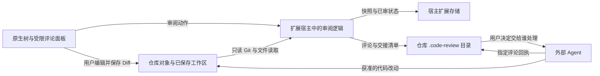

# 安全与信任边界

维护责任：安全审核；状态：现行；最后核查：2026-11-03。适用范围：VSIX 1.0.1 的数据与权限边界、后续适配的安全要求，以及公开内容审核。实现依据为 `689de246facc1c2389bb5f51ff6a3254e6f8b2c5` 的正式源码，与 1.0.1 发布提交 `d7e6b0d` 的运行代码相同；本轮只重建文档。

用户报告漏洞请从根目录 [SECURITY.md](../../SECURITY.md) 进入。存储格式、备份和恢复以[数据协议](../客户端/数据协议.md)为准；本文维护信任前提、防护能力及其限制，不重复定义协议。

## 运行环境与数据流

ReviewSlate 是运行在编辑器扩展宿主中的本地工具，没有独立服务端、账户系统或租户边界。当前扩展不发起网络请求、不上传代码、不采集遥测，也不启动 HTTP 服务。它使用宿主进程的文件系统权限；安全前提是用户信任工作区、编辑器、扩展安装和所使用的 Git 可执行文件。

扩展还会按需向根 `.gitignore` 追加 `/.code-review/`。图中的 Agent 是用户选择的外部执行者：“交给 Agent”只复制说明，不启动 Agent 或自动发送材料。宿主、其他扩展及接收材料的 Agent 有各自的数据策略，扩展的本地运行行为不能约束它们。

| 对象或入口 | 信任边界 |
| --- | --- |
| 编辑器与本机账户 | 拥有实际文件访问权；扩展不是对其他本机进程的沙箱 |
| 仓库内容、文件名、Git 元数据 | 读取和展示的数据；不因来自用户打开的仓库而成为命令或额外授权 |
| 评论、引述代码与 Agent 回执 | 需要校验归属和版本的数据；回执不证明作者身份，也不代表问题已解决 |
| Webview 消息 | 只接受已知动作和有界字段，敏感写入还要经过服务层校验；不能把 UI 中的可见状态当作最终事实 |
| 本地 JSON、快照与删除标识 | 依赖文件系统访问控制；哈希校验和 scope 用于完整性与归属，不提供加密或多用户鉴权 |

## 当前实现提供的防护

以下是本轮静态核查到的实现。关联测试说明可回归的边界，不表示本轮重新执行过这些测试；实际执行记录见[验证记录](../测试/验证记录.md)。

| 边界 | 当前实现与来源 | 复核重点 |
| --- | --- | --- |
| 工作区信任 | [`package.json`](../../package.json) 声明不支持未受信任及虚拟工作区；[`extension.ts`](../../src/extension.ts) 激活前检查 `isTrusted` | 宿主拒绝未信任工作区时不能开始审阅；不把其他宿主的权限语义直接套用过来 |
| Git 与进程调用 | [`git.ts`](../../src/git.ts) 以 `execFile` 传参数，子命令白名单只读；禁止协议、lazy fetch、替换对象和 fsmonitor，不执行仓库过滤器或 external diff | 特殊引用名不能变成选项；缺失对象不能隐式联网或写 Git 对象、索引及引用 |
| 路径与文件读取 | [`model.ts`](../../src/model.ts) 拒绝绝对路径、穿越组件及 `.git`；[`git.ts`](../../src/git.ts) 检查父目录，符号链接只读链接文本；[`filesystem.ts`](../../src/filesystem.ts) 检查存储目录与普通文件 | 越界路径、符号链接、特殊文件、变化中的文件应被拒绝或明确报错，不能读出链接目标作为审阅正文 |
| 评论显示与消息 | [`panel.ts`](../../src/panel.ts) 使用 nonce CSP、`default-src 'none'` 和空本地资源根；[`comments.js`](../../media/comments.js) 用 `textContent` 展示外部正文 | HTML、代码和回执应作为文本显示；未知动作、超长字段和陈旧页面不能越过服务层写入 |
| CR 与内容归属 | [`review.ts`](../../src/review.ts)、[`extension.ts`](../../src/extension.ts) 检查当前仓库、CR、分支、内容指纹及未保存状态；[`comments.ts`](../../src/comments.ts) 校验 scope、ID 和 revision | 切分支、切 CR、内容变化和旧页面重试不能误写当前对象；旧回执不能标记新评论已处理 |
| 持久化与失败 | [`filesystem.ts`](../../src/filesystem.ts)、[`state.ts`](../../src/state.ts) 实现有界读取、存储锁、临时文件替换、备份与快照校验 | 损坏、缺失和写入失败不能变成空数据或已审成功；删除中断按已持久化阶段恢复或继续清理 |

现有相关回归入口包括 [`review.test.cjs`](../../test/review.test.cjs)、[`editable.test.cjs`](../../test/editable.test.cjs)、[`comments.test.cjs`](../../test/comments.test.cjs)、[`panel.test.cjs`](../../test/panel.test.cjs)、[`editor.test.cjs`](../../test/editor.test.cjs)、[`purge.test.cjs`](../../test/purge.test.cjs) 和 [`pending-size.test.cjs`](../../test/pending-size.test.cjs)。新增适配器必须复核自己到这些边界的调用路径，不能只因复用了一部分核心就沿用全部结论。

文件锁只约束遵守协议的写入者，文件身份检查也不构成对恶意本机进程的隔离。临时文件替换提供单文件保护，两处存储之间没有统一事务；外部 Agent 的回执写入没有服务端 CAS 或自动合并。实际部署若引入共享账户、网络接口或多用户访问，必须重新设计身份与权限边界。

## 敏感数据的产生、保留与分享

已审快照可能保存完整代码文件；评论可包含原片段和上下文；交接说明、派生清单和部分错误信息含绝对路径。CR 分支、提交和文件名也可能暴露项目背景。这些内容以普通本地文件保存，未加密；宿主还可能保存界面草稿。新建存储目录和临时文件使用受限权限，但不代替宿主及备份介质的访问控制。

`.code-review/` 的忽略规则仅降低误提交概率，不会取消已跟踪内容，也不限制其他程序读取。完整备份需要宿主扩展存储与仓库 `.code-review/` 的对应数据，不能把评论目录当作全部进度。对外提供复现材料时使用合成仓库；只附必要版本、脱敏路径和操作步骤，不上传整个审阅目录或原始日志。

归档与单条评论删除仍保留数据；永久删除清理可确认归属的审阅数据并保留无正文的删除标识。用户另存备份、编辑器缓存、未知附加文件和磁盘残留不保证被清理，永久删除不是安全擦除。清理与恢复的具体阶段及失败条件见[数据协议](../客户端/数据协议.md#归档评论删除与永久删除)。

## Agent 与后续 Codex 接入

当前交接协议要求先核对指定 CR 的分支、固定基点和删除状态，只处理其中的评论 ID，保留原评论并单独写回执，最终由审阅者确认解决。评论、引述代码、文件内容及生成清单中的正文都属于待分析材料，不能改变用户任务或扩大工具权限。原始评论和 JSON 即使可由本机读取，也不自动属于当前任务。

这些要求写在 [`handoff.ts`](../../src/handoff.ts) 和 [`comments.ts`](../../src/comments.ts) 的交接说明中，是协作约定。扩展不会替外部 Agent 执行权限检查，也不能阻止已获本机访问权的程序修改原评论或读取其他文件；不能把交接提示词宣传为技术隔离。

Codex 目前只有忽略目录中的合成探针和独立测试应用。工具发现、模拟消息或独立应用读写证据均不能证明真实 Codex 面板、授权、保存和生命周期已经通过；本轮没有对探针或目标宿主出具完整安全验收。已知范围与缺口见 [Codex 接入](../客户端/Codex接入.md)和[验证记录](../测试/验证记录.md)。

正式接入的安全复核随客户端实现推进，至少需要以下可验证结果：

- 宿主授予的仓库范围可核对；工具端重新检查路径、CR、分支、内容身份和评论版本，不接受页面提供任意命令或扩大文件访问范围。
- UI 与工具桥接只接受已定义动作和对应回执；失败、迟到响应、陈旧页面和撤销权限不能报告保存成功。
- 明确哪些代码与评论进入宿主或模型上下文，以及由什么用户动作触发；不把“没有额外上传通道”写成“材料不会交给模型”。
- 应用独立存储，不读取或覆盖现有 VSIX 审阅数据；实际布局、写入中断、并发与删除恢复有对应验证。
- 安装包不含开发机绝对路径、真实资料或凭证；在实际安装位置验证运行时、stdio 子进程退出和无额外网络监听。

客户端研发统一负责本地逻辑、Git、存储、桥接和宿主生命周期；QA 验证实际候选版本，安全审核复核其中的信任边界。当前没有独立后端服务或相应部署责任。

## 公开内容与问题复核

发布或推送的检查对象是实际提交、可达历史增量、元数据、目标引用，以及将上传的最终包、媒体和文案。普通增量可以复用同目标、同受众的可信基线；新增目标或公开范围变化要重新确定完整披露范围。`.gitignore`、干净工作区、扫描无命中或功能测试通过均不能单独证明可发布。

公开身份保留项目已采用的 `github.com/To-Re <To-Re@users.noreply.github.com>`，保留 MIT 与必要第三方署名。其余材料只保留读者需要的信息：示例使用相对路径、占位值和合成数据，不收录个人路径、账户标识、内部链接、原始审阅内容或会话日志。报告自身进入 Git 时同样接受检查；敏感定位只记录脱敏类别和必要位置，不复述敏感值。

发现问题后由安全审核给出触发前提、影响、证据位置及最小修复条件；客户端研发修复实现，文档作者修复披露，QA 执行相关回归，安全审核在实际修复版本复核。问题位置、被检版本、方法、结果和未覆盖项进入相应项目记录；漏洞细节沿 [SECURITY.md](../../SECURITY.md) 的私密报告入口处理。

本轮安全文档依据静态核查更新，没有新增运行行为。公开文档的最终推送结论须绑定本轮实际提交和树、仅更新的引用、目标及受众；本文不是可复用于其他版本的发布许可。安全审核不增加发布权限，也不表示已完成 Codex 验收、依赖漏洞审计或全量渗透测试。
