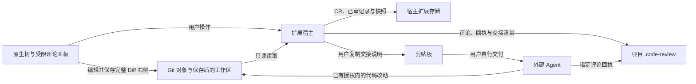

# 安全与信任边界

维护责任：安全审核；状态：现行；最后核查：2026-11-04。适用范围：`main` 的 VSIX，包括 Trae / Trae CN 兼容目标。本轮审核以 `eba6bbf` 为基线的 1.0.3 树筛选及正式发布准备，实际版本与发布状态见[项目现状](../项目现状.md)。

漏洞报告入口见根目录 [SECURITY.md](../../SECURITY.md)，存储与恢复见[数据协议](../客户端/数据协议.md)。其他客户端的实现与文档在 [beta 分支](https://github.com/To-Re/review-slate/tree/beta)，不在本页审核范围内。

## 运行边界

ReviewSlate 在受信任的编辑器扩展宿主中运行，没有独立服务端、账户系统或租户边界。当前运行代码不发起网络请求、不上传代码、不采集遥测，也不启动 HTTP 服务。扩展使用宿主进程的文件系统权限，依赖用户信任工作区、编辑器、扩展安装与 Git 可执行文件。

“交给 Agent”只复制说明，扩展不启动 Agent 或自动发送材料。外部 Agent 可在用户授权内修改项目代码并单独写回执；其权限和数据策略由用户与宿主决定。首次保存评论或接续已有评论时，扩展还会按需向根 `.gitignore` 追加 `/.code-review/`。

| 资产或入口 | 安全边界 |
| --- | --- |
| 仓库内容、路径与 Git 元数据 | 读取与展示的数据，不能变成 shell 命令或扩大用户授权 |
| 评论、引述代码与 Agent 回执 | 待分析资料；回执不认证作者身份，也不自动解决评论 |
| Webview 消息 | 只接受已定义动作和有界字段，写入仍校验仓库、CR、分支和版本 |
| 树筛选偏好 | 宿主 `workspaceState` 只保存固定模式，不保存路径或正文；隐藏仅影响显示，不限制评论概览或 Agent 交接范围 |
| 本地状态、快照与删除标识 | 依靠文件系统访问控制；哈希和 scope 校验完整性与归属，不提供加密或多用户鉴权 |
| 编辑器、本机账户与其他扩展 | 具备各自文件访问权；本扩展不是隔离恶意本机进程的沙箱 |

## 现行防护与性能改动约束

| 边界 | 已核查的实现 | 必须保持的条件 |
| --- | --- | --- |
| 工作区信任 | [`package.json`](../../package.json) 不支持未信任及虚拟工作区；[`extension.ts`](../../src/extension.ts) 激活前检查 `isTrusted` | 未信任工作区不能启动审阅；不同兼容宿主的实际拦截需分别验证 |
| Git 调用 | [`git.ts`](../../src/git.ts) 使用 `execFile` 参数数组和只读子命令白名单，禁协议、lazy fetch、替换对象与 fsmonitor | 不执行 fetch、checkout、过滤器或 external diff，不修改对象、索引或引用 |
| 批量读取 | Git 批量协议只接收完整十六进制对象 ID；校验对象顺序、类型、长度和批次边界 | 不把文件名或引用名拼入批量协议；保留 5 MiB 单文件、80 MiB 差异限制及有界并发 |
| 路径与文件 | [`model.ts`](../../src/model.ts) 拒绝绝对路径、穿越组件及 `.git`；Git 读取检查父目录，链接只读链接文本；[`filesystem.ts`](../../src/filesystem.ts) 校验存储目录和普通文件 | 不能把链接目标作为审阅正文；拒绝特殊文件和变化中的文件，失败不能记录为已审 |
| 文本显示 | [`panel.ts`](../../src/panel.ts) 使用 nonce CSP、`default-src 'none'` 和空本地资源根；[`comments.js`](../../media/comments.js) 通过 `textContent` 显示外部正文 | HTML、代码和回执作为文本呈现；消息字段校验不能代替写入归属检查 |
| 单文件打开与异步结果 | [`review.ts`](../../src/review.ts) 重新读取目标文件并检查分支、CR 和 HEAD；[`extension.ts`](../../src/extension.ts) 将只读打开与写入队列分开 | 陈旧导航不能重设当前目标，旧读取不能覆盖新结果；保存评论必须固定接收时的目标与选区 |
| 标记与评论写入 | 标已审前复读内容并检查指纹、目录成员和未保存状态；[`comments.ts`](../../src/comments.ts) 检查 scope、ID 和 revision | 快速打开不能弱化标记与评论的最终检查；旧页面、旧评论回执不能误写当前对象 |
| 持久化 | [`filesystem.ts`](../../src/filesystem.ts)、[`state.ts`](../../src/state.ts) 提供有界读取、存储锁、临时文件替换、备份和快照校验 | 损坏、缺失与写入失败显式报告，不能覆盖为空进度或伪造成功 |

文件锁约束遵守协议的写入者；路径和文件身份检查不能隔离已获本机权限的恶意进程。临时文件替换提供单文件保护，两处存储之间没有统一事务。外部 Agent 写回执也没有服务端 CAS 或自动合并。引入共享账户、网络接口或多用户访问时，需要重新设计身份与权限边界。

## 数据保留与分享

已审快照可能保存完整代码文件，评论可保存原片段和上下文；交接说明、派生清单及部分错误文本包含绝对路径。文件名、分支和提交信息也可能暴露项目背景。这些资料是未加密的本地文件，宿主还可能保留界面草稿。新建存储目录与临时文件使用受限权限，仍需要宿主和备份介质保护。

`.code-review/` 忽略规则不会取消已跟踪文件，也不能阻止其他程序读取。完整备份涉及项目资料与宿主扩展存储两处；分享复现材料应使用合成仓库，只附版本、脱敏路径和操作步骤，不上传整个审阅目录、原始日志或真实业务截图。

归档与单条评论删除仍保留数据。永久删除清理能确认归属的审阅数据并保留无正文的删除标识；未知附加文件、另存备份、编辑器缓存与磁盘残留不保证清理，不能把永久删除称作安全擦除。恢复和清理阶段见[数据协议](../客户端/数据协议.md)。

交接要求外部 Agent 核对指定 CR 的分支、固定基点和删除状态，只处理指定评论 ID，保留原评论并单独回复，最后由审阅者确认解决。评论、代码与生成清单中的指令不能扩大用户任务或工具权限。[`handoff.ts`](../../src/handoff.ts) 与 [`comments.ts`](../../src/comments.ts) 中的交接说明是协作约定，不是阻止 Agent 访问其他文件的技术隔离。

## 公开内容与复核规则

公开资料使用相对路径、占位值和合成数据，不收录凭证、个人路径、非授权账号、内部链接、原始审阅内容或会话日志。保留项目已选择的 `github.com/To-Re <To-Re@users.noreply.github.com>`、MIT 与必要第三方署名；报告本身同样接受披露检查，发现只给脱敏定位。

推送前核对真实提交树、增量历史、提交说明、作者与提交者、目标引用和可见性。打包与安装前检查实际 VSIX 条目及内容，包括编译文件、媒体和打包文案；忽略规则不等于打包排除。新增目标或受众变化需覆盖完整将披露范围，不能沿用同仓库某个旧版本的结论。

安全审核结论绑定实际版本、提交范围、包与文案指纹及目标。审核后改动需补查；审核不扩大提交、推送、安装或正式发布授权。发现问题由实现或文档责任人修复，QA 复测受影响路径，安全审核核对修复后的实际对象；敏感漏洞细节按 [SECURITY.md](../../SECURITY.md) 的私密入口处理。

## 当前审核：1.0.3 树筛选与正式发布

2026-11-04 核查对象为 `eba6bbf016cfbed147bb280338aceb7f3703961b` 加本轮变更，版本号为 1.0.3。用户已授权检查代码与文档后推送公开仓库 `To-Re/review-slate` 的 `main` 并发布 1.0.3。发布范围为本轮源码与文档、`v1.0.3` 标签、正式 GitHub Release，以及 `review-slate-1.0.3.vsix`、`SHA256SUMS.txt` 两个附件。保持 `beta` 独立，不公开诊断包、原始日志、截图或本地配置，不操作 SSH 或实际业务数据。实际 Git 对象在生成后只读核验，包与文案按下列指纹绑定。

| 被检源码 | SHA-256 |
| --- | --- |
| `src/extension.ts` | `dccb0edd3c26a6fea251a158f97e500cb20e2f901211d2f0d19d9e1fda7f99dd` |
| `src/tree.ts` | `8160cb6dc0bdc73320f792fd35f048ae685624a30186e99f6010adcc2e8b7d4d` |
| `src/review.ts` | `6034f6b43d7ece6283cd7328361515134b8a1741b4c75221eb5b73b294b3bcec` |

### 新增边界与检查结论

**源码与当前待公开差异的增量检查通过，未发现高置信新增安全或隐私问题。** 本轮静态追踪了筛选输入、宿主偏好、树投影、评论导航与批量标记的调用链，并核对新增测试和文档。检查范围限于相对已审基线的变化，没有重复全库安全审计。

- 筛选输入只接受 `all`、`unreviewed`、`comments`，缺失或未知值恢复全部。新偏好仅由宿主按工作区保存，写入按顺序执行；持久化失败保留原显示，不向评论文件、审阅快照或 Git 写入筛选数据。
- 筛选在已有完整视图上计算，保留相关祖先，完整计数与原始数据继续存在。它不是权限隔离或脱敏措施；隐藏对象仍可出现在当前 Diff、评论、待处理概览及交接清单中。
- 目录与整树批量操作同时检查接收时和执行时的筛选状态，并在拿到仓库与 CR 写锁后复查归属、筛选和未保存状态。该锁内检查是进入既有持久化过程前的提交检查点；已经越过检查点的操作不承诺因后来切换筛选而撤销。单文件操作继续使用既有指纹和归属校验。
- 评论导航先核对目标、当前 CR 和导航身份；仅对有效且被隐藏的对象恢复全部。陈旧自动导航不能覆盖后来的手动筛选，筛选本身不改变评论草稿或选区的归属。
- 新增两个原生命令和菜单，没有新增运行时依赖、Webview 消息、网络入口或文件路径输入。扩展 ID、工作区信任声明、审阅数据格式及存储路径保持不变；锁文件仅调整项目版本。
- 当前公开差异使用相对路径和合成样例，未见凭证、真实审阅正文、个人绝对路径或内部地址。原始测试、宿主状态和合成数据保留在忽略的 `artifacts/tree-filter/`，不随源码或包披露。

### 产物与验证边界

**正式发布包、校验文件与 Release 文案检查通过。** 实际包为 `artifacts/review-slate-1.0.3.vsix`，143,758 字节、27 项。已检查 ZIP 条目、清单、编译模块、媒体和打包文案；无越界路径、链接条目、重复条目、诊断配置、trace、原始日志、审阅数据、个人路径或源码映射。

| 正式发布对象 | SHA-256 |
| --- | --- |
| `review-slate-1.0.3.vsix` | `ad8ad2a3aa182e94a5e0610f304d07fcd89ec09da0d86e41116f2b6d50b2314a` |
| `SHA256SUMS.txt` | `1f443be053beae90234b8f876161dbaa07a1e9ad4d0163ea880ee58e4649c14e` |
| Release 文案 `release-notes.md` | `4daedba148b969edda5441cebb1dd3c47934de212ddc7d626758676c790a5d07` |

正式包与已安装的合成 GUI 候选 `e90887eb24bab73fe4053c14518a6d5a7278568f891eea06516317927bcfc57d` 条目集合相同，仅内嵌 README、CHANGELOG 改变。16 个运行模块、清单、依赖声明与媒体逐字节一致；候选的全部运行模块已与按项目配置在内存转译的冻结源码匹配。正式包清单等于当前 `package.json`，README／CHANGELOG 仅经打包器改写相对链接，内容与当前源码文案一致。扩展 ID、引擎与工作区信任能力未扩大，没有新增依赖。校验文件只包含该 VSIX 的一行哈希和文件名，无本地绝对路径。

安全角色回读 QA 正式发布前的单次 `npm test`：142 项中 141 通过、0 失败、1 项可选采样跳过，70.336 秒；`npm run package` 成功。此前候选的旧命令数断言已修正，本次全量检查包含该完整编辑器流程。原始日志、包比对与校验文件保存在忽略的 `artifacts/releases/v1.0.3/`，不将测试日志或本机验证记录作为 Release 附件。

最终 Release 说明的功能、升级、数据边界及验证范围已检查，未发现敏感披露。说明准确限定为 Trae CN 3.4.14（内核 1.107.1）的合成项目实测，不把兼容目标或自动回归扩大为跨宿主全部通过；正文与两个附件均按上表指纹绑定。

设计在同一 `e90887eb…` 运行代码上完成三模式、取消、筛选目录批量入口禁用、单文件标记后 Diff／草稿保留、隐藏评论“打开位置”恢复全部、“有评论”模式重载恢复，以及未审核空态点击恢复全部的定向实测。安全角色回读了忽略目录 `artifacts/tree-filter/gui/` 的 03～14 辅助功能证据，没有独立操作 GUI；完整现场结论见[设计记录](../设计/README.md)。本轮未覆盖“有评论”空态、“定位代码”按钮、dirty／读取错误的实机状态或其他宿主，正式文档重包也不记作重新实测。功能自动化和其他限制见[验证记录](../测试/验证记录.md)。

### 最终对象核验

工作区源码、测试及公开文档的增量检查通过，未发现凭证、个人绝对路径、内部地址或真实审阅资料。两份新增筛选测试及编辑器入口断言只使用临时合成数据；新增文档没有扩大运行权限或把隐藏视为数据隔离。媒体、工作流、构建脚本和其他运行代码没有本轮差异。

实际提交与标签尚待生成后的只读核对，包括父提交、提交树、增量对象、作者／提交者、tagger、说明和目标引用。该核对通过前不执行本轮外发；通过后按已有授权推进，由主负责人确认 CI、Release 目标及上传后下载字节。最终结论经交接绑定实际对象，避免为了记录自身提交号反复修改报告。源码、包、文案、目标或受众变化后补查受影响范围；构建和安全审核不代替发布回执。

## 已审公开基线

1.0.2 的安全基线为 `eba6bbf016cfbed147bb280338aceb7f3703961b`，提交树 `397b82af9dde157f996524249f0860951d868efd`；annotated tag `v1.0.2` 对象 `b6141070a8acc299164d8b4e7b2ab54e28cae516` 指向该提交。实际提交、增量历史、约定 noreply 身份及公开目标 `To-Re/review-slate` 已完成只读审核，未发现非授权隐私或凭证披露。功能源码来自 `cb9f9a1`，该发布准备提交只更新文档。

正式 1.0.2 VSIX 为 141,829 字节、27 项，SHA-256 `1dd2d10c649a062c42926ae6eccd506352980673ca3104f8f7e5923fb8678cf1`；校验文件为 `455b8b726995e73f9f17c98e5556c2d14adc294d656687382434030b0964c4e2`，Release 文案为 `d3c09acec502b56b3bdf2d0984c1543c1f9ea470bc189515d78062a0dce2c3d2`。实际包未含诊断配置、trace、原始日志、审阅数据、个人路径、源码映射或越界条目；16 个运行模块与当时已验候选一致。原始材料留在忽略的 `artifacts/releases/v1.0.2/`。

此前安全定向回归、全量测试、合成性能和 Trae CN 定向 GUI 证据仅适用于当时运行代码与已记录场景；详细结果及未覆盖的完整流程、主题和宿主见[验证记录](../测试/验证记录.md)与[设计](../设计/README.md)。本页不保证零漏洞，也不代表全量渗透测试或合规认证。
