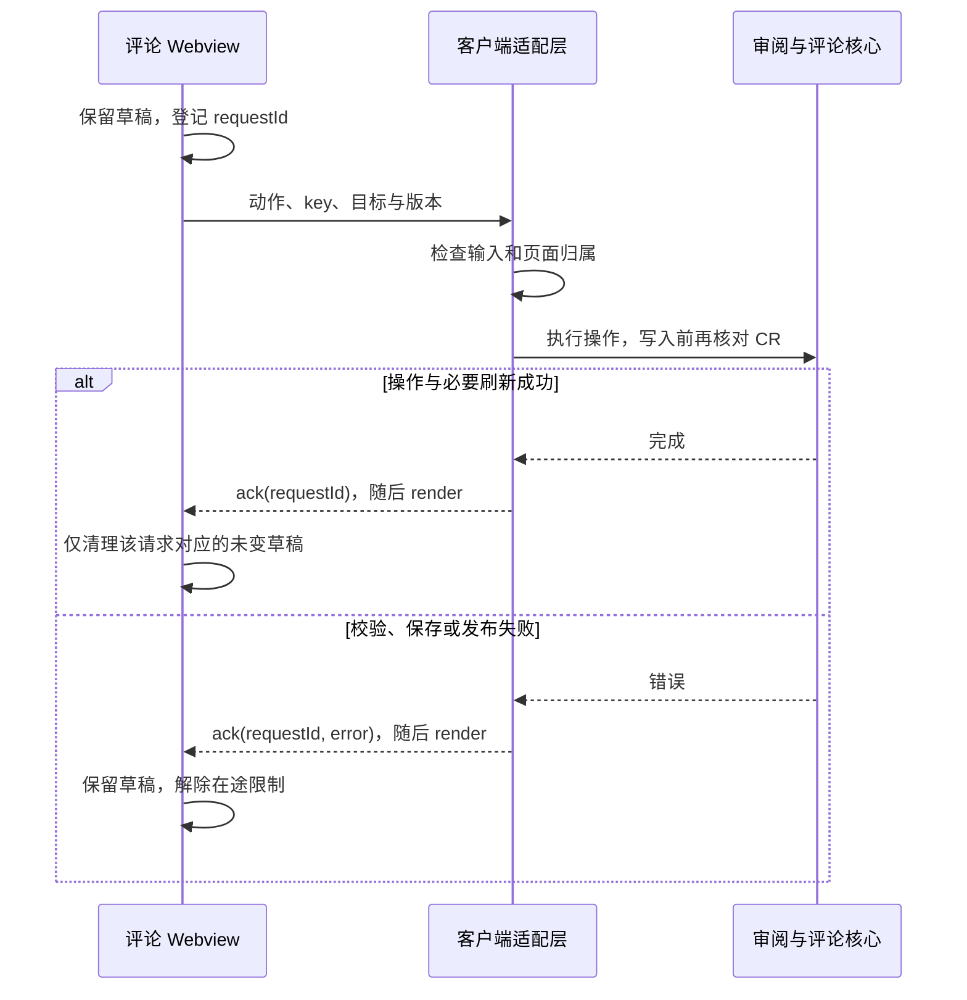

# 客户端研发

维护责任：客户端研发；最后核查：2026-11-03。适用范围：ReviewSlate 的 VS Code 系客户端与 Codex 客户端。状态：VSIX 现行说明；Codex 0.1.2 已通过官方 CLI 更新本地安装并启用，缓存资产与最终审核包一致，目录热区及键盘焦点已在自有测试应用复验。真实 Codex 完整面板、深色与窄窗未覆盖，候选未公开发布。核查基线：`3dd7e30` 加本轮实现。来源：[扩展入口](../../src/extension.ts)、[平台声明](../../package.json)、[Codex 控制器](../../src/codex/controller.ts)、[安装核对](Codex接入.md#正式包与运行时方案)及本文链接的代码。

正式工具 `mcp__reviewslate__reviewslate_open` 已可发现，旧探针已卸载；工具发现不代表真实 Codex 完整面板已验收。当前公开客户端仍是 VSIX。Codex 已实现一个 MCP App 工作区与本地 stdio，覆盖仓库切换、CR、完整只读 Diff、已审、意见、导航／草稿恢复、中英切换及操作核对；实现和限制见[客户端方案](Codex客户端方案.md)。源码直接编辑暂未启用，真实 Codex 验收未完成。根标准包、Node 捆绑与宿主门槛由 [Codex 接入](Codex接入.md)维护，布局见[数据协议](数据协议.md#codex-独立存储方案)。以下 VSIX 专节描述既有宿主，不能直接当作 Codex 行为。

0.1.2 将单文件 Diff 和草稿保存与整仓扫描分离，后台刷新期间仍可保留输入并切文件；树采用汇总缓存和节点复用，自动刷新按耗时调度。目录展开与已审控件各有独立 32 × 32 px 热区，名称继续打开目录概览。当前行为与边界见[客户端方案](Codex客户端方案.md#四状态归属与连续性)。

正在运行的旧面板不保证自动采用新包。用户应先等页面确认本地保存，再完全退出并重开 Codex；安装流程不代替用户重启宿主，也不清理原审阅资料。

本文负责视图、状态、宿主适配和开发发布入口。业务语义见[产品](../产品/README.md)，视觉与交互规则见[设计](../设计/README.md)，业务模块和持久化见[本地审阅引擎](../客户端/本地审阅引擎.md)及[数据协议](../客户端/数据协议.md)，使用步骤见[用户指南](../用户文档/使用指南.md)。测试方法和版本结果统一由[测试](../测试/README.md)维护，不在客户端文档复制执行记录。

## 平台与实现入口

ReviewSlate 使用 TypeScript、VS Code 扩展 API 与 Node.js 内置模块，作为 workspace 扩展运行。只在受信任的文件系统工作区启用；不支持浏览器版或虚拟工作区。Remote SSH 下的 Git 与文件操作在远端扩展宿主执行，本机路径不能代替远端路径。版本要求与安装范围见[项目首页](../../README.md#安装)。

树、菜单、选择器和 Diff 使用宿主原生控件，只有评论区使用本地 Webview。没有前端组件框架或独立浏览器构建管线；页面脚本与样式随 VSIX 打包。

| 界面 | 实现 | 适配责任 |
| --- | --- | --- |
| 审阅设置 `codeReview.settings` | [settings.ts](../../src/settings.ts) | 当前仓库、默认基点及读取状态；原生选择器由扩展入口协调 |
| 审阅记录 `codeReview.reviews` | [history.ts](../../src/history.ts) | 新建、当前与历史 CR、归档及删除未完成状态；业务操作交给服务层 |
| 变更文件 `codeReview.files` | [tree.ts](../../src/tree.ts) | 稳定节点、手动管理 checkbox、目录聚合、评论数量、装饰和可访问名称 |
| 审阅评论 `codeReview.comments` | [panel.ts](../../src/panel.ts)、[comments.js](../../media/comments.js) | 目标评论、待处理概览、草稿、原卡片编辑及请求确认 |
| Diff、代码选区和导航 | [extension.ts](../../src/extension.ts) | 虚拟快照、真实文件 URI、活动标签归属、未保存缓冲区检查 |
| 基点与提交输入 | [baselines.ts](../../src/baselines.ts)、[commit-picker.ts](../../src/commit-picker.ts) | 原生 Quick Pick、SHA 校验与取消反馈 |

[`package.json`](../../package.json) 声明视图、命令和菜单条件，`ReviewExtension` 注册并协调它们。保持扩展 ID `to-re.code-review`、`codeReview.*` 命令和 `code-review` URI scheme 的兼容；其他宿主适配不能直接假设存在这些扩展点。

评论区样式由 [comments.css](../../media/comments.css)维护，使用项目紫蓝主色与状态色，适配宿主深色、高对比度和字体变量。状态同时使用图标或文字，错误区有警示语义，输入框有可访问名称。代码具备这些基础支持，不代表各宿主的键盘、主题及窄面板体验均已验收。

## 状态分工与身份

`ReviewExtension` 当前持有一个 `ReviewService`，把 `service.view` 投影到视图；Webview 不直接读 Git 或写业务 JSON。业务保存与客户端草稿必须分开理解。

| 状态 | 维护位置 | 生命周期与限制 |
| --- | --- | --- |
| 仓库选择、草稿清理标识 | 宿主 `workspaceState` | 重开优先匹配原仓库；永久删除后通知页面清理可识别草稿 |
| CR、基点、已审快照与评论 | 服务层及核心存储 | UI 展示读取结果；格式、归属和备份以[数据协议](../客户端/数据协议.md)为准 |
| 当前目标、选区、概览、Diff 文档映射 | 扩展实例内存 | 随交互更新；切换 CR 后丢弃失配的当前目标和锚点 |
| 新评论、原评论编辑草稿 | Webview `getState()` / `setState()` | 按目标隔离；保留原评论 ID/revision 与编辑前草稿；不属于已保存评论 |
| 在途页面请求 | `comments.js` 的 `pending` Map | 等待对应 ack，禁用重复操作；没有跨进程恢复保证 |

[`Selection`](../../src/review.ts) 的 `key` 与 `draftKey` 用途不同。文件 `key` 包含仓库、CR、路径及左右内容指纹，约束当前写入；`draftKey` 包含仓库、CR 与路径，内容刷新后仍可接续草稿。目录另含目标类型，待处理概览使用 CR 级独立 key。页面不得自行重建这些值或用草稿身份代替写入身份。

命令、页面消息和刷新经 `enqueue()` 串行处理。文档保存、文件树或记录树显示会触发刷新；这些树可见且没有排队操作时每 5 秒刷新。缓冲区变化先更新“未保存”显示，不把未保存文本当成磁盘快照。`dispose()` 清理监听器、定时器及文档映射，并阻止尚未开始的排队任务启动；已经开始的异步任务没有取消或等待完成保证，仍可能执行后续 I/O 与渲染。

视图需区分未选仓库、未选 CR、无变更、读取失败与未保存。读取失败提供重试并撤去有效写入 key；未保存、失败或仅保留评论的文件没有普通已审 checkbox。已审计数排除失败和未保存文件，目录按相关文件聚合，checkbox 的瞬时外观不构成持久化事实。

## 页面请求与保存确认

消息字段以 [`PanelModel` / `PanelMessage`](../../src/panel.ts) 为真源。页面经 `acquireVsCodeApi().postMessage()` 发送动作；宿主发送 `render` 与带 `requestId` 的 `ack`。这是宿主消息通道，没有 HTTP 接口。



`panel.ts` 过滤动作白名单、字段类型及长度；页面以 nonce CSP 加载本地脚本和样式，`localResourceRoots` 为空。评论、代码片段与 Agent 回复使用文本节点展示，不解释为 HTML 或执行指令。

`panelAction()` 核对当前 key、CR、目标与评论 ID，修改时携带预期 revision，并向核心传入 `assertCurrent()` 写入 guard。页面检查不能代替核心的锁内归属与版本检查；直接调用底层评论模块也不能省略客户端提供的当前上下文。

保存期间禁用当前草稿编辑与重复提交，普通 render 不解除保存锁。新增评论失败后，未修改正文的重试复用 request ID；成功 ack 仅清理该请求所属、正文仍匹配的草稿，不清空后来切换到的对象。编辑原评论保留 ID/revision，原卡片消失时保留草稿并阻止退化为新增；同一编辑目标的周期 render 不拆卸输入框。

报错可能发生在评论已写入、派生清单发布失败之后，不能据此推断“什么都没保存”。客户端保留草稿，依靠重新读取和幂等重试确认，恢复规则见[数据协议](../客户端/数据协议.md)。当前 VSIX Webview 没有请求超时或在途请求持久化机制，异常退出后的自动重试仍是缺口。

## Diff 与导航边界

完整 Diff 调用原生 `vscode.diff` 并使用预览模式。虚拟文档 URI 绑定仓库、CR、完整／增量视图及左右侧身份，同一语义下复用文件 URI。`repo.editablePath()` 校验通过的普通 UTF-8 工作区文件可作为真实可编辑右侧；其余内容使用只读虚拟文档。

不同 CR 的可编辑右侧可能共用同一个真实文件 URI，因此归属判断使用活动 Diff 标签的原始侧 URI。旧 CR 的固定标签仍可查看，右侧编辑仍修改真实工作区，但不能给当前 CR 绑定代码评论。固定、变脏或预览标记变化不会切走评论草稿；实际切换标签或分组才重新定位对象。

标记已审时，树生成的 [`MarkRequest`](../../src/tree.ts) 携带展示时 CR、内容指纹及目录文件集合。客户端检查未保存缓冲区，核心再次校验分支、CR、内容和成员；失败后渲染实际状态。选区评论要求本工具完整 Diff、非空选区以及编辑器与磁盘内容一致。定位不唯一时保留原片段并提示确认，不按旧行号猜测。

待处理概览和目录评论可以打开具体目标并 reveal 到树节点；稳定节点 ID 使普通刷新保留展开状态。按分支接续 CR 与已保存资料已经实现，但选中文件、目录展开和 Diff 定位的跨重启整体恢复未完成验收，不能由数据恢复推导成立。

## 开发、安装与回退

依赖与通用命令见[贡献指南](../../CONTRIBUTING.md)。客户端修改可先编译并运行相关模拟测试：

```sh
npm run compile
node --test test/panel.test.cjs test/tree.test.cjs test/editor.test.cjs test/editor-context.test.cjs test/editable.test.cjs
```

代码或打包修改提交前执行 `npm test` 与 `npm run package`；实际执行范围和结果写入[测试](../测试/README.md)。模拟宿主与 DOM 检查状态及消息，原生窗口、快捷键、真实主题和 Remote SSH 另做实机验证。Codex 使用 `npm run typecheck:codex-ui`、`npm run test:codex`、`npm run build:codex` 独立验证。仓库尚无 `.vscode/launch.json` 或 `tasks.json`，没有现成 F5 配置；测试不得隐式安装或打开编辑器。

[`scripts/package.cjs`](../../scripts/package.cjs) 从 `package.json` 取版本，输出 `artifacts/review-slate-<version>.vsix`；分发内容由 `files` 白名单限定。构建不自动安装或打开编辑器。按[用户指南](../用户文档/使用指南.md)安装重载后，核对版本、四个视图及本次受影响交互；签名、构建成功与目标宿主可用分别记录。

回退前停止扩展及 Agent 写入，按[数据协议](../客户端/数据协议.md)保留同一时点的两处业务数据。只使用已确认兼容当前格式的 VSIX，安装后核对 CR、固定基点、已审数量及评论归属。存在永久删除标识时，旧于 0.10.0 的客户端不兼容。当前没有逐版本自动回滚或降级验证矩阵，不能靠卸载、清空 JSON 或降级旧客户端恢复数据。

## 本方向的维护边界

客户端行为改变时，同次更新本页和涉及的设计／产品规则，向测试交接真实入口、状态变化与风险。本地接口或存储变化由客户端研发统一核对本地引擎与宿主适配，不在页面另造 schema。新宿主的能力判断与运行方式更新 [Codex 接入](Codex接入.md)；没有目标宿主证据时继续标为未验证，不能由独立测试应用代签验收。
