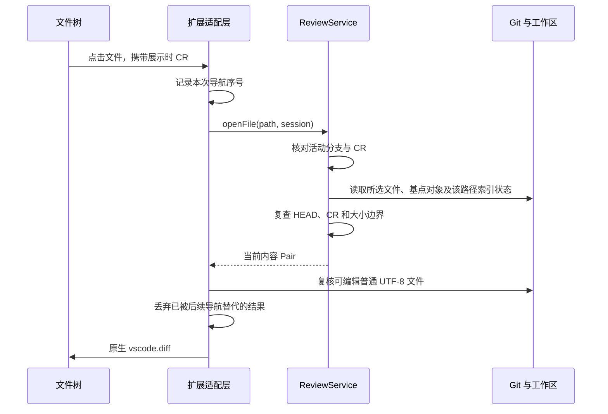

# VSIX 客户端

维护责任：客户端研发；状态：现行；最后核查：2026-11-04。适用范围：`main` 的 VS Code 系 VSIX，含 Trae / Trae CN 兼容目标。本分支版本为 1.0.3，新增变更树筛选；安装入口见 [1.0.3 Release](https://github.com/To-Re/review-slate/releases/tag/v1.0.3)，实际可用性以 Release 及其附件为准。发布范围见[项目现状](../项目现状.md)，实际测试与宿主验证见[测试记录](../测试/验证记录.md)。

本目录维护客户端实现、运行和数据恢复。业务规则见[产品](../产品/README.md)，交互规范见[设计](../设计/README.md)，使用步骤见[用户文档](../用户文档/使用指南.md)。Codex 研发单独保存在 `beta`，不属于本分支客户端与安装包。

## 平台、模块和原生界面

客户端使用 TypeScript、VS Code 扩展 API 和 Node.js 内置模块，没有运行时第三方框架、HTTP 服务或浏览器端独立构建。入口为 `dist/extension.js`；API 下限、工作区信任与虚拟工作区声明以 [`package.json`](../../package.json) 为准。扩展作为 workspace 类型运行，Remote SSH 的 Git、磁盘和存储位于远端扩展宿主；远端兼容性需要单独验收。

| 入口 | 代码 | 职责 |
| --- | --- | --- |
| 审阅设置、基点选择 | [settings.ts](../../src/settings.ts)、[baselines.ts](../../src/baselines.ts)、[commit-picker.ts](../../src/commit-picker.ts) | 仓库、默认基点、原生 Quick Pick 和完整 SHA |
| 审阅记录 | [history.ts](../../src/history.ts) | 当前 CR、分支分组、归档和删除未完成状态 |
| 变更文件 | [tree.ts](../../src/tree.ts) | 稳定节点 ID、目录聚合、手动 checkbox、装饰及可访问名称 |
| 评论区 | [panel.ts](../../src/panel.ts)、[comments.js](../../media/comments.js)、[comments.css](../../media/comments.css) | 本地 Webview、目标评论、概览、草稿及保存确认 |
| Diff 和宿主事件 | [extension.ts](../../src/extension.ts) | 原生 Diff、虚拟文档、真实文件 URI、导航归属、脏缓冲区和事件调度 |
| 审阅服务与持久化 | [本地审阅引擎](本地审阅引擎.md)、[数据协议](数据协议.md) | 只读 Git、CR、内容指纹、评论版本、锁和恢复 |

扩展 ID `to-re.code-review`、`codeReview.*` 命令、`code-review` URI 和 `.code-review/` 存储布局保持兼容。树、菜单和 Diff 沿用宿主原生控件；评论面板沿用项目主题变量、图标与文字状态，没有引入新的 UI 风格或组件库。

## 状态与调度

`ReviewExtension` 持有当前仓库的 `ReviewService`，把 `service.view` 投影到文件树、记录树与评论区。Webview 不直接读取 Git 或写业务文件。

| 状态 | 存放位置 | 生效范围 |
| --- | --- | --- |
| CR、固定基点、进度和快照 | 宿主 `globalStorageUri` | 由核心读取与校验，支持本扩展历史格式 |
| 评论、Agent 回执、交接清单 | 仓库 `.code-review/` | 按 CR scope 和评论 revision 区分 |
| 选择的仓库、树筛选偏好、草稿清理标识 | 宿主 `workspaceState` | 当前工作区 |
| 当前目标、选区、概览、Diff 映射 | 扩展内存 | 当前实例；不承诺跨重启导航恢复 |
| 评论草稿和编辑草稿 | Webview `getState()` / `setState()` | 按仓库、CR、路径、目标类型隔离 |

写入、配置、目录操作及完整刷新仍串行执行。普通文件的完整 Diff 使用只读旁路，可与完整扫描并行；它不持久化进度或评论。`whenIdle()` 等待队列和已启动的文件打开任务，供模拟宿主验证使用。

保存事件、显式刷新和视图重新显示合并尚未开始的刷新请求。扫描中再收到保存会保留一次后续完整刷新，避免吞掉扫描期间发生的变化。文件树或记录树可见且队列空闲时，仍每 5 秒刷新。缓冲区修改只改变“未保存”显示，不能作为已保存快照。

完整刷新更新整树和评论；打开文件只复读该路径并更新它的行，不宣称其他路径已经重新扫描。后台刷新完成不会覆盖期间新打开文件的选择。全仓扫描没有用户取消入口，Git 子进程各自有超时。关闭扩展会清除监听器、定时器和文档映射，阻止未开始的队列任务；已启动的读写不保证被中断，迟到的文件打开不会再展示 Diff。

## 变更树筛选

标题栏漏斗通过原生 Quick Pick 选择“全部／未审核／有评论”，当前项显示“当前”；取消选择不改模式。非全部时，树顶部以纯文本显示筛选模式与全部范围的已审进度，标题栏增加“显示全部”按钮。没有匹配项时保留固定基点，空结果行也可点击恢复全部。

| 模式 | 匹配对象 |
| --- | --- |
| 全部 | 原有变更树，包含仅保留评论及已删除评论的入口 |
| 未审核 | 非 `commentOnly` 的真实变更文件，尚未已审、需要复审、读取失败或有未保存修改 |
| 有评论 | 当前 CR 内有未删除文件、选区或目录评论的对象，包含已解决评论；独立回执和仅已删除评论不命中 |

`ReviewTree` 保留全量节点索引，再生成可见子树和可见索引。匹配对象的祖先保留；目录自己的评论不会使其无评论后代显示。目录进度、评论计数和错误／未保存汇总始终按完整子树计算，提示说明统计包含隐藏项。全 CR 进度、评论区、待处理概览与交接清单不受树筛选影响。

筛选偏好存入 `workspaceState.treeFilter`，在同一工作区切换仓库、CR 或重开后保留；未知值按全部处理。偏好写入使用独立队列，成功后更新显示，失败提示错误并保留原模式。自动定位在写入偏好期间被新导航替代时，先恢复此前偏好，再处理后续手动筛选，防止旧定位清除当前模式；实际执行时目标已可见则保持当前模式。切换和清除只投影已有 `ReviewView`，不调用 Git、不排在全仓扫描之后，也不递增导航序号、关闭 Diff 或清除评论锚点。刷新、评论操作、标记与脏缓冲区变化后按当前模式重新投影。

筛选中隐藏目录 checkbox 和目录标记菜单；命令及勾选回调也拒绝目录或无目标的整树标记／取消标记，排队时保留接收请求的模式，取得存储锁后再次校验。单文件操作保留原校验，标记后即使从未审核列表消失，其 Diff 和评论上下文仍保留。恢复全部后，目录标记继续检查完整目录成员、内容指纹和 CR 归属。评论的“打开位置”与“定位代码”遇到隐藏目标时，会保存全部模式、重新显示并 reveal 目标，同时提示“已显示全部，以定位评论对象”。

## 文件打开与导航安全



所选文件来自真实磁盘，不复用旧工作区内容缓存。新合并冲突、子模块、文件读取失败或 CR 已切换会拒绝本次打开。普通 UTF-8 右侧经 `editablePath()` 再校验后使用真实文件 URI，可由编辑器保存；二进制、非 UTF-8、符号链接和纯模式变化使用只读表示。“上次审阅后的变化”仍先完整刷新，再读取保存的已审快照。

命令和评论消息在接收时绑定导航序号，排队等待不会重新获得后续请求的身份。连续点击采用最后一次导航：旧请求可以结束读取，但不能重新打开旧 Diff、替换当前评论目标或更新操作上下文。目录、待处理概览、评论面板操作、手动标签切换和 CR／仓库命令也使旧打开失效。自身 `vscode.diff` 触发的标签激活与手动切换区分，避免把程序自己的激活当成新导航。原生 Diff 分派期间，预览替换产生的空标签过渡不改变导航序号或评论目标，等待真实标签到达后再同步；此时暂时禁用选区评论上下文。同一标签内的焦点或左右侧事件只更新操作上下文，不覆盖树、目录或概览已选择的评论目标。标签与编辑器事件分开发送时，先按新标签的原始 URI 确认归属，不借用仍指向上一文件的编辑器目标。

不同 CR 可能共用真实文件 URI，评论归属以活动 Diff 的不可变原始侧 URI 为准。回切已打开的完整 Diff 时，若其右侧是本工具登记的可编辑文件，评论定位使用当前服务最近成功读取的完整内容；判定不依赖编辑器事件是否已到达。增量与元数据 Diff 保持原快照语义。切到外部或旧 CR 的 Diff 会清除当前评论目标，即使宿主暂未提供活动编辑器。旧 CR 标签可继续查看，不能借共享工作区 URI 给当前 CR 写选区评论。选区还必须来自本工具的完整 Diff、非空，并在保存后核对编辑器文本和磁盘一致。

读取失败、未保存和仅保留评论的文件不提供普通已审 checkbox。标记动作仍携带展示时的指纹及目录成员，完整扫描后再保存；打开快并不降低标记前的校验。当前没有单独的 Diff 加载动画或取消按钮；真实窗口主题、焦点、键盘与连续点击体验须由目标宿主验证。

## 评论消息与失败确认

消息字段以 [`PanelModel` / `PanelMessage`](../../src/panel.ts) 为准。页面通过宿主消息通道发送动作、目标 key、预期 revision 和 request ID；宿主返回 `render` 与对应 `ack`。输入过滤、nonce CSP、空 `localResourceRoots` 及文本节点渲染限制内容执行；评论和回执只是用户数据。

文件 `Selection.key` 含内容指纹，`draftKey` 对同一仓库、CR 和路径保持稳定；目录和概览使用独立身份。提交消息接收时固定服务、CR、目标和代码锚点；随后打开其他文件不改变已提交评论的归属或把行评论降为文件评论。成功后只清除仍属于该提交的锚点，保留后来选择的锚点。新增评论失败且正文未改时沿用请求 ID 重试；成功 ack 只清理该请求仍匹配的草稿。编辑草稿保留原评论 ID/revision，不能在原卡片消失后悄悄退化为新增。

保存和清单发布不是跨文件事务，报错时原评论可能已经保存。页面保留草稿，通过重读和幂等重试确认；不得把错误当作“什么都没写入”。当前 Webview 没有请求超时和跨进程在途请求恢复保证。详细恢复入口见[数据协议](数据协议.md#失败处理与恢复)。

## 开发、验证和交付

沿用 [CONTRIBUTING.md](../../CONTRIBUTING.md) 的工具链。相关回归入口：

```sh
npm run compile
node --test test/vsix-performance.test.cjs test/qa-vsix-performance.test.cjs
node --test test/tree-filter.test.cjs test/tree.test.cjs
npm test
npm run package
```

核心测试使用真实 Git 与临时合成仓库；编辑器测试使用模拟 VS Code API。性能测量从命令触发到树就绪或 `vscode.diff` 调用完成，不能等同于原生 Diff 渲染时间。样本、基线、测量方法和结果由[测试记录](../测试/验证记录.md)集中维护。

打包脚本 [`scripts/package.cjs`](../../scripts/package.cjs) 读取包版本，输出 `artifacts/review-slate-<version>.vsix`，内容由 `files` 白名单控制。构建不会安装、启动或发布扩展。VS Code、Trae、Trae CN 与 Remote SSH 是分别验收的目标，不能由一个宿主成功推导其他目标通过。

安装或回退前，停止写入并按[完整备份](数据协议.md#完整备份与容量)保存两处数据。当前改动不升级文件格式或清空进度；回退仍须使用理解现有目录版本和永久删除标识的客户端。测试、安装、目标宿主验收和公开发布各自记录。
