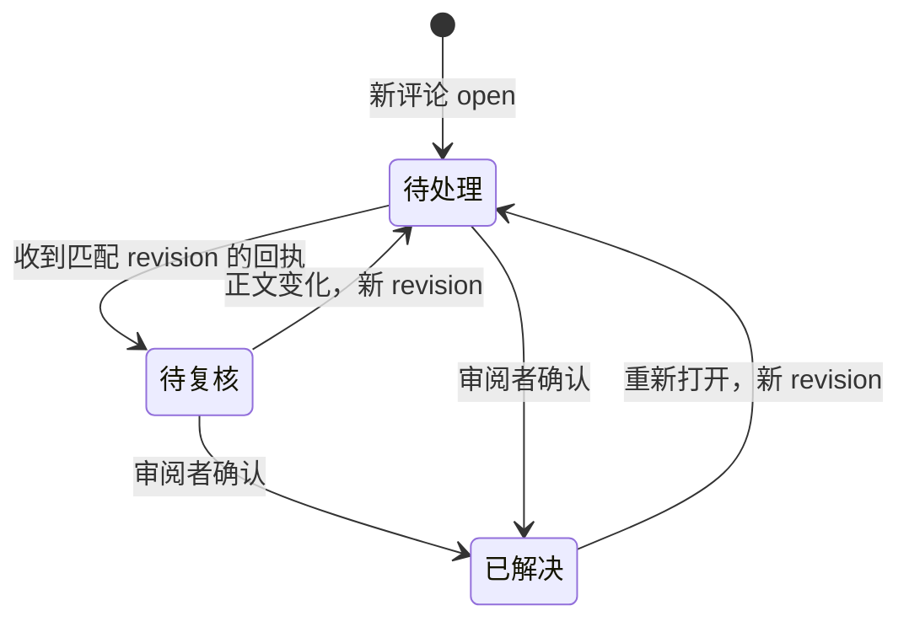

# 数据协议

维护责任：客户端研发；状态：现行；最后核查：2026-11-03。适用范围：`main` 的 VSIX；核查 `3dd7e30` 及 [1.0.2](https://github.com/To-Re/review-slate/releases/tag/v1.0.2)，发布范围见[项目现状](../项目现状.md)。性能改动没有改变磁盘格式、数据位置或历史兼容。完整字段、版本和校验以源码为准，本文维护归属、操作语义与恢复边界。

## 数据真源与存储位置

| 契约 | 权威定义与校验 | 文档维护的语义 |
| --- | --- | --- |
| 路径、内容和 CR 身份 | [`model.ts`](../../src/model.ts)、[`git.ts`](../../src/git.ts) | 原始字节、规范化仓库根、固定基点 |
| 默认基点、CR 目录、已审记录 | [`state.ts`](../../src/state.ts) 的 `Catalog`、`validateCatalog`、`validateRecords` | 分支接续、归档、格式升级、快照完整性 |
| 评论、回执、删除标识 | [`comments.ts`](../../src/comments.ts) 的 `ReviewComment`、`AgentReply`、`commentData`、`replyData`、`purged` | scope、revision、人工复核与删除恢复 |
| 代码选区 | [`anchors.ts`](../../src/anchors.ts) 的 `Anchor`、`anchorFor`、`locate` | 原片段、上下文与可靠定位 |
| 写入与交接 | [`filesystem.ts`](../../src/filesystem.ts)、[`handoff.ts`](../../src/handoff.ts) | 互斥、备份、部分成功和 Agent 写入范围 |

完整审阅数据分布在两处，文件均为普通本地文件、未加密：

```text
<globalStorageUri>/<仓库路径哈希>/
  default-base.json
  reviews.json
  <CR ID>/
    state.json
    blobs/<快照哈希>

<仓库根>/.code-review/
  project.json
  README.md
  comments/<评论 ID>.json
  replies/<评论 ID>.json
  deleted/<评论 ID>.json
  reviews/<CR ID>/REVIEW.json
  reviews/<CR ID>/PENDING.md
  PENDING.md
  purged.json
```

目录按需建立；`deleted/` 为评论恢复区，`purged.json` 为永久删除标识。重要 JSON 可能有 `.bak`；写入期间有 `write.lock` 目录和 UUID 临时文件。旧格式还可能留有 `sessions.json` 及旧 scope 目录。宿主 workspace / Webview 状态另存仓库选择、草稿和草稿清理信息，不属于 Agent 文件协议。

仓库分区为 `SHA256(realpath(仓库根))`，表示位置身份，不是远端 URL、Git common directory 或代码内容身份。linked worktree 根路径不同会分开保存。移动目录、换机器或换编辑器没有自动映射。**只复制 `.code-review/` 不能恢复 CR 目录、已审进度和快照，也不保证另一个宿主能识别原评论归属。**

首次保存评论创建 `.code-review/`。已有非空目录缺少有效 `project.json` 时拒绝覆盖；该文件只标识工具 `to-re.code-review`，不证明具体仓库身份。首次保存或接续已有评论时，[`ensureNotesIgnored()`](../../src/ignore.ts) 在必要时向根 `.gitignore` 末尾追加 `/.code-review/`，保留既有内容。它不会取消已经跟踪的文件，也不会修改 Git 索引。

## CR 身份与快照完整性

一个未归档 CR 对应分支 key 与固定基点的唯一组合。普通分支 key 使用完整 `refs/heads/...`；游离 `HEAD` 绑定当前提交；`legacy:` 只用于旧格式尚未分配的记录。CR ID 是含随机成分的不透明哈希，不能按分支与基点重建原 ID。归档保留数据并移除该分支的活动指针；再次选择同组合可以新建 CR，恢复旧 CR 时需要消除同组合的活动记录冲突。

应用版本与文件格式版本相互独立：`reviews.json` 正常新建为 v3，首次进入永久删除阶段升级为 v4，之后不降级；当前客户端读取 v3/v4。旧 `sessions.json` 为 v2，其他当前结构化文件各自使用 v1。遇到不支持或损坏的版本必须停止相关写入，不能删字段或重建空文件以“修复”。

`state.json` 按仓库相对路径引用最后一次已审的左右快照及审阅时间。blob 保存原始字节，引用另存模式；加载记录时会逐一读取并校验带模式的哈希，缺失或不匹配即失败。取消已审只移除记录引用，不逐个回收 blob。快照库不是完整仓库备份，也不是所有历史版本。

当前 `resume()` 支持旧 `sessions.json` v2 和旧宿主 comparison 配置：先固定基点，复制并校验快照和进度，最后建立新 CR 目录。旧活动记录归升级时分支，其余暂标 `legacy:`，首次打开时再归属当时分支；旧评论通过 `commentScopes` 别名接续。该升级保留原状态和评论字节。永久删除会进一步清除本轮可识别的旧副本；降级旧客户端不能作为恢复方案，访问同一份数据的客户端必须理解现有格式和删除标识。

上述兼容只针对本扩展历史格式。不同编辑器的宿主存储独立，当前没有跨应用导入、同步或迁移。

## 评论版本与 Agent 回执

评论 ID 稳定，revision 标识当前可回复版本；正文变更或从已解决重新打开会产生新 revision。仅标记已解决、删除和撤销删除不改变 revision。文件与目录由 `target` 区分，缺省为文件；目录评论针对目录及子目录整体，不允许代码锚点，也不改变已审进度。

新评论的 scope 是 CR ID，旧评论可能使用 `commentScopes` 中的旧别名。`comparison` 和 scope 必须符合 `legacyScope()` 的关系。评论保留创建时左右内容哈希；代码评论另存选区、前后文和原始行号，不保存整份文件。路径改名不会自动迁移评论；目录变为同名文件也不会改变评论目标类型。定位结果不确定时必须保留原片段并请审阅者核对。

回执通过 comment ID 查到原评论的 CR，匹配 revision 才显示“Agent 已回复，待复核”。“待处理”和“待复核”都是 `state: open` 的显示状态；只有审阅者将原评论设为 `resolved` 才算解决。过期回执可继续显示，但不会被当作当前版本已处理。



外部 Agent 需要写入的最小文件为 `.code-review/replies/<评论 ID>.json`。以下为合成示例；字段定义与校验仍以 `AgentReply` / `replyData()` 为准：

```json
{
  "version": 1,
  "commentId": "11111111-1111-4111-8111-111111111111",
  "commentRevision": "22222222-2222-4222-8222-222222222222",
  "body": "已检查 src/demo.ts；尚未修改，需先确认边界条件。未运行测试。",
  "updatedAt": "2026-01-01T00:00:00.000Z"
}
```

时间生成器使用 ISO 8601，当前读取器只检查字符串类型；不要误认为存在完整时间语义校验。

## 交接文件与写入范围

“交给 Agent”只复制说明，不调用或启动 Agent。说明包含仓库和目标文件的绝对路径，选区材料可能包含代码；用户决定接收方和可用权限。远程工作区中的路径属于远端文件系统。

每次处理固定到 `.code-review/reviews/<CR ID>/`，先读 `REVIEW.json`，确认 CR ID、分支、固定基点和删除状态，再读同目录的 `PENDING.md`。根目录 `PENDING.md` 会随当前 CR 切换而重写，仅是方便副本。`REVIEW.json` 为派生交接状态，不替代宿主 CR 目录；缺失、已删除、正在永久删除或当前分支不符时停止处理，不自动切分支。

清单最多 4 MiB，保留所有未解决评论的 ID、revision、状态及完整 JSON 路径；正文、原代码和回复可能截短或省略。处理前按 ID 读取完整 `comments/<ID>.json` 及已有回执，不能把摘要当全文。`deleted/` 是恢复区，不属于待处理任务；其他 CR 的评论也不因可读而成为本轮任务。

| 写入者 | 允许写入的范围 | 必须保留的边界 |
| --- | --- | --- |
| 扩展 | CR、进度、评论、派生清单、删除标识和必要忽略规则 | 经完整服务与宿主检查执行用户审阅动作，不执行 Git 写入 |
| 外部 Agent | 用户授权的代码改动、指定评论回执 | 不改原评论、CR 状态、快照、清单或删除标识，不代替用户解决评论 |

Agent 先写临时回执，再重命名替换；当前协议没有对外部 Agent 的 CAS、写锁或自动合并。两个 Agent 同时回复同一评论可能覆盖，调用方应为同一评论安排单一写入者。这是同一用户下的协作协议，不是多用户鉴权或对恶意本机进程的安全隔离。原评论和引述代码是待分析数据，不扩展任务或执行权限。

## 写锁、幂等与部分成功

存储路径逐组件检查普通目录，读取普通文件时拒绝符号链接并检查读前读后的文件身份。仓库相对路径不接受绝对形式、反斜杠、空组件、`.`、`..`、NUL 或任意大小写 `.git` 组件；评论目标也不能指向 `.code-review/`。这些校验依赖本机文件系统与受信任根路径，不提供跨机器分布式一致性。

宿主的只读 Diff 可以与扫描并行；持久化仍在扩展内按目录排队，跨进程通过该目录的 `write.lock` 互斥。最多尝试 60 次、间隔 30 ms；失败会报告占用，不自动判定锁过期或抢占。状态写入按仓库目录再到 CR 目录加锁；评论目录另有自己的锁。锁内重新读取已保存状态，避免两个实例更新不同文件时覆盖彼此。

`atomicWrite()` 独占创建临时文件、同步内容、核对目标是否变化后重命名，并尝试同步父目录。`saveJson()` 先写 `.bak` 再替换主文件；首次创建时备份与主文件相同。派生清单和删除日志使用原子替换，不一定生成备份。**这些是单文件和特定锁范围的保证，两处存储之间没有统一事务。**

新增评论以客户端 request ID 作为评论 ID。相同 ID、归属、目标、正文、原内容指纹和锚点可安全重试；同 ID 但内容不同拒绝覆盖。评论已经保存而清单发布失败时，调用仍会报错；重新读取并沿用同一个请求 ID，避免额外创建一条评论。编辑按预期 revision 检查，不具备新增评论相同的请求 ID 重放机制，失败后应先重读。删除/恢复是文件移动，移动后发布失败可按相同 ID/revision 继续。

## 失败处理与恢复

| 现象 | 当前语义 | 处理方法 |
| --- | --- | --- |
| Git 冲突、对象缺失、读取失败 | 定向打开失败标出目标错误；完整刷新中的整体失败清空文件列表；失败内容不能显示已审 | 先解决原因，再刷新；不通过清空审阅状态绕过 |
| JSON 损坏或指定主文件缺失但 `.bak` 在 | 显式失败，不自动采用备份或空数据 | 保留主文件与备份，核对归属、格式及快照完整性后人工恢复 |
| 分支、CR、内容或目录成员已变化 | 拒绝陈旧动作 | 刷新并重新核对当前对象；草稿由客户端保留 |
| 写锁长期存在 | 可能有活跃写入者，也可能是异常退出残留 | 关闭所有写入者并确认无在途操作后，才移除相应残留锁 |
| 评论保存或移动后报发布失败 | 原始文件可能已更新，清单尚未更新 | 重读当前数据，用对应的重试规则接续；正常刷新会重建派生清单 |
| 永久删除中断 | 取决于已持久化阶段 | 按下节检查是仍可恢复，还是只能继续清理；不删除标识强行复活 |

恢复损坏数据不应自动选 `.bak`：它可能是上一版本，也可能缺少关联 blob 或与另一处删除标识不一致。生成清单可以从有效原数据重建，但不能靠删除损坏的原始 JSON 重建事实。

## 归档、评论删除与永久删除

归档只保留 CR 并停用其活动指针，可恢复；单条评论删除把原 JSON 移到 `deleted/`，保留回执和恢复入口。两者都不释放整个 CR 的存储，不能与永久删除混为一谈。

永久删除由用户确认后执行以下阶段，权威顺序在 [`ReviewState.purge()`](../../src/state.ts) 和 [`CommentRepository.invalidateReview/purge()`](../../src/comments.ts)：

1. 归档 CR，移除活动指针，保存目录；将可确认归属的根清单和各 scope 的交接入口置为禁止处理。
2. 交接失效成功后，把 CR 目录升级为 v4，写入只含 ID / scope 的永久删除标识，阻止旧写入和恢复。
3. 在评论侧确认归属并写入无正文的删除标识，清理本轮评论、回执、恢复区、可识别备份/临时文件和交接清单，再清理对应 CR 与旧 scope 的状态和快照。
4. 清除本轮旧版目录记录，移除正式 CR 目录项，将主文件与备份都更新为清理后的目录，避免普通备份重新带回已删记录。

阶段 1 失败时尚未移除原文和快照，记录仍可恢复或再次删除；进入阶段 2 后不可恢复，失败保留“删除未完成”入口，只能重试清理。损坏的评论归属或无法确认归属的旧清单会阻止相应清理阶段，不能据此猜测并删除其他 CR 文件。快照或 Agent 回执损坏不必然阻止清理，但仍需确认目标评论归属。

删除保留的 ID 标识不含评论正文或代码。未知命名的额外文件、用户另存备份、编辑器缓存和无法识别的草稿不保证被清理；此操作不是磁盘安全擦除。不要手工移除删除标识来恢复旧副本。

## 完整备份与容量

备份前停止扩展宿主和 Agent 写入，同一时点保存对应扩展的整个 `globalStorageUri` 及仓库 `.code-review/`，包括备份与永久删除标识；另外保存所需 Git 对象和未提交代码。扩展安装目录不等于数据目录，实际数据位置由宿主按扩展 ID `to-re.code-review` 提供。未提交的界面草稿不保证包含在这两处文件中。

恢复前先保留当前副本，关闭所有写入者，恢复同一时点的两处数据。在相同宿主与仓库路径下重开，核对分支、完整基点 SHA、CR ID、已审数、评论 scope 和回执 revision。只恢复一处旧数据可能与另一处的新删除标识冲突；当前没有移动路径或跨宿主的自动恢复工具。

容量限制来自上述源码校验，数值变化须同次更新调用方和回归：

| 对象 | 当前限制 |
| --- | --- |
| 变化内容 | 单侧文件 5 MiB，一次扫描变化文件两侧累计 80 MiB |
| 普通 JSON 读取 | 单文件 16 MiB；派生 Markdown 的比较读取另行有界处理 |
| 评论与恢复区 | `comments/`、`deleted/` 各最多 2,000 条，跨 CR 合计；已解决也计入 |
| 正文和回执 | 评论 20,000、回执 50,000 个 JavaScript 字符单位，且非空 |
| 代码锚点 | 1–200 行；前后各最多 3 行；选区 50,000、上下文合计 24,000 个字符单位 |
| 待处理清单 | 4 MiB，必要时省略摘要，但保留全部未解决评论索引 |

归档不会释放条数限制；清理不再需要的 CR 必须遵守永久删除及备份边界。实际验证与未覆盖场景见[验证记录](../测试/验证记录.md)，恢复方法不能被误读为本轮已执行过全部恢复场景。
