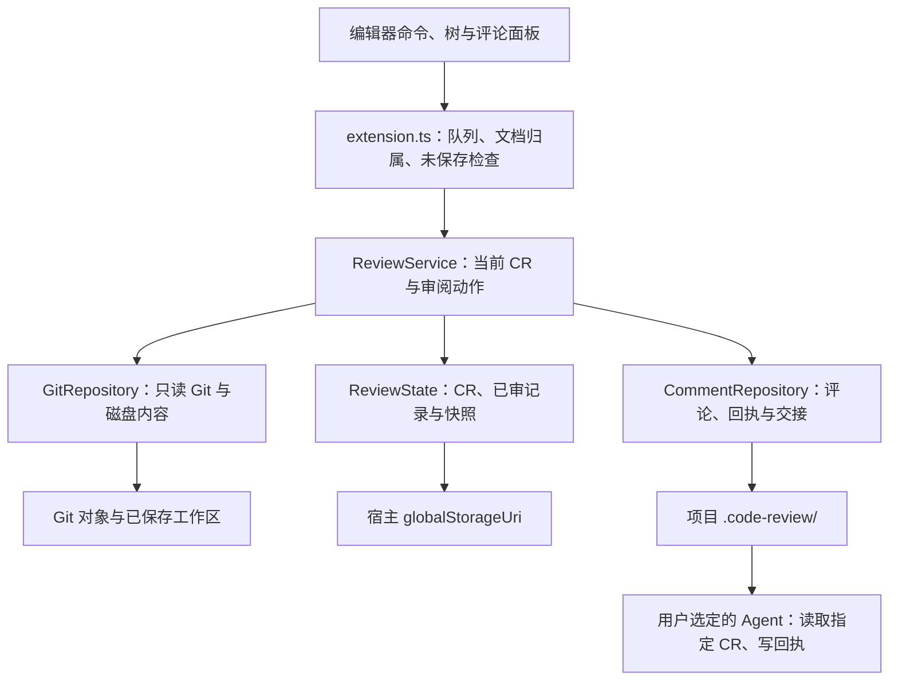

# 本地审阅引擎

维护责任：客户端研发；状态：现行实现说明，Codex 部分为待实施方案；最后核查：2026-11-03。核查基线为 `689de24`，其中正式源码与 VSIX 1.0.1 的发布提交 `d7e6b0d` 相同。本轮只重建文档，没有变更运行时代码或数据格式。

本文说明客户端内部的只读 Git、内容身份、CR 状态、评论与持久化。字段与读取校验以源码为准，[数据协议](数据协议.md)维护数据归属、文件交接和恢复方法；编辑器入口与界面生命周期从[客户端总览](README.md)进入。[产品](../产品/README.md)维护用户规则，验证范围统一见[测试](../测试/README.md)。

## 运行边界与代码地图

ReviewSlate 1.0.1 是在 VS Code 系扩展宿主中运行的 TypeScript 程序。运行时使用编辑器 API、Node.js 内置模块和可执行的 Git，没有第三方运行依赖、HTTP 监听、插件自建上传通道或常驻服务。Remote SSH 中 Git、文件读取和存储发生在远端扩展宿主。项目没有服务部署、生产数据库或后台运维任务。

[`package.json`](../../package.json) 声明 workspace 扩展、`dist/extension.js` 入口及 API `^1.107.0`；不支持虚拟或不受信任的工作区。稳定标识包括扩展 ID `to-re.code-review`、`codeReview.*` 命令、`code-review` 文档 URI 和项目 `.code-review/` 目录。新增宿主不改变这些既有入口。

核心模块未导入 `vscode`，但尚未成为独立包；必须结合适配层才能得到当前产品的完整保护。

| 责任 | 权威代码 | 接手时关注 |
| --- | --- | --- |
| 内容模型与限制 | [`model.ts`](../../src/model.ts) | `Snapshot`、`Pair`、指纹、路径校验与大小限制 |
| 仓库与基点 | [`git.ts`](../../src/git.ts)、[`baselines.ts`](../../src/baselines.ts) | 根路径规范化、只读命令、主分支选择与扫描 |
| 审阅协调 | [`review.ts`](../../src/review.ts) | `ReviewView`、`Selection`、`MarkRequest`、刷新与归属检查 |
| CR 和进度 | [`state.ts`](../../src/state.ts) | `Catalog` 校验、分支恢复、快照完整性、旧格式升级与永久删除 |
| 评论与定位 | [`comments.ts`](../../src/comments.ts)、[`anchors.ts`](../../src/anchors.ts) | scope、revision、幂等请求、原片段与定位结果 |
| 本地 I/O 与交接 | [`filesystem.ts`](../../src/filesystem.ts)、[`ignore.ts`](../../src/ignore.ts)、[`handoff.ts`](../../src/handoff.ts) | 写锁、原子替换、忽略规则和外部 Agent 的有限写入范围 |

## 从打开仓库到保存进度

[`ReviewExtension`](../../src/extension.ts) 从工作区和内置 Git 扩展发现仓库，经 `GitRepository.open()` 取得 `realpath` 根目录，再构造 `ReviewService(repo, globalStorageUri.fsPath)`。当前界面一次展示一个仓库。`start()` 先恢复当前分支的活动 CR，再刷新数据；仓库选择保存在宿主 workspace state 中。

新建审阅有两条基点路径：选择分支时，适配层调用 `forkPoint()` 求它与 `HEAD` 的共同祖先；选择提交时直接解析提交。`choose()` 验证并保存完整 SHA，随后 `state.select()` 复用同分支、同基点的未归档 CR，或生成新 ID。基点固定后不随 `HEAD` 或主分支移动；设置仓库默认基点只影响下次选择。

刷新按当前分支读取 CR 目录、同步评论与派生清单、校验已审记录及 blob，再扫描工作区。文件没有记录时为 `pending`；当前指纹与记录相同为 `reviewed`，否则为 `changed`。只有评论、没有当前差异的路径仍会补入视图，但不计作待勾选的变更文件。目录进度由客户端聚合，不额外持久化一份目录已审状态。

文件指纹由左右两侧的模式和原始字节决定：`snapshotId = SHA256(mode + NUL + bytes)`，`pairId = SHA256(left.hash + right.hash)`。它不是 Git blob ID，也不依赖当前提交、mtime 或暂存状态。只做 stage / commit 而内容未变会保留进度；恢复到原已审内容后也能重新匹配。每个路径只保存最后一次已审引用，“上次审阅后的变化”读取这份引用对应的快照。

标记动作必须通过 `ReviewService.mark()`：请求带上展示时的 CR、路径、指纹和勾选值；目录动作还要携带当时的成员列表。服务重新刷新，检查内容和成员变化，再检查活动分支/CR，并在写锁内复查归属。宿主还需提供未保存文档检查。直接调用 `state.record()` 写入一份旧 `Pair` 会绕过前面的保护，不能作为新适配器的标记入口。

## Git 扫描的保证与限制

Git 经 `execFile` 调用，白名单只有 `rev-parse`、`for-each-ref`、`merge-base`、`log`、`ls-tree`、`ls-files`、`cat-file`。实现关闭可选锁、fsmonitor、懒加载、替换对象和终端提示，不执行 fetch、checkout、索引写入、Git 过滤器或 external diff。缺失对象会报错，不主动联网补齐。

候选路径来自固定基点树、索引、未忽略的未跟踪文件和历史已审路径；`.code-review/` 始终排除。索引用于发现路径、类型与合并冲突，右侧读取磁盘已保存内容，不独立展示暂存区版本。扫描前后比较 `HEAD`，服务另查分支和活动 CR。这是对并发变化的检查，不是对整个仓库加锁或取得全仓事务快照。

| 边界 | 当前行为 |
| --- | --- |
| 单次 Git 调用 | 超时 30 秒，输出上限 32 MiB；没有整轮扫描总超时或公共取消接口 |
| 内容读取 | 变化文件单侧最多 5 MiB；一次扫描变化文件两侧累计最多 80 MiB |
| 大文件与缓存 | 未变化文件可按 Git blob 摘要校验后跳过；对象缓存受 20 MiB / 1,000 项上限控制 |
| 特殊内容 | 二进制、非 UTF-8 以摘要展示；符号链接只读链接文本，不跟随父目录链接；子模块需另开仓库 |
| Git 展示差异 | 比较原始磁盘字节，不做 clean、LFS、换行或 textconv 转换，结果可能与 Git 的过滤后展示不同 |
| 文件错误 | 单个文件读取错误保留错误行；合并冲突、累计超限等整体错误使刷新失败 |

扫描失败时 `ReviewService` 清空 `view.files` 并设置 `view.error`。调用方不能把保留的旧 session 或 notes 当作最新可写视图。未读到内容不能转成“没有差异”或“已审”。

## 核心与宿主必须共同守住的写入边界

| 动作 | 核心已有检查 | 当前宿主补充检查 |
| --- | --- | --- |
| 标记已审 | CR、展示指纹、目录成员、写锁内活动归属 | 未保存文档；界面请求不能偷偷换成最新成员列表 |
| 新增评论 | CR 归属、内容格式、请求 ID 重试一致性、删除标识 | 当前页面 key、目标类型、选区来源 |
| 编辑、解决、删除、恢复评论 | 预期 revision、文件完整性、写锁内 guard | 从当前 CR 的可见评论查找 ID，核对路径/目录目标 |
| 选区评论 | 锚点大小、原始内容及定位算法 | 只认本工具完整 Diff；普通 Git Diff、旧 CR 标签和共享工作区 URI 不借用当前身份 |
| 可编辑 Diff | `editablePath()` 复读普通 UTF-8 文件，检查当前快照 | 编辑器负责保存；取选区时再次核对缓冲区与磁盘 |
| 永久删除 | 归档、交接失效、删除标识和可重试清理 | 用户确认，清理本宿主能识别的相关草稿 |

评论更新不是凭 ID 获得权限的公共 API。直接使用 `CommentRepository.update/remove/restore()` 的调用方，必须先检查目标归属并提供 `beforeWrite` guard。`Selection.key` 包含内容指纹，`draftKey` 则按仓库、CR 和路径稳定保存草稿；目录和文件的身份独立。

评论锚点保存原选区及前后文。[`locate()`](../../src/anchors.ts) 只在内容相同或可唯一匹配时返回原位、移动或上下文间内容改变的位置；无法确认时返回 `unavailable`，保留原片段。它没有 AST 语义定位或改名追踪能力。

## 本地运行、故障与验证

扩展的命令和刷新经 `enqueue()` 串行执行。保存文档、视图重新显示会触发刷新；文件树或 CR 树可见且队列空闲时，每 5 秒刷新一次。退出时清除定时器和监听器。当前没有独立健康接口或结构化错误码；失败通过异常、视图错误和宿主通知呈现，不应将错误文案当作机器协议。

`refresh()` 会在已有评论目录中补充忽略规则并重建清单，有本地写入副作用。诊断时先区分 Git/文件读取、数据校验、写锁等待、落盘和界面确认；保存报错不一定意味着尚未写入任何文件。具体恢复步骤见[数据协议](数据协议.md#失败处理与恢复)。收集问题只保留脱敏错误和合成复现，不直接发布含路径、评论或代码的原文件。

构建入口见 [CONTRIBUTING.md](../../CONTRIBUTING.md)。开发使用 TypeScript 编译和 Node.js 测试，核心测试调用真实 Git、临时合成仓库与文件系统；编辑器和 DOM 测试是模拟宿主。以下入口用于定位回归，不代表本轮全部执行：

| 风险 | 测试入口 |
| --- | --- |
| 内容身份、恢复、Git 只读与路径边界 | [`review.test.cjs`](../../test/review.test.cjs)、[`editable.test.cjs`](../../test/editable.test.cjs) |
| CR 归属、分支和旧格式 | [`reviews.test.cjs`](../../test/reviews.test.cjs)、[`baselines.test.cjs`](../../test/baselines.test.cjs) |
| 评论、幂等、目录与原片段 | [`comments.test.cjs`](../../test/comments.test.cjs)、[`directories.test.cjs`](../../test/directories.test.cjs) |
| 部分失败、永久删除与大清单 | [`purge.test.cjs`](../../test/purge.test.cjs)、[`pending-size.test.cjs`](../../test/pending-size.test.cjs)、[`ignore.test.cjs`](../../test/ignore.test.cjs) |
| 宿主归属和草稿确认 | [`editor-context.test.cjs`](../../test/editor-context.test.cjs)、[`editor.test.cjs`](../../test/editor.test.cjs)、[`panel.test.cjs`](../../test/panel.test.cjs) |

本轮核查了上述核心实现及 `extension.ts` 的写入调用链；TypeScript 编译通过，并对新进程恢复、分支接续、内容变化、陈旧勾选、并发记录、旧格式、损坏数据、请求重试、评论版本及永久删除阶段执行 14 项定向回归，全部通过。环境为 macOS arm64、Node.js 23.11.0、Git 2.55.0；它不替代 Node.js 22 CI 或真实编辑器验收。精确命令与记录由[验证记录](../测试/验证记录.md)集中维护。本轮未重新打包、安装或发布 VSIX，未验证 Codex Git 审阅。

## Codex 核心适配：决定与实施边界

目标是在 Codex 应用内连续完成 Git 人工审阅，关闭重开后接续基点、进度、评论与导航。各应用独立存储，不做跨应用互通、同步或迁移；不增加 HTTP 监听、常驻服务器或服务部署。目标宿主协议与接入证据由[Codex 接入](Codex接入.md)维护，本地合成探针不属于正式审阅引擎。

当前模块适合复用，但以下工作尚未实施：

1. **明确核心调用边界。** 以 `ReviewService` 协调 Git、CR 和评论；把目前散在宿主的目标归属与脏文件检查显式纳入适配契约。保留 VSIX 的默认调用与存储行为，不为接入改写既有 CR 身份。
2. **使数据位置可配置。** Codex 拟使用独立的 `.reviewslate/codex/`。仅更换 `ReviewService` 的 storage 参数不能隔离评论：`NOTES_FOLDER`、评论仓库、忽略规则、扫描排除及交接文本均仍固定 `.code-review/`。正式改动必须覆盖这些入口，并在合成仓库证明两套数据互不修改；具体布局与版本尚未成为正式协议。
3. **定义跨进程请求和结果。** 现有接口含 `Buffer`、`Map`、回调和异常字符串，不能直接当稳定 RPC。客户端研发需同时定义页面与本地执行层使用的可序列化身份、快照/展示版本、幂等 ID、预期 revision 和错误分类，在代码中确定唯一契约来源。数据损坏、归属过期、内容过期、写入占用和存储失败需要可区分；错误回执不能假装保存成功。
4. **覆盖生命周期和导航。** 新适配器需界定刷新顺序、迟到响应、关闭时的在途调用及重开恢复。现有数据只保证 CR、内容与评论的持久化，不能据此声称已实现文件选择、树展开、Diff 位置的连续导航。若宿主没有可靠保存和脏状态接口，先按产品确认的只读方式处理，不把内存编辑当磁盘快照。

正式实现应先贯通一个合成仓库：固定基点 → 树与 Diff → 文件评论与已审 → 关闭重开 → 内容改变与分支切回，再补齐目录、旧页面和并发失败场景。现有模块与测试可作为依据，不能替代新适配器的验收。真实宿主接入、正式存储布局、跨进程错误契约和可分发运行时仍是未完成项，接续责任与状态见[项目状态](../项目状态.md)。
