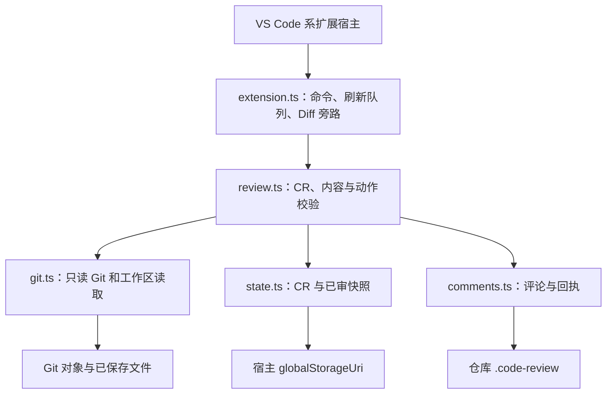

# 本地审阅引擎

维护责任：客户端研发；状态：现行；最后核查：2026-11-04。适用范围：`main` 的 VSIX 1.0.3，沿用既有审阅引擎和数据协议。来源为本文链接的源码；版本与安装入口见[客户端](README.md)，发布范围见[项目现状](../项目现状.md)，执行证据见[测试记录](../测试/验证记录.md)，不将实现存在视为实机验收。

## 模块和数据流

[`model.ts`](../../src/model.ts) 定义路径、快照和指纹；[`anchors.ts`](../../src/anchors.ts) 处理代码锚点；[`filesystem.ts`](../../src/filesystem.ts) 提供安全读取、写锁与原子替换；[`ignore.ts`](../../src/ignore.ts) 和 [`handoff.ts`](../../src/handoff.ts) 管理忽略规则与交接说明。核心模块不导入 `vscode`，但当前没有独立服务或公开 RPC。

Git、文件操作和存储都发生在扩展宿主所在机器。运行时无遥测、上传、HTTP 监听或仓库联网补对象。完整 Diff 的可编辑右侧交给宿主修改真实工作区；这是编辑器保存，不是 Git 写入。

## CR 与内容身份

打开仓库以 `realpath` 得到根路径，`start()` 恢复当前分支的活动 CR。选择分支基点时取共同祖先，选择提交时解析完整 SHA；同分支、同固定基点复用未归档 CR。设置默认基点不移动当前 CR 的固定 SHA。

`choose()` 在持久化前完整扫描验证基点，保存或复用 CR 后再次刷新。保留这两个阶段，防止预检失败却替换现有 CR；性能优化没有删掉首次完整校验。

完整刷新读取分支、CR 目录、评论、已审记录及快照，再扫描候选路径；最后复核活动归属并发布 `ReviewView`。没有记录为 `pending`，当前指纹匹配最后已审记录为 `reviewed`，不匹配为 `changed`。无差异但仍有评论的路径以 `commentOnly` 保留，目录汇总不另存一份已审数据。

变更树筛选只在客户端对已有视图做投影，不修改 `ReviewView` 或触发扫描。筛选中客户端拒绝目录与整树批量标记；单文件仍调用相同 `ReviewService.mark()`，恢复全部后目录仍携带完整成员和指纹校验。核心不接收筛选后的目录列表作为新的标记协议。

`snapshotId` 是 `SHA256(mode + NUL + 原始字节)`，`pairId` 由左右快照身份共同生成，均不依赖当前提交或暂存状态。stage／commit 不改变字节时保留进度，恢复已审字节后重新匹配。每个路径只保存最后一次已审左右快照；文件模式变化也改变内容身份。

## 扫描和批量读取

候选路径来自固定基点树、当前索引、未忽略的未跟踪路径及已有已审路径，始终排除 `.code-review/`。索引用来发现路径、子模块和冲突；右侧是磁盘已保存字节，不单独显示暂存区。扫描前后核对 `HEAD`，服务再核对分支和 CR；这不是全仓事务快照。

[`GitRepository.scan()`](../../src/git.ts) 对最多 8 个文件同时执行既有安全读取，每轮最多领取 512 个路径。已保留的工作区内容达到 16 MiB 后停止领取新路径，等已启动的读取全部结束，再处理当前批次。8 个在途文件可能使临时保留量超过 16 MiB；该值是调度阈值，不是整个进程的内存上限。失败也等待已启动的读取结束，不留下跨扫描的后台读取。

变化文件的不可变 Git 对象使用 `cat-file --batch-check` 先检查类型与大小，再以 `--batch` 读取。一个内容批次最多 512 个对象、16 MiB 数据；协议输入仅为校验过的对象 ID，解析核对 ID、类型、字节数、分隔和末尾。共享 blob 去重，已有对象缓存继续受 20 MiB／1,000 项约束。对象缓存可能在同一扫描中淘汰，但当前批次保留自己的对象引用。

这些改动减少逐文件 Git 进程和串行磁盘等待，没有改为依赖 `git diff` 路径集，也没有跳过候选工作区检查。未变化普通文件可在已验证过内容后凭同基点、模式、设备、inode、大小、mtime、ctime 的完整签名复用“与基点相同”的结论；变化内容仍复读，符号链接只读链接文本。

| 边界 | 实现语义 |
| --- | --- |
| Git 执行 | `execFile`，仅允许 `rev-parse`、`for-each-ref`、`merge-base`、`log`、`ls-tree`、`ls-files`、`cat-file` |
| Git 副作用 | 关闭可选锁、fsmonitor、懒加载、替换对象、协议访问与终端提示；不 fetch、checkout、调用过滤器或 external diff |
| 单次进程 | 30 秒超时、32 MiB 输出限制；没有整轮扫描总超时 |
| 内容大小 | 变化文件单侧 5 MiB，整轮变化文件左右累计 80 MiB；超限不产生成功视图 |
| 未变化大文件 | 可流式验证是否与基点一致；变化后不能保存超限快照 |
| 路径与文件 | 父目录逐层检查，不跟随链接；普通文件用 `O_NOFOLLOW` 打开并校验读取前后身份和属性 |
| 单文件错误 | 保留错误行，不变成“无差异”或“已审” |
| 整体错误 | 冲突、累计超限、CR 校验等失败清空文件列表，保留磁盘数据并显示错误 |

比较不运行 clean、LFS、换行转换或 textconv，因此原始字节结果可能与 Git 经过过滤后的展示不同。子模块要求独立打开为仓库。

## 只读 Diff 与完整写入校验

普通文件点击走 `openFile()`：要求该路径属于当前可用视图并匹配展示 CR，经 `capture()` 读取当前 Pair，前后核对分支／活动 CR 与 `HEAD`。`pair()` 额外读取该路径的索引状态，拒绝新冲突与子模块；路径规格使用 literal 模式。读取后只更新该路径，内容恢复基点且无评论时移除树行，有评论时转成保留评论行。

完整刷新与定向读取共享视图发布版本，正常结果和错误结果都受检查。较早读取完成时若已有其他读取发布，完整刷新重新读取整轮资料与工作区，定向读取重新读取目标；被后续导航替代的请求直接放弃发布。这样旧扫描不能把更新内容恢复成已审，旧定向读取也不能覆盖新完整刷新。并发打开可能使在途完整刷新多扫描一轮，点击本身仍不等待该轮扫描。

定向读取只证明当前目标的新鲜度，其余路径仍由完整刷新更新。打开时按当前视图的差异加目标内容保守检查 80 MiB，超过限制需完整刷新或另选基点。只读旁路不调用 `record()`、评论写入或清单同步；导航守护和编辑器状态检查见[客户端](README.md#文件打开与导航安全)。

`mark()` 保持完整校验链：完整刷新 → CR ID → 展示指纹 → 目录成员 → 未保存 guard → 活动分支／CR → 写锁内归属 → 保存 → 完整刷新。目录请求必须保留用户勾选时的集合；不能在服务端换成扫描后的新成员来“修复”陈旧请求。取消标记只移除指定记录引用，不删除评论或重置整个 CR。

评论新增、修改、解决、删除和恢复检查目标归属、预期 revision 与写锁内 guard。代码选区还依赖宿主确认当前完整 Diff、保存状态和文本一致；直接写 `state.record()` 或评论 JSON 会绕过完整入口，不能当作 UI 操作的替代。

## 性能验证和维护边界

[`test/vsix-performance.test.cjs`](../../test/vsix-performance.test.cjs) 检查批量对象、并发上限、冷／热扫描一致、目标复读、陈旧身份、冲突、链接、刷新合并及扫描中打开；[`test/qa-vsix-performance.test.cjs`](../../test/qa-vsix-performance.test.cjs) 维护独立大仓测量和回归。测量包含“变化文件多”和“跟踪文件多、变化文件少”两类，分别观察首次树、空闲打开、扫描中打开、刷新和标记。

基线取独立冻结的旧版实现，候选以实际源码指纹和编译结果定位；耗时只代表所列硬件、合成数据与模拟宿主。Git 进程数、扫描数和排队时间可用于解释收益，不能转换成所有仓库的响应承诺。完整结果、真实宿主状态与未覆盖项见[测试](../测试/README.md)。

本轮未改变数据格式、存储位置、扩展标识、Git 白名单或评论权限。后续性能工作继续保留真实读取、内容指纹、失败语义与写入归属；不能靠清空数据、忽略错误文件或扩大不校验的缓存取得更快数字。
