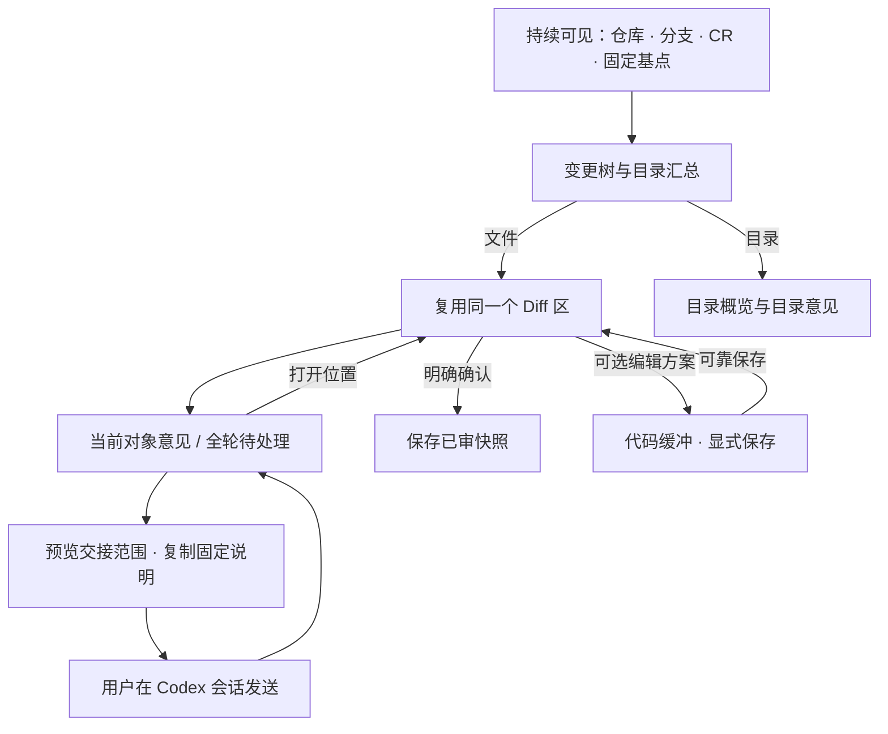

# Codex 人工审阅工作区

维护责任：设计负责人；最后核查：2026-11-03。状态：**0.1.2 目录树热区、动作分离及已审保存后的键盘焦点已在独立测试宿主定向验收通过。0.1.1 入口整改保留原证据范围，真实 Codex 成品设计验收未完成。** 依据：`3dd7e30` 的项目设计基线、本轮[产品规则](../产品/业务规则.md)和[验收条件](../产品/验收条件.md)，以及当前实际客户端核查。宿主能力结论只以 [Codex 接入](../客户端/Codex接入.md)及其实际证据为准。

本页维护 Codex 的布局、交互和状态，不改变[通用设计语义](README.md)、产品 AC 或存储协议。原型仅使用合成数据，未连接 Codex、Git、MCP、HTTP 或任何网络服务；其中的“保存代码”只修改原型数据。

当前实际客户端的入口和视觉实施以[客户端体验整改](客户端体验整改.md)补充本页：最近项目优先、独立设置、紫蓝树与意见区。该整改不新增跨宿主配置或编辑保存能力；原型以下的演示与预审记录保留其原有证据边界。

## 0.1.2 目录树定向验收

2026-11-03，设计在主负责人确认相关检查通过并释放窗口后，独占自有 **ReviewSlate Client Test Host / AppKit / WKWebView**，实际启动包内 UI 与 stdio 服务，只操作合成 `orchard`。宽度约 1440 px、浅色，截图为 2 倍像素；不是原型或真实 Codex。基线为 `3dd7e30` 加未提交的性能与热区改动。

**本轮指定范围通过，可作为本地候选更新的设计依据。** 首轮包 manifest `d94ed6ada1f90d14b59c801307f09be419eb296898a773472101bd3df85ad62c` 已实测热区与动作分离，但发现原生 checkbox 临时禁用后丢失键盘焦点。客户端修正后，设计正常退出并重新启动同一独立应用，复验最终包的实际键盘保存链路及主动移焦；该缺陷已关闭。最终包未改 CSS，前一包的物理热区证据按未变几何沿用，最终截图另确认焦点环、悬停和布局。

| 最终被检输入 | SHA-256 |
| --- | --- |
| 包 manifest | `c1474f2999446e3aade0c77c5cbe7f0e34c4f856e41fe1e152289a87ee3880b6` |
| ZIP | `4f26ab790c4c781d1c65288431c7484f1cde6057e5a1651ea770bbd5ebdc9f3f` |
| 包内 UI | `113019933148c4698af7c2fa4d053d7bb429156e547746e5bbee360623fe7085` |
| `app.ts` | `777b53e77d167340aa31cc3756e99e4e315d8b12d5ee5c0b658e2a01f68521dd` |
| `workspace.css`，两包相同 | `02d22d5d608d40e9f301031636513d3e9a8553fa84e3c9a407c164e0f80e5e81` |

本地实点坐标、输入指纹与 AX 结果摘录在忽略目录 `artifacts/codex-performance/design-hotzone-evidence.json`；截图在本轮 CUA 回传中实际查看，未另外导出。该文件是动作与观察记录，不冒充原始 AX 导出。

| 实际检查 | 结果与证据 |
| --- | --- |
| 箭头边缘 | **通过**：点击 `src` 箭头左上缘与右下缘，先收起再展开；已审维持 1/4，当前 Diff、两条意见和原草稿不变；动作后焦点仍在该箭头 |
| checkbox 外围 | **通过**：点击 `value.test.ts` 的 label 左上和右下外围，真实回执使进度 1/4 → 2/4 → 1/4；没有展开/收起目录或切换当前文件；保存期间控件正确禁用 |
| 目录名称语义 | **通过**：收起 `src` 后点击名称，进入目录概览与目录意见，树保持收起，进度不变；返回 `value.ts` 后原草稿与两条意见仍在 |
| 密度、视觉与箭头焦点 | **通过**：250 px 树内 34 px 行高、两层缩进、32 px 操作区与叶节点空位对齐，目录计数、测试淡绿底和当前紫底无重叠。箭头及 checkbox 的局部悬停可辨；Space 展开后焦点环保留，Tab 到相邻 checkbox 显示独立内收焦点环 |
| 键盘勾选后的焦点 | **修复后通过**：从箭头连续 Tab 到测试文件 checkbox，Space 保存结束后 AX 焦点回到该 checkbox，截图显示独立焦点环；无需重新定位再按 Space，即可撤回至 1/4，结束后焦点仍在原控件。原失败由原生禁用触发 blur，先前模拟 DOM 未覆盖；本结论来自修复包的实际复验 |
| 保存期间主动移焦 | **通过**：Space 后立即 Tab，在“正在更新…”期间焦点移到顶部项目按钮；真实回执到达后仍停留在该按钮，没有被抢回树。失败、切上下文等其他分支未做 GUI 故障注入 |
| 更新后的连续性 | **所列范围通过**：导航保存与无数据变化的后台刷新后箭头/checkbox 的键盘位置可接续，展开与文件切换不清除原评论稿。此观察不证明大型树渲染时间或全部输入场景 |

最终结束已恢复原来的 1/4、`src/deep/value.ts`、展开状态、两条评论和合成草稿，确认“本地已保留”后正常退出测试应用，并通过应用清单确认退出。没有修改原评论正文或状态。验收结束回读最终包及源码指纹，与上表一致；未修改插件安装。

**未执行：** 窄窗、深色、forced-colors、完整键盘遍历与输入法、超深/超长路径及大型树实际渲染计时。测试壳将宿主主题固定为浅色，没有可用主题切换入口；未更改系统主题或绕用脚本注入。后端大仓提速证据见[性能验证](../测试/验证记录.md#2026-11-03-大型-idl-仓库性能验证)，不能从控制器计时推定页面耗时。真实 Codex 面板与完整成品设计验收仍未完成。

## 设计选择

采用**单一审阅工作区**：上方固定身份，左侧导航对象，中间阅读完整 Diff，右侧维护意见。切文件复用主区，不增加标签；历史和新建始终可见，仓库设置、默认基点及危险动作从次级入口进入。审阅者无需从聊天回溯当前 CR，也无需先运行 Agent。

载体优先采用自绘的本地工作区，与宿主管理的本地工具通信；这不依赖获得 Codex 原生资源管理器、侧栏或 Diff API。真实入口、可用宽度、权限和生命周期仍待接入验证。若载体无法成立，记录具体缺失能力并交回范围决策，不把文件列表或自动审查文字当作本方案已实现。

普通 UTF-8 完整 Diff 的工作区侧优先提供显式编辑；本轮原型演示其状态。它仍是待验证的实现选择，不是新加的用户必选。是否启用与可支持的内容范围沿用 AC-06：需可靠保存、识别未保存与外部改动；若先交只读阶段，阶段必须标为受限，并保留完整 Diff 和后续决定。

## 布局与视觉基线

本轮按 `ui-design-presets` 的既有项目优先规则，沿用 ReviewSlate 的紫蓝语言；未采用 Element 预设、运行库或其他框架。依据是现有 [comments.css](../../media/comments.css) 与 [README 中的状态 token](README.md#视觉与布局基准)。原型中的布局数值是本项目建议值，不是宿主或上游标准。

| 范围 | 布局约束与理由 |
| --- | --- |
| 宽工作区，建议内容宽度 ≥ 1200 px | 树约 240–260 px，意见约 336–360 px，Diff 占剩余空间；不将三栏等分。顶部身份与当前对象保持可见，各内容区独立滚动 |
| 760–1199 px | 树约 220 px；Diff 优先。意见从当前对象按钮打开为约 350 px 的侧面板，关闭返回触发控件，保留草稿和对象 |
| ≤ 759 px | 树也收起，由当前对象旁的导航按钮打开。身份、基点和文件路径仍可访问；长代码允许局部滚动。用于受限宿主宽度检查，不承诺移动端产品支持 |
| 新建、历史、基点详情、交接确认 | 次级对话框约 570 px、最大 90vw；内容超高滚动。打开后焦点进入标题或首个可操作项，关闭返回原按钮 |
| 文件树 | 行高至少 34 px；展开与已审热区各为 32 × 32 px、间隔 2 px，名称独立选择对象。目录计数采用紧凑文本，状态有文字/图标及可访问名称，不只靠颜色 |
| Diff | 文件头、视图切换、两侧来源固定；代码默认 11–12 px 等宽、约 1.8 行高，可随宿主缩放。长行必须能完整阅读；不能只截断后依赖 tooltip |
| 意见 | 正文 12–13 px、1.6–1.7 行高；卡片内边距 12 px、间距 12 px；输入最小约 82–92 px。操作组可换行，路径以 LTR 隔离并可折行 |

浅色使用背景 `#f3f6ff`、卡片 `#fcfdff`、正文 `#22375a`、辅助文字 `#536789`、主操作 `#5940ae`、链接 `#284ba9`。待处理用琥珀，待复核用紫，已解决用绿，失败用红；具体语义延续通用基线。深色沿用 `#161e32` / `#1d2943` 背景和较亮文字，原型将主操作调整为 `#9d82e8` 配深色字，以保留深色对比。正式适配须读取宿主主题，不以原型“深色”按钮替代主题契约。

控件圆角 6 px、卡片 8 px，边框 1 px；焦点环 2 px。图标为本地自绘简单 SVG，字体使用系统及系统等宽字体，没有远程字体、图片或新增素材依赖。高对比主题、系统放大和屏幕阅读器仍需正式实现及验收，原型只提供基础名称、焦点环、原生表单与状态区域。

## 任务与关键交互

### 进入、固定基点和切换记录

新用户先选已授权仓库，再选择分支来源或提交 SHA。共同祖先和直接提交两种方式在确认区各自说明，展示来源、说明、完整 SHA；只在验证完成后建立或接续 CR。验证中禁止重复提交；无效、歧义、无共同祖先、分支在选择过程中变化均保留输入并明确原因。取消保留当前记录。

首次启用本应用存储时，在同一确认区显示保存位置、包含的资料及将追加的忽略规则，主动作写“启用并新建审阅”；后续无需重复展示启用步骤。具体位置由客户端实际方案提供，不在主视图堆放数据设置，也不默认接管另一应用已有资料。

工作区顶部持续显示仓库简称、分支、CR、固定短 SHA、基点来源及保存状态；完整 SHA 从独立详情/复制动作获取，不把复制和更换基点绑定为同一次点击。长分支可折行或受控截断，但完整身份可通过详情读取。默认基点放在仓库设置中，并写明只影响之后新建的选择。

审阅记录按“当前分支可接续 → 其他分支 → 已归档”组织。同组合复用后明确提示进度与评论保留；其他分支记录先说明应由用户自行切换分支，插件不 checkout。切换前保存导航和已落盘草稿；切换失败显示目标身份及失败原因，不以原仓库的正常列表冒充新仓库结果。

### 从树阅读并确认已审

文件行选择对象，主区始终只有一个当前 Diff；目录行打开目录概览及直接意见，箭头只展开，checkbox 只操作已审。树显示全仓相对固定基点的变化，不只显示 Agent 触及的文件。路径筛选与“未完成”筛选不改变全局进度分母。

#### 目录操作热区

0.1.2 沿用紧凑树布局，展开按钮和原生 checkbox 的 label 分别占固定 32 × 32 px，之间留 2 px；14 px 箭头与 16 px checkbox 居中。行高至少 34 px、层级缩进 16 px，叶节点保留相同宽度的展开空位。热区不能借透明覆盖层侵入名称、相邻勾选或下一行；名称过长时省略，完整相对路径保留在 tooltip，展开与已审控件的可访问名称包含路径。

悬停时只突出所指控件，使用现有浅紫背景与紫色前景；键盘焦点环为 2 px 并内收，避免与相邻控件混淆。禁用的已审控件保留原因和不可用状态，不呈现可操作的悬停效果。箭头的可访问名称包含展开/折叠动作和目录路径，并同步 `aria-expanded`；展开后焦点回到该箭头。checkbox 的名称与提示说明将标记或取消哪些变化文件，点击 label 外围与点击控件中心执行同一已审动作。键盘勾选后，临时禁用不能使用户失去原位置；保存结束仍停留在原控件。若等待期间用户主动移到别处、对象已不可用或上下文改变，不强行抢回焦点。

目录名称仍打开目录概览和意见，不能因扩大热区而改成整行展开或批量已审。展开、收起及后台刷新均应保留当前对象、意见草稿和已审进度；没有数据变化的更新应保留现有输入节点与焦点。热区规格取代早期整改稿中的 16 px 展开列与至少 24 px 勾选热区，实际验收范围见本页当前候选记录。

目录呈现 `已审数 / 变化文件总数`；部分已审显示中间态，折叠仍保留汇总。单击部分目录的 checkbox 表示确认整个目录范围，tooltip 和可访问名称明确“标记本目录 N 个变化文件已审”；已审完时表示取消该范围。实际写入前重新验证整组对象，失败保留原记录并指出受影响文件。

未保存与读取失败阻止文件及对应目录认证；目录不得把部分成功呈现为全部完成。评论数包含本目录与所有后代，未解决优先显示；详情区分别列未解决、已解决、本目录、子项。仅评论对象保留入口，不加入变化文件分母。已审与评论完成互不推导。

### 完整 Diff、增量和编辑候选

文件头显示路径、变化类型及当前状态；两侧来源明确为“固定基点 SHA”和“已保存的工作区”。“上次审阅后的变化”单独切换，左侧改为“上次已审快照”；没有快照或没有后续变化时显示具体空状态，不隐藏完整 Diff 入口。增量视图只读，代码选区意见返回完整 Diff 创建。

完整 Diff 的基点侧只读。编辑候选方案从“编辑工作区”进入右侧缓冲；按钮、区域标题和橙色状态明确其尚未保存。键入时立即撤去可用的已审动作；“返回阅读”不丢弃缓冲，阅读区仍展示已保存版本并提示草稿存在。只有“保存代码”收到可信结果后才刷新比较内容；保存不会自动标已审。

| 编辑状态 | 用户看到的内容与下一步 |
| --- | --- |
| 干净 | 完整 Diff 可读；编辑入口说明仅支持已确认的普通 UTF-8 工作区内容 |
| 有未保存内容 | 文件标“未保存”，全局有数量；保存代码与继续编辑可用，已审不可用。切文件保留按对象隔离的缓冲 |
| 保存中 | 禁止重复保存，保留输入；不提前显示已保存或已审 |
| 保存失败，确认未写入 | 指出未写入，保留缓冲，允许修复后重试 |
| 写入结果不确定 | 显示“结果待确认”，先重新读取核对；不能自动重复写入或断言未写入 |
| 外部内容变化 | 同屏提供当前保存版与本地草稿，保留恢复副本；默认不覆盖。核对后以新版本为起点继续编辑，再显式保存 |
| 重开有代码恢复副本 | 提示恢复副本属于哪个文件及基于什么版本，恢复只进入缓冲；内容已变或对象失效时先核对，绝不自动落盘 |

二进制、非 UTF-8、超限或不支持对象必须按客户端实际读取结果说明；可显示可靠的类型/大小/指纹及文件意见，不能虚构文本行号。完整 Diff 不能因为编辑受限而从产品目标中删去。

### 意见、选区与待处理

右栏默认“当前文件/目录”，次页为本轮“待处理 N”。目录视图先显示直接意见，再给出子项意见数量及可到达入口；待处理列表逐条标对象路径，支持打开对象、原位编辑、解决、删除。选中后树、Diff、意见归属同步，返回不会额外开标签。

完整 Diff 用鼠标或键盘选择代码后，提供“为选区写意见”，显示侧别、行号及原片段。原型以点击行号和 Shift + 点击演示连续选区，正式实现仍需键盘完整链路。未保存工作区、增量或受限内容不提供伪造选区。保存前核对内容版本；失配保留正文与片段，要求重新选择或由用户明确改为文件意见。

编辑在原卡片内展开，保留 ID、目标与原版本；同一时刻只编辑一条，但原对象的新评论草稿保留。取消只退出该编辑，恢复原新评论草稿；成功只清理此次请求对应的草稿。刷新不得重建正在输入的节点或抢光标。远端版本、删除、解决状态变化均提示冲突，保留编辑正文，不能悄悄另存为新评论。

待处理、待复核、已解决分开。Agent 回执显示自己的内容与匹配状态；旧回复可展开，不能继续显示本版已处理。解决/重开/删除后更新目录和总数；当前列表移除卡片时把焦点移到相邻意见或列表标题，屏幕阅读器简短播报结果。单条删除从原对象的“已删除”区恢复。

定位文案沿用通用规范：“原位置”“已跟随行号变化”“相关代码已变化”“位置待确认”。可确定时才定位代码；无法确定时只打开对象，保留原片段与解释。不把路径改名或删除自动等同为评论已迁移。

### 交给 Agent 并人工复核

顶部“交给 Agent”先显示本轮身份、拟交接意见数、评论版本及资料范围；已有匹配回执的待复核意见默认不再交接。用户确认后复制固定说明，再由用户在可访问该项目的 Codex 会话发送。按钮成功态只说“已复制”，不说“已发送”“Agent 已接收”或“处理完成”。取消不改变评论状态。

返回回执后进入待复核；用户读代码、必要时看增量、再分别解决意见和标文件已审。插件不自动发送消息、不自动切分支或替用户解决。接收方、资料与执行边界以产品规则和客户端协议为准。

## 保存与连续性

页面区分已保存业务数据、未提交评论草稿、未保存代码缓冲、导航四类状态；不能使用一个“全部已保存”覆盖它们。草稿保留成功需收到真实持久化确认；失败显示“尚未保留，请勿关闭”，继续保留页面输入。保存错误尽量在原对象就地显示，短暂通知只作补充。

| 恢复对象 | 回到工作区的行为 |
| --- | --- |
| CR 与业务数据 | 恢复固定基点、已审快照、评论及回执；内容重新核验后再判断已审。读取失败保留原数据，不写成空记录 |
| 新评论草稿 | 按仓库、CR、对象类型与路径隔离，正文及选区侧别、完整片段、上下文、来源版本一起恢复。标“未提交” |
| 原评论编辑草稿 | 同时恢复原 ID/revision、编辑正文及进入编辑前的新评论草稿；原评论不可用时保留输入并阻止保存 |
| 导航 | 恢复当前对象、目录展开、完整/增量模式、代码可识别位置与滚动上下文。位置重新核验；找不到原对象时说明变化并保留返回待处理与变更树的入口 |
| 归档 | 已落盘资料与草稿保留，默认展示记录摘要、意见/回执和已有已审快照；不承诺还原归档时完整工作区。对此归档记录的新增评论、编辑评论、解决、标已审和代码写入停用；顶部新建 CR 保持可用。恢复后重新校验身份，再回到完整的当前 Diff |
| 永久删除 | 历史项次级危险动作；确认列清仓库/分支/完整基点、进度/评论/快照/草稿/回执范围和不可恢复性。取消无变化；删除未完成单列重试，不允许旧页面重新写回 |

导航恢复不是仅存像素位置：代码变动、窗口变窄或原目标失效时，应优先使用可核验的文件与内容上下文。保存协议和具体字段由客户端维护，本页不另造 RPC schema。

现有审阅引擎未保存归档时全部未审工作区内容。归档中的“快照”只指实际存在的已审快照；若后续增加“与当前磁盘比较”，必须明示当前内容来源并核对分支，不能把它标成归档时的完整 Diff。

## 相关异常与可访问性

| 状态 | 可见反馈与恢复动作 |
| --- | --- |
| 尚无仓库 / 无提交 | 说明无法开始审阅的原因，提供选择已授权仓库或补齐提交后重试；不显示正常的 0/N |
| 加载 | 保留身份，树和 Diff 显示局部忙碌，重复写入停用；旧数据显示“上次结果，正在更新” |
| 无变化 | 保留固定基点与比较来源，说明本轮无变化；仍有意见时保留待处理与仅评论对象 |
| 无权限 / 仓库不可读 | 明确失败对象及原数据保留，沿宿主已有授权方式恢复；不提供自行扩大权限的按钮 |
| 部分内容受限 | 树保留失败对象与原因，其他可读对象仍可看；分母与进度不能冒充整轮完成 |
| 陈旧页面 / CR 或分支改变 | 拦截写入，保留原草稿与身份，提示重新打开正确记录；不能把原请求绑定到新 CR |
| 超时 / 存储损坏 / 并发冲突 | 区分结果未确认、读取失败与版本冲突，保留原数据，重新读取或人工恢复；重试不得产生重复意见 |

正式键盘链路需从身份区到树、Diff、评论和待处理完整可达。树使用稳定焦点与方向键惯例，Space 只触发当前已审控件；不能把树选择键当作批量确认。侧面板打开后焦点进入有效起点，Escape 关闭并返回触发控件；刷新不抢焦点。表单空白、超长或选区失配应有字段级错误和可访问名称，保存结果用非阻塞状态区，失败用警示区。

长路径、中文/英文/RTL 混合评论应自然换行；路径与代码隔离为 LTR，正文保持原文方向，不把内容解释为 HTML。高对比主题、200% 缩放、输入法组合输入、键盘选区和辅助技术需要在正式候选版实测；原型不作为其通过证据。

## 原型入口与检查范围

本地产物在被忽略的 `artifacts/codex-design/`：`index.html`、`style.css`、`app.js` 与本地操作说明 `README.md`。普通 checkout 不带该目录；方案本身保存在本页。打开 `index.html` 即可，或由自有 WKWebView 壳通过本地文件加载；无需安装依赖、构建网站或启动服务器。原型用自己的 `localStorage` 键保留合成数据，与既有接入探针及正式产品存储分离。

建议连续检查：

1. 从 `src/retry.ts` 查看固定基点和完整 Diff，展开/折叠 `src`，核对目录部分已审与评论数。
2. 点击行号，再 Shift + 点击扩展范围；写入选区意见并保存，在原卡片修改，切换文件后返回。
3. 标文件已审；从“演示场景”触发内容变化，切到“上次审阅后的变化”，确认仅该文件需要复审。
4. 进入“编辑工作区”，修改合成代码；触发“下一次保存失败”，保存失败后仍能继续编辑并重试。外部变化时检查冲突提示及恢复副本。
5. 在“待处理”打开位置、解决意见，检查文件已审与意见状态分离；预览交接并复制，模拟收到回执后人工确认。
6. 留下新评论/原位编辑草稿与未保存代码，切文件、模拟重开及实际重载本地页面，核对对象、展开和草稿保持。归档后检查禁写，恢复后接续。

原型刻意只维护一个合成仓库、一轮 CR、六个文本文件与有限目录。新建演示 SHA 校验和同组合复用，不演示多仓库/多 CR 的真实数据隔离。没有真实 Git 内容身份、锚点重定位引擎、权限获取、HTTP/stdio、Agent 调用、原子写盘、崩溃恢复、永久删除 CR、完整受限文件类型或跨应用交互。其简化 LCS 仅用于样例行对齐，不作为正式 Diff 引擎选择。

本轮的检查结论分开记录：静态语法、原型运行、视觉预审都只对应原型文件；产品和 QA 的完整 Codex AC 仍为未执行。正式成品验收必须在实现和 QA 后针对同一真实候选版本进行。

| 本轮范围 | 结果与证据边界 |
| --- | --- |
| 设计文档与客户端可实现性核对 | 已完成方案核对；单工作区、编辑候选、保存/恢复及归档读取语义一致。依据当前[客户端方案](../客户端/Codex客户端方案.md)，不代表实现已通过 |
| 产品设计覆盖核对 | 产品逐段核对后通过；归档行已明确只对本轮禁写，顶部新建 CR 保持可用。结论见[产品核查](../产品/验收条件.md#2026-11-03-首版设计覆盖核查)，不是完整产品验收 |
| 语法与文档引用 | 设计执行 `node --check artifacts/codex-design/app.js`、设计范围 `git diff --check` 及本地相对链接检查，均通过 |
| 原型脚本行为 | 独立 QA 在 Node VM、模拟 DOM/存储中执行 7 项检查，修复后 7/7 通过；已回读 [QA 记录](../测试/验证记录.md#2026-11-03-codex-首版设计核查)。该记录绑定实际脚本指纹，不证明浏览器、焦点、像素布局或真实文件写入 |
| 实际原型视觉预审 | 设计在独立 Preview 实看 1440×900 的浅色与深色完整 Diff/意见页，发现两处图标样式偏差后修正并实际重载复验；所列代表页面通过。详细范围与指纹见下节 |
| 正式 Codex 成品 | 真实 Codex 未执行；独立测试宿主中的 0.1.1 QA 与本轮指定视觉复验见[客户端体验整改](客户端体验整改.md)，不替代目标宿主验收 |

### 2026-11-03 原型视觉预审

环境为 macOS 上的自有 AppKit / WKWebView 应用 **ReviewSlate Design Preview**，内容区 1440×900；不是 Codex，也不连接 MCP 或真实仓库。设计仅使用 CUA 的该应用绑定、AX 状态、截图、主题按钮及应用重载快捷键，直接查看实际渲染，没有操作其他应用。截图在本轮工具结果中查看，未另存图片文件。

实际查看了浅色与深色的正常审阅页面：`src/retry.ts` 完整 Diff，固定基点、2/6 已审、折叠的 `src` 目录及两张文件/选区意见卡片。三栏边界、标题、路径、按钮与意见输入区没有重叠；Diff 两侧来源清楚，长代码与引述可折行，增删背景、需复审和待处理状态可辨。主题切换后对象、折叠和评论保持；通过应用重载后再次看到相同对象、主负责人新增的合成意见与折叠状态。这只证明本次页面重载的接续，不证明退出进程后的存储恢复。

| 实际偏差 | 修正与复验 |
| --- | --- |
| 深色树中的文件类型和目录图标仍用浅色值，视觉偏暗 | 为深色复用项目的 `#8fb9ff` / `#dfb562`；正常应用重载后截图确认图标可辨、正文层级保持 |
| README 的 `M↓` 类型标记被通用文本省略规则裁为省略号 | 仅对类型标记取消省略；深色重载与切回浅色后均看到完整标记，路径截断规则保持 |

本次只改原型 CSS，未改 `app.js`；因此没有重复未受影响的 7 项脚本检查。主负责人另行实际操作的新评论保存、原位编辑/取消、目录折叠及“模拟重开”结果见 [QA 记录](../测试/验证记录.md)，不写成本角色亲自执行。

被检最终文件均位于 `artifacts/codex-design/`：

| 文件 | SHA-256 |
| --- | --- |
| `index.html` | `8274043252f7752a619831a04108ca8f37aadade39e546b1d5501b577aadc02d` |
| `style.css`，图标修正并重载复验后 | `8161e3ee63fb18a730cb9d8a41cca43ff8970182c24a6d9225c1bb596a44af49` |
| `app.js`，与 QA 最终 7/7 的版本相同 | `bf579d50abb96cafd86713316dde5a608b2ba56940d65498b4852389af48dcb1` |

窄宽断点、200% 缩放、高对比、完整键盘/焦点链路、输入法与辅助技术、全部异常状态未在本次 GUI 预审执行；保持后续候选版的验收责任，不由代表页面通过推导全部场景通过。根据用户最新要求，预览已切回浅色紫蓝正常审阅态并保持打开，没有修改 Codex 或系统主题，也没有退出该预览窗口。
