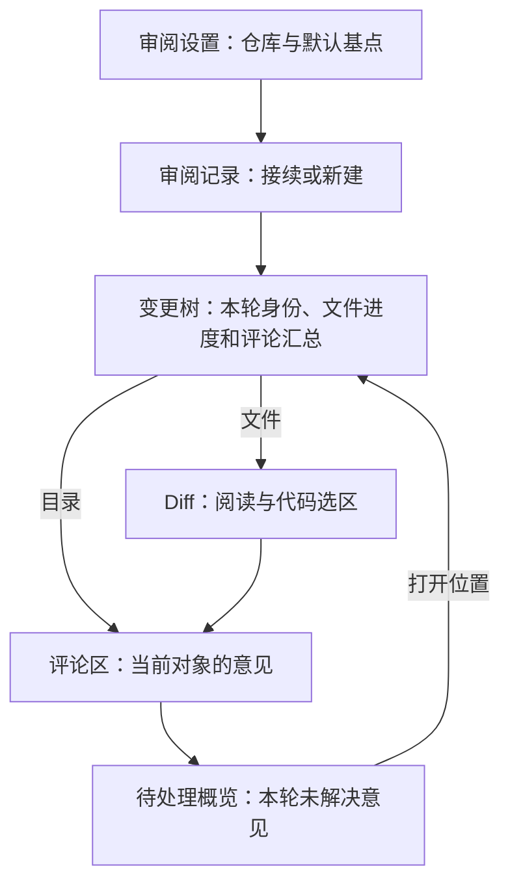

# ReviewSlate 设计规范

维护责任：设计负责人 `designer`；最后核查：2026-11-03。适用范围：VSIX 1.0.1 的人工审阅界面，以及 Codex 工作区。状态：**VSIX 实现基准已核查；Codex 0.1.1 入口整改及 0.1.2 目录树热区、键盘保存焦点已在独立测试宿主按各自范围通过；真实 Codex 成品验收未完成**。

本目录是用户流程、界面布局、组件状态、视觉基准与设计验收的权威入口。VSIX 基准依据 `689de24` 的实际源码建立；Codex 本轮设计基于 `3dd7e30` 及当前工作区实现。当前有未提交的客户端、核心和构建改动，不能沿用早期“与发布基线无差异”的结论。源码说明当前实现，目标条款说明下一步设计要求，两者均不代替运行证据。

业务身份和状态语义以[产品规范](../产品/README.md)为准；宿主接口与实现职责见[客户端研发](../客户端/README.md)和 [Codex 接入](../客户端/Codex接入.md)；保存协议见[核心数据协议](../客户端/数据协议.md)。使用步骤见[用户指南](../用户文档/使用指南.md)，执行证据由[测试与验收](../测试/README.md)统一维护。本文不复制字段定义、产品验收编号或宿主能力结论。

## 设计判断

ReviewSlate 的界面应支持用户反复返回同一轮审阅。设计首先回答三个问题：**正在审什么，哪些内容需要处理，刚才的操作是否已经保存。** 记录选择、文件进度、评论状态分别呈现；打开文件、收到 Agent 回复或解决评论，不通过视觉暗示替代其他状态。

当前 VSIX 使用原生树、选择器、菜单和 Diff，评论区使用轻量 Webview。沿用这一分工及现有紫蓝视觉语言；原生控件服从宿主尺寸和主题，评论区负责较长的意见、引述与操作反馈。本次没有整体换肤，按设计预设的既有项目优先规则，不采用新的 Element 风格或组件库。

后续 Codex 复用对象、状态和反馈语言，具体控件服从实际可用的宿主能力。完整任务需要用户在应用内查看变更并操作；技术探针、聊天输出和自动审查结论不能代替可交互工作区。

## 当前 VSIX：工作台与任务衔接

图示为当前界面关系。待处理概览是评论区的一种模式，不增加独立视图；Agent 交接也不改变正在审阅的对象。

| 区域 | 用户需要看见的信息 | 入口与动作 | 实现来源 |
| --- | --- | --- | --- |
| 审阅设置 | 当前仓库、之后新建时使用的默认基点 | 选择仓库、设置默认基点 | [settings.ts](../../src/settings.ts) |
| 审阅记录 | 分支、短 SHA、基点说明、当前或归档状态 | 顶部“新建审阅…”、加号、打开、归档、恢复、永久删除 | [history.ts](../../src/history.ts) |
| 变更文件 | 仓库与分支、固定基点、已审数量、“保存后的工作区”、树节点状态 | 文件 Diff、目录评论、勾选、刷新、展开与折叠 | [tree.ts](../../src/tree.ts)、[extension.ts](../../src/extension.ts) |
| Diff | 两侧来源、当前路径、完整或审阅后增量视图 | 查看；适用时编辑工作区侧；选择代码；固定预览标签 | [extension.ts](../../src/extension.ts) |
| 审阅评论 | 对象路径、全轮未解决数、输入范围、评论与回复、删除恢复区 | 新增、编辑、解决或重开、定位、删除及撤销、交接 | [panel.ts](../../src/panel.ts)、[comments.js](../../media/comments.js) |

四个侧栏视图在 [package.json](../../package.json) 中依次注册为设置、记录、文件、评论，初始尺寸权重为 `2 / 3 / 12 / 5`，不是固定像素高度。Diff 位于宿主编辑器主区；用户调整面板后，布局仍应让当前对象与下一步操作可识别。

### 进入与切换一轮审阅

新建入口在已有记录时仍显示。新建、改变本轮基点、设置默认基点分别使用明确标题；选择器说明默认设置不会移动当前固定基点。相同组合复用后提示进度和评论已保留，新组合提示原记录仍保留。历史列表先放当前记录，再按最近使用排列；已归档和删除未完成各自分组。

提交选择支持搜索与直接输入 SHA。验证时忙碌并禁止重复接受；失败保留输入，候选区显示“无法选择此提交”及重试原因；取消不改变当前记录。Git 图形菜单是补充入口，菜单不可用时仍可使用命令面板或审阅记录菜单；兼容范围交由[客户端研发](../客户端/README.md)说明。

对比起点行显示来源、提交说明、8 位短 SHA，提示补充完整 SHA 和日期。行点击用于更换基点，复制按钮独立复制完整 SHA；不能仅凭长提交说明识别当前轮次。仓库、分支与 CR 的具体复用、隔离规则引用产品规范，不在界面中引入另一套身份概念。

### 从文件返回意见

点击文件打开“基点 → 当前工作区”，并使评论区跟随该文件。同一 CR 的同一文件复用标签，连续浏览使用预览标签，需要保留时用宿主固定标签。完整 Diff 的普通 UTF-8 工作区文本可在右侧编辑；其他类型、只读侧及增量限制由用户指南说明。审阅状态始终针对已保存内容。

旧 CR 的固定标签可能继续编辑真实工作区，但不能给当前 CR 绑定选区评论。发现归属不符时，评论区提示从当前变更树重新打开。没有已审快照或审阅后没有变化时显示原因，不伪造增量内容。

目录名称打开目录评论，箭头控制展开，复选框操作已审。目录评论区将本目录直接意见与“子目录与文件的评论”入口分开，子项显示相对路径及两类评论数量，有未解决意见的对象优先。

待处理概览显示当前轮未解决意见，每张卡片标明对象路径；可直接处理，也可“打开位置”返回文件或目录并在树中选择、聚焦。概览不直接新增评论或恢复已删除评论，这些操作回到具体对象完成。

## 当前 VSIX：状态呈现与组件行为

### 树状态

目录排在文件之前，同级名称排序；顶层初始展开，深层初始折叠。稳定节点 ID 支持普通刷新保留手动展开状态，“展开全部”不主动转移选择和焦点。跨关闭重开的文件、展开和 Diff 定位恢复未在本轮验证，不把普通刷新连续性扩写成完整导航恢复。

| 状态 | 当前呈现 | 操作含义 |
| --- | --- | --- |
| 文件待审 / 已审 | 原生未勾选 / 已勾选框，提示和可访问名称补充状态 | 行内描述不重复这两个常规状态；打开文件不自动勾选 |
| 文件需复审 | “需复审”、橙色与 `!` | 未勾选；可进入审阅后增量 |
| 未保存 / 读取失败 | 状态文字与 `!`；分别使用橙色 / 错误色 | 不提供文件复选框；重新保存或修复读取后刷新 |
| 目录未审 / 部分已审 / 已审完 | 文字、已审数 / 总数；部分为 `◐`，完成为 `✓` | 复选框仍为两态；部分状态下点击标记整个目录，完成后点击取消 |
| 目录变化文件中有未保存或读取失败 | 已审数量排除这些项，提示说明原因；失败优先错误装饰 | 不提供目录复选框，不将局部已审呈现为整目录完成 |
| 仅评论对象 | “保留的评论”“已删除评论”或目录“仅评论” | 保留查看与恢复入口，不加入变化文件数，无已审复选框 |

普通文件装饰以 `A / M / D` 表示新增、修改、删除；测试文件优先用 `T`，异常优先用 `!`。变化类型仍在提示和可访问名称中，不能只读装饰字母判断状态。

目录评论聚合覆盖本目录与全部子项。行内有未解决时优先显示“n 评论”，否则显示“n 已解决评论”；它不是所有状态的总数。目录提示分别列出未解决、已解决，以及本目录和子项的数量。已删除评论不加入有效计数，恢复入口仍保留。目录评论不计作变化文件。

### 评论卡片与位置

输入区显示“文件评论”“目录评论”，或“基点 / 工作区侧 n–m 行”；选区显示原片段，可改为文件评论，目录不显示选区动作。当前输入框上限 20,000 字符，空白内容不提交；选区范围及长度校验以 [anchors.ts](../../src/anchors.ts)为准，超限提示改用文件评论。当前空白提交没有独立行内校验提示。

卡片依次包含状态与位置、正文、原片段、Agent 处理说明、操作。评论和回复均为纯文本，保留换行；内容中的代码或指令不变为可执行控件。

| 卡片主状态 | 视觉表达 | 用户动作 |
| --- | --- | --- |
| 待处理 | 琥珀色标签与左边框 | 编辑、定位、解决或删除 |
| Agent 已回复，待复核 | 紫色标签与左边框，保留处理说明 | 查看代码与回复后由用户决定是否解决 |
| 已解决 | 绿色标签与左边框 | 可重新打开或继续维护意见 |

旧版本回复带“旧版本回复”前缀，不进入待复核主状态。评论解决与文件已审分别保留动作和状态，不共用一个完成标记。

定位在卡片中另行表达：

| 位置文案 | 当前证据与可执行动作 |
| --- | --- |
| 文件评论 / 目录评论 | 不绑定代码行，无代码定位按钮 |
| 原位置 | 对应侧内容仍匹配，定位到保存位置 |
| 已跟随行号变化 | 原片段与上下文唯一匹配，定位到新行号 |
| 相关代码已变化 | 原片段变了，前后上下文仍唯一确定当前区间；可打开该区间，保留原引述供人工核对 |
| 位置待确认 | 无法确定可靠区间，不显示“定位代码”，保留对象与原片段 |

“定位代码”选择对应侧的可确认区间；概览中的“打开位置”只返回文件或目录，不证明行号已确认。具体匹配逻辑来自 [anchors.ts](../../src/anchors.ts)，界面不得静默把原意见附到猜测位置。

### 编辑、草稿和保存反馈

编辑在原卡片内进行：同一输入节点移入卡片，出现编辑横幅、“保存修改 / 取消编辑”，并聚焦输入。结束前禁用其他卡片的编辑入口并说明原因。周期刷新不拆卸正在编辑的输入节点；取消或成功保存后恢复编辑前的新评论草稿。

保存期间显示“正在保存…”，禁用输入和相关动作；单条评论等待结果时禁用该卡片动作。失败显示错误、恢复操作并保留草稿；成功仅清除对应草稿，不能清空已切到另一对象的输入。新增重试复用请求身份，正文变化后产生新身份。单条删除成功后展开“已删除”区，提供“撤销删除”。

当前草稿通过 Webview 状态保存正文、编辑身份及编辑前草稿，按仓库、CR 和对象隔离，概览编辑有独立范围。代码选区锚点在扩展内存中，**正文恢复不代表选区草稿完整恢复**。当前没有持续的本地草稿状态提示，本轮也没有实测关闭重开。原评论消失时保留编辑草稿、禁用保存，并提示取消编辑后到原位置查看。

## 视觉与布局基准

原生控件继承宿主字体、行高、缩放和键盘习惯。活动栏资产为 [review.svg](../../media/review.svg)，树和菜单采用宿主 `ThemeIcon`；[review-flow.svg](../../media/review-flow.svg)仅用于概念说明，不能作为界面截图。

树状态 token 的真源是 [package.json](../../package.json)。高对比深色与浅色默认值分别沿用对应深、浅色，宿主主题可覆盖。

| `codeReview.*Foreground` | 语义 | 浅色 / 深色 |
| --- | --- | --- |
| `added` | 新增、完成目录、当前记录图标 | `#16753A / #79D69A` |
| `modified` | 修改 | `#174AC5 / #8FB9FF` |
| `deleted` / `error` | 删除 / 读取失败 | `#BD3446 / #FF98A6` |
| `changed` | 需复审、未保存、部分已审 | `#9B5500 / #FFC177` |
| `comment` | 评论、设置和基点入口 | `#7540B6 / #C9ABFF` |
| `folder` | 未完成目录 | `#986817 / #DFB562` |

评论区样式真源为 [comments.css](../../media/comments.css)。重点 token 为：页面背景 `--cr-bg`，浅 / 深色 `#f3f6ff / #161e32`；卡片背景 `--cr-card` 为 `#fcfdff / #1d2943`；主按钮 `--cr-primary` 为 `#5940ae / #6848b8`；路径和次操作 `--cr-blue` 为 `#284ba9 / #b4ceff`。状态使用 `--cr-open / --cr-review / --cr-done` 及配套底色，完整值留在 CSS，不另建样式副本。

当前页面内边距 14 px，卡片内边距与卡片间距 12 px，动作间隙 7 px；卡片圆角 8 px，按钮与输入圆角 6 px；输入框最小高度 92 px，可纵向调整。正文和按钮继承宿主字号，行高 1.5；辅助文字与代码片段 12 px，对象标题 13 px。高对比模式去圆角并使用宿主对比边框，焦点环来自 `--vscode-focusBorder`，错误文字使用宿主错误色。

评论面板宽窄均为单列，标题、路径、正文和引述可折行，动作组可换行，没有宽度断点。原生树不改成 Web 卡片，也不硬编码树行高。当前没有通用双向文本隔离；长路径、长按钮组、混合语言、高对比主题和用户缩放需要实机检查，不能凭 CSS 规则认定可读性已通过。

## 反馈、恢复与可访问性

| 场景 | 当前 VSIX 表达 | 设计核查重点 |
| --- | --- | --- |
| 无仓库、未选 CR | 提示打开包含提交的 Git 仓库；欢迎区提供新建入口 | 当前无仓库提示合并部分不可用情形，不能声称已有完整诊断分类 |
| 读取或验证中 | 设置“读取中…”；SHA 选择器忙碌 | 普通树扫描没有独立加载态，不把旧内容默认为本次扫描成功 |
| 无变化、无评论 | 保留基点并说明无变化；对象或概览分别显示无评论文案 | 有遗留评论的对象仍可访问，空直接评论不掩盖子项评论 |
| 整体读取失败 | 树可点击重试，说明已有数据保留；评论区显示错误 | 不显示正常完成进度，不将失败当作零变化 |
| 保存失败或陈旧对象 | 错误与保留草稿，重新核对当前对象后重试 | 不在失败时清空输入或显示已保存 |
| 工作区不受信任、虚拟工作区 | 通过宿主能力声明与激活条件限制 | 不设计绕过宿主的授权入口；访问恢复沿宿主权限边界处理 |
| CR 归档 | 完成后提示可从已归档分组恢复 | 与不可恢复删除区分；具体冲突规则引用产品规范 |
| CR 永久删除 | 上下文菜单危险操作，原生模态列明仓库、分支、完整基点、数据范围及不可恢复性 | 取消无变化；删除标识保存前失败仍可能处于可恢复的“已归档”，标识保存后清理失败才进入“删除未完成 · 可重试” |

当前文件和目录的可访问名称组合了对象与状态，目录复选框有动作说明；输入框名为“评论内容”，错误区为 `role="alert"`，按钮和恢复区使用原生 HTML 控件。显示评论区调用保留焦点的 `show(true)`；显式编辑才聚焦输入框，树的键盘导航由宿主负责。

现有实现没有统一的保存结果朗读或操作后焦点恢复机制。删除或解决后卡片消失、失败错误播报、树与 Diff 进入 Webview 的键盘路径，需要真实操作验证。模拟面板测试的 `focus()` 为空实现，不构成焦点或辅助技术证据。

## Codex 工作区设计入口

[Codex 工作区](Codex工作区.md)维护本轮的单工作区布局、连续任务、编辑候选、评论与导航恢复、异常状态、键盘约束和原型检查范围；当前实际候选的[目录树定向验收](Codex工作区.md#012-目录树定向验收)记录 0.1.2 热区与焦点修复。本页继续维护 VSIX 实现基准与通用视觉语义，不复制另一套目标正文。

[客户端体验整改](客户端体验整改.md)是当前实际客户端的实施补充，包含仓库切换、独立设置、审阅工具分层、紫蓝视觉恢复，以及[入口设计稿](客户端入口整改.svg)。它来自独立测试宿主实看和用户反馈；最终候选的包指纹、实际复验结果与未覆盖范围见该页。

本地交互原型位于被忽略的 `artifacts/codex-design/index.html`，使用同目录 CSS/JS，无外部依赖、网络或真实仓库操作。它可演示树、Diff、三类意见、已审、合成编辑与失败恢复；不是正式插件或 Codex 宿主能力证据，普通 checkout 不包含该产物。具体打开方法和未覆盖范围见工作区设计页。

正式方案优先由自绘本地页面承载，不预设原生侧栏或 Diff API。编辑是待验证的优先方案，完整 Diff 与保存状态区分仍必须保留；宿主接入门槛、产品取舍和正式验收分别由[客户端](../客户端/Codex接入.md)、[产品](../产品/README.md)和[QA](../测试/README.md)维护。

## 设计验收与交接

VSIX 基准核查在 `689de24` 上检查了上述源码、状态与布局声明，未安装、启动或操作编辑器，也未取得该版本的完整实际页面、键盘或辅助技术证据。**本轮 VSIX 成品设计验收未执行；Codex 0.1.1 入口整改与 0.1.2 热区、键盘保存焦点已在独立测试宿主按各自范围通过，真实 Codex 成品设计验收未完成。** 实际页面问题及复验分别记录在[客户端体验整改](客户端体验整改.md)和[目录树定向验收](Codex工作区.md#012-目录树定向验收)；原型的预审范围单独记录在 [Codex 工作区](Codex工作区.md#原型入口与检查范围)，不替代正式验收。技术探针仅说明它实际验证的通道，独立测试宿主不等于 Codex；证据边界统一链接[测试与验收](../测试/README.md)。

设计验收在相关 QA 通过后针对同一候选版本进行，记录提交及工作区差异、宿主与系统版本、实际页面和操作、截图位置、结果与未覆盖项。源码、模拟测试、CSS 声明及历史结果都不能替代最终成品。纯文档整理本轮不重复运行 VSIX 测试或打包。

| 必查任务 | 实际成品需要证明的结果 | 当前缺口与接手方 |
| --- | --- | --- |
| 接续与新建 | 入口能找到，长分支与基点可辨，复用、取消和删除确认对象清楚 | 设计在目标 VSIX / Codex 候选宿主分别检查 |
| 深树审阅 | 部分已审、仅评论、未保存和失败不混淆，折叠仍能识别汇总 | QA 提供状态样例；设计核对真实树布局和操作 |
| Diff 与意见往返 | 两侧来源清楚，旧标签、代码定位与返回对象不误导 | QA 覆盖归属；设计实际走完整导航 |
| 编辑与恢复 | 输入法、光标、草稿、失败重试、删除恢复和旧回复都可理解 | 选区草稿完整恢复尚无证据；客户端实现后 QA 和设计复验 |
| 主题与宽窄 | 长中英文、路径、代码和按钮不遮挡，浅、深、高对比及缩放下可读 | 尚未实测；设计查看实际代表页面并操作 |
| 键盘与可访问性 | 焦点可见、动作后可预期，对象、错误和结果可被朗读 | 尚未实测；不能以模拟 DOM 的调用记录判通过 |
| Codex 连续任务 | 在真实宿主完成产品要求，并在关闭重开后回到正确审阅对象 | 已有候选 UI 与独立测试宿主；简化入口/视觉与同包 QA 已取得所列证据，真实 Codex 证据另行确认 |

设计负责人维护本页的现行基准、目标条款、实际偏差与复验结论。界面变化时更新受影响正文及验收范围，待实现内容完成后以代码和运行证据替换目标描述；跨领域规则变化通知对应负责人。总状态、发布和阶段安排由[项目文档入口](../README.md)协调，不在设计目录复制一份项目进度表。
