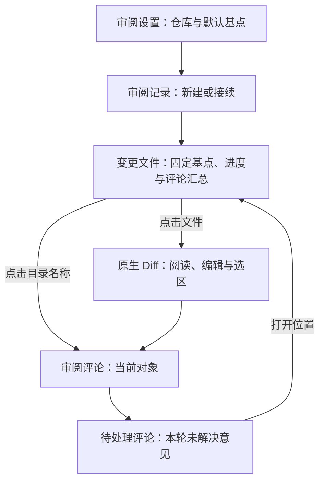

# ReviewSlate VSIX 设计规范

维护责任：设计负责人；状态：现行规范，1.0.3 文件树筛选定向实机验收通过；最后核查：2026-11-04。适用范围：`main` 的 VS Code 系 VSIX，兼容目标包括 Trae / Trae CN。依据：`eba6bbf` 加本轮冻结的筛选实现，以及产品确认的规则。各版本现场证据及未覆盖范围见本文末节。其他客户端见 [beta 分支](https://github.com/To-Re/review-slate/tree/beta)。

本页维护用户流程、界面状态、视觉基准和设计验收边界。业务含义见[产品规则](../产品/业务规则.md)，可判定结果见[产品验收条件](../产品/验收条件.md)，实现与存储边界见[客户端](../客户端/README.md)，执行证据见[测试记录](../测试/验证记录.md)。源码核查用于说明实现，不能代替成品验收。

## 工作台与审阅流程

界面始终帮助用户辨认当前仓库、分支与固定基点，找到需要审阅的内容，并确认评论是否已保存。文件已审、评论已解决和 Agent 已回复分别表示不同结果，保留独立状态与动作。

沿用项目已有紫蓝配色、原生树和 Diff。按 `ui-design-presets` 的既有项目优先规则检查主题、密度与状态，本轮不引入新的预设风格或组件库。树、菜单、选择器及 Diff 服从宿主布局与键盘惯例；评论区使用单列本地 Webview 承载意见、引述和保存反馈。

图示表示界面关系。待处理评论是评论区内的一种模式；交给 Agent 只复制交接说明，不启动另一工作台。

| 区域 | 信息与操作 | 实现来源 |
| --- | --- | --- |
| 活动栏 | ReviewSlate 图标进入审阅侧栏 | [package.json](../../package.json)、[review.svg](../../media/review.svg) |
| 审阅设置 | 仓库名称、默认基点；点击切换仓库或设置新建时的默认来源 | [settings.ts](../../src/settings.ts) |
| 审阅记录 | 分支、短 SHA、基点说明、当前或归档状态；新建、打开、归档、恢复、永久删除 | [history.ts](../../src/history.ts) |
| 变更文件 | 仓库与分支、固定基点、已审数量、文件树和评论汇总；打开 Diff、目录评论、勾选、刷新、展开或折叠 | [tree.ts](../../src/tree.ts) |
| 原生 Diff | 两侧来源和路径；完整对比或上次已审后的变化；适用时编辑工作区侧 | [extension.ts](../../src/extension.ts) |
| 审阅评论 | 当前对象、全轮未解决数、评论范围、意见和回执；新增、编辑、解决、定位、删除与恢复 | [panel.ts](../../src/panel.ts)、[comments.js](../../media/comments.js) |

侧栏从上到下为设置、记录、文件、评论，初始尺寸权重为 `2 / 3 / 12 / 5`，不表示固定像素高度。Diff 在主编辑区。用户调整侧栏后，当前对象、进度与下一步动作仍需可辨认。

### 选择基点与接续记录

“新建审阅…”在已有记录时仍显示，工具栏另有加号入口。新建、改变当前基点和设置默认基点分别使用明确标题；默认设置说明不会改变已有审阅的固定提交。复用同组合时提示进度和评论已保留，新建其他组合时说明原记录仍保留。历史列表先显示当前记录，再按最近使用排序；“已归档 · 可恢复”和“删除未完成 · 可重试”分组表达不同恢复能力。

提交选择器支持搜索最近提交及直接输入 SHA。验证中显示忙碌并阻止重复接受；失败保留输入，显示“无法选择此提交”和重试原因；取消不改变当前 CR。Git 图形右键是补充入口，菜单能力不足的宿主仍可从审阅记录或命令进入提交选择。

树顶端“对比起点”显示来源、提交说明和 8 位短 SHA，提示中包含完整 SHA 与日期。点击行更换基点，独立复制按钮复制完整 SHA。长提交说明不能成为识别当前轮次的唯一信息。打开其他分支的审阅记录不切换 Git 分支，需先由用户切到相应分支。

归档后提示可恢复。永久删除使用原生模态，列明仓库、分支、完整基点、被清理的资料及不可恢复性；取消无变化。清理中断后的可恢复或可重试状态以[产品规则](../产品/业务规则.md)为准，不把归档与永久删除共用一个成功文案。

### 从文件、目录进入评论

点击文件打开“基点 → 当前工作区”，评论区跟随该文件。同一 CR 的同一文件复用 Diff 标识；连续浏览使用预览标签，需保留时使用宿主固定标签。点击目录名称打开目录评论，箭头控制展开，复选框控制已审，三者不混用动作。

目录评论区分本目录直接意见和“子目录与文件的评论”。子项入口显示相对路径及未解决、已解决数量，有未解决意见的对象优先。没有直接评论时仍保留子项入口；目录评论不绑定某个代码行。

待处理评论汇总当前 CR 的未解决意见，每张卡片标明路径，目录后缀带 `/`。用户可以直接编辑、解决或删除，也可以“打开位置”返回文件或目录并在树中选择、聚焦。此概览不直接新增或恢复已删除评论，相关操作需进入具体对象。没有待处理意见时显示“本轮没有待处理评论。”，不会呈现为读取失败。

## 树状态与视觉含义

目录优先于文件，同级名称排序；顶层目录初始展开，深层目录初始折叠。稳定节点 ID 用于普通刷新保留展开状态；“展开全部”不主动改选中对象和键盘焦点。完整的关闭重开后导航恢复尚未验证，不能由普通刷新连续性推导。

| 对象状态 | 当前表达 | 操作边界 |
| --- | --- | --- |
| 文件待审 / 已审 | 原生未勾选 / 已勾选框；提示和可访问名称补充状态 | 行内不重复常规状态；打开 Diff 不自动标已审 |
| 文件需复审 | “需复审”、橙色及 `!`，复选框未勾选 | 可查看上次已审后的变化 |
| 未保存 / 读取失败 | 状态文字及 `!`，分别使用橙色 / 错误色 | 文件不显示已审复选框；保存或修复读取后重新核对 |
| 目录未审 / 部分已审 / 已审完 | 文字和已审数 / 总数；部分为 `◐`，完成为 `✓` | 复选框为两态；部分时勾选表示标记整个目录，完成后取消表示取消该目录范围 |
| 目录含未保存或读取失败的变化文件 | 已审数量排除这些项，提示原因；读取失败优先错误装饰 | 不显示目录复选框，不把部分成功呈现为整目录完成 |
| 仅评论对象 | 文件显示“保留的评论”或“已删除评论”，目录显示“仅评论” | 可查看、维护或恢复评论，不增加变化文件分母，也无已审复选框 |

文件装饰使用 `A / M / D` 表示新增、修改、删除；测试文件优先显示 `T`，异常优先显示 `!`。类型仍保留在提示和可访问名称中，不能只依赖字母或颜色表达语义。

目录评论计数覆盖本目录与所有后代。行内有未解决意见时显示“n 评论”，否则显示“n 已解决评论”；这不是两类评论总数。目录提示分别列出未解决、已解决及本目录、子项数量。已删除评论不计入有效数量，具体对象仍提供恢复入口。

### 文件树筛选

筛选只改变“变更文件”的可见对象，不改变 CR、已审记录、评论、Diff 内容或待处理概览范围。沿用原生 TreeView、QuickPick 和标题栏图标，不新增 Webview、配置页或颜色 token。实际成品的验收范围见末节。

标题栏保留一个常驻漏斗按钮，名称为“筛选变更文件”。点击打开单选列表，标题为“筛选变更文件”，当前项带“当前”说明；键盘可选择，取消保持原模式。三个选项互斥：

| 选项 | 列表说明与命中规则 |
| --- | --- |
| 全部 | 显示所有变更及保留的评论对象；默认模式 |
| 未审核 | 显示待审、需复审、未保存和读取失败的变更文件；不包含仅评论对象 |
| 有评论 | 显示有未解决或已解决评论的文件、目录；不包含仅有已删除评论的对象 |

非“全部”时，树上方纯文本先显示“筛选：未审核”或“筛选：有评论”，再显示“全部范围 X/Y 已审”等现有说明。标题栏同时出现原生 `clear-all` 图标，名称为“显示全部”，一次点击恢复全部；恢复后清除图标消失。当前模式依靠文字表达，不能只靠图标或颜色。使用当前宿主公开支持的字符串消息，不在树消息中依赖 Markdown 命令链接。

筛选保留命中对象的祖先目录，以便识别路径。某目录自身有评论时保留该目录，但不因此显示没有评论的后代；只因后代命中而出现的目录仍可打开其评论。目录排序、折叠展开、固定基点行及现有颜色含义保持一致。“展开全部”只作用于当前可见树。

顶部进度、待审徽标、目录进度和目录评论汇总仍按完整 CR 或完整目录计算，不能把隐藏文件当作不存在。筛选时目录提示明确“进度与评论数包含隐藏项”，并保留本目录、子项的评论计数说明。目录显示 `1/10` 而可见文件不足十个是筛选结果，不是部分扫描成功。

为避免当前可见操作影响隐藏成员，任何非“全部”模式都不提供目录复选框及目录、整树批量标记或取消入口；命令也需拒绝这类操作，并提示“筛选时请切换到全部后批量标记”。目录提示同样说明这一限制。单文件复选框和单文件菜单沿用原规则；完成单文件标记后若不再命中“未审核”，该文件可从树中消失，已打开的 Diff 和评论对象仍保留。

| 状态或动作 | 界面结果 |
| --- | --- |
| 未审核无结果 | 保留固定基点，显示可点击行“没有未审核文件”，提示“点击显示全部”；标题栏同时保留“显示全部”，不写成整个 CR 没有改动 |
| 有评论无结果 | 保留固定基点，显示可点击行“暂无带评论的文件或目录”，提示“点击显示全部”；标题栏同时保留“显示全部”，不把已删除意见计为命中 |
| 无当前 CR / 读取失败 | 优先显示现有欢迎或错误状态，保留当前筛选文字及清除入口；不把读取失败解释为零条命中 |
| 改变或清除筛选 | 只投影已取得的完整视图，不启动 Git 扫描，不显示整页加载或锁住评论；不主动打开文件或迁移评论目标 |
| 当前文件被筛掉 | 允许树不再选中该对象，继续保留原生 Diff、评论范围和各对象草稿；不能自动选择下一行 |
| 评论“打开位置”或“定位代码”的有效目标被筛掉 | 恢复全部后展开、选中并按原规则定位，提示“已显示全部，以定位评论对象”；已可见目标不改变筛选，无可靠锚点或归属失效时仍拒绝定位 |
| 后台刷新或评论、已审状态改变 | 按当前筛选重新计算可见对象；更新过程不覆盖后来选中的文件、目录、待处理模式或输入草稿 |

筛选是当前工作区的浏览偏好，保存在宿主工作区状态；切换仓库或 CR 保持模式，重新载入后恢复。不新增用户配置项，不改变 CR 的保存格式，也不承诺跨宿主同步。清除筛选后该工作区恢复“全部”。普通编辑器标签切换不自动清除筛选。

## Diff、编辑与保存边界

完整 Diff 左侧为固定基点，右侧为当前工作区。普通 UTF-8 工作区文件可在右侧编辑，保存由编辑器完成；审阅进度针对磁盘上已保存内容。未保存内容显示“未保存”，不能标已审，也不能以尚未保存的右侧文本建立选区评论。文件、类型、权限或磁盘内容变化后的具体限制见[用户指南](../用户文档/使用指南.md)。

二进制、非 UTF-8、符号链接、删除、模式变化等按读取结果显示快照或元信息，不承诺右侧可编辑。上次已审增量比较“上次已审 → 现在”，不提供完整 Diff 的选区评论能力。没有快照或两次内容相同时给出原因，不造出空的成功对比。

旧 CR 的固定标签可能仍可编辑同一个真实工作区文件，但不能把它的选区绑定到当前 CR。归属不符时评论区提示从当前变更树重新打开。切换真实 Diff 标签应更新评论对象；固定预览标签、脏状态变化或普通后台刷新不应被当作用户切换对象。

打开文件、保存代码、保存评论、标记已审分别产生自己的结果。提速后定向读取一个文件不能暗示整棵树已重新扫描；只有完整扫描可以确认变化集合。失败保留可恢复资料，并明确错误，不以零变化或旧内容作为成功结果。

## 评论状态、草稿和反馈

输入范围显示“文件评论”“目录评论”，或“基点 / 工作区侧 n–m 行”。选区附原片段，可改为文件评论；目录不显示选区动作。输入上限为 20,000 字符，空白内容不提交；选区上限和位置校验见 [anchors.ts](../../src/anchors.ts)。当前空白提交没有单独的行内校验提示。

卡片依次呈现状态和位置、正文、原片段、Agent 处理说明及动作。评论和回执均按纯文本显示，保留换行。收到 Agent 回执只进入人工复核，不能替用户解决评论。

| 主状态 | 视觉表达 | 可用动作 |
| --- | --- | --- |
| 待处理 | 琥珀色标签与左边框 | 编辑、适用时定位、标为已解决、删除 |
| Agent 已回复，待复核 | 紫色标签与左边框，显示处理说明 | 检查代码和回复后决定是否解决 |
| 已解决 | 绿色标签与左边框 | 重新打开、编辑、适用时定位或删除 |

不匹配当前评论版本的回执显示“旧版本回复”，不进入待复核主状态。评论已解决不改变文件已审。

| 位置状态 | 表达与定位 |
| --- | --- |
| 文件评论 / 目录评论 | 不绑定行号，无代码定位动作 |
| 原位置 | 内容仍匹配，可定位到原区间 |
| 已跟随行号变化 | 原片段和上下文唯一匹配，可定位到新行号 |
| 相关代码已变化 | 原片段改变，前后上下文仍能确定区间；可定位，保留原引述供人工核对 |
| 位置待确认 | 无可靠区间，不显示“定位代码”，保留对象与原片段 |

“定位代码”进入可以确认的代码区间；概览中的“打开位置”返回对象，不代表已确认原行号。无法确定位置时不静默猜测。

编辑在原卡片内进行，显示编辑横幅及“保存修改 / 取消编辑”，并聚焦输入。结束前禁用其他卡片的编辑入口；取消或保存成功后恢复编辑前的新评论草稿。周期刷新保留正在编辑的输入节点，不重置光标。

保存中显示“正在保存…”，禁用输入及相关操作；单条操作在等待期间禁用该卡片动作。失败显示错误、恢复操作并保留草稿。成功只清除对应请求、对应对象且内容未再改变的草稿，晚到回执不得清除另一个对象的新输入。新增重试复用请求身份，正文改变后使用新身份。删除成功后展开“已删除”区，提供“撤销删除”。

正文、编辑身份和编辑前草稿通过 Webview 状态保存，按仓库、CR 与对象隔离；待处理概览有独立编辑范围。选区锚点保存在扩展内存中，正文恢复不代表选区完整恢复。原评论已不在列表时保留编辑草稿、禁止保存，并提示取消编辑后回原位置查看。当前没有持续的本地草稿状态提示；关闭重开的实际恢复范围需实机核对。

## 主题、尺寸与可访问性

树、菜单和 Diff 继承宿主字体、缩放、行高与主题，不另设固定行高。活动栏使用仓库内的 [review.svg](../../media/review.svg)，树和菜单采用宿主 `ThemeIcon`。[review-flow.svg](../../media/review-flow.svg)是概念说明图，不是成品截图。

树颜色真源在 [package.json](../../package.json)，高对比浅色、深色默认沿用对应浅色、深色值，用户主题可以覆盖。

| `codeReview.*Foreground` | 语义 | 浅色 / 深色 |
| --- | --- | --- |
| `added` | 新增、已完成目录、当前记录图标 | `#16753A / #79D69A` |
| `modified` | 修改 | `#174AC5 / #8FB9FF` |
| `deleted` / `error` | 删除 / 读取失败 | `#BD3446 / #FF98A6` |
| `changed` | 需复审、未保存、部分已审 | `#9B5500 / #FFC177` |
| `comment` | 评论、设置与基点入口 | `#7540B6 / #C9ABFF` |
| `folder` | 未完成目录 | `#986817 / #DFB562` |

评论区真源为 [comments.css](../../media/comments.css)。页面 `--cr-bg` 为 `#f3f6ff / #161e32`，卡片 `--cr-card` 为 `#fcfdff / #1d2943`，主按钮 `--cr-primary` 为 `#5940ae / #6848b8`，路径与次操作 `--cr-blue` 为 `#284ba9 / #b4ceff`。状态使用 `--cr-open / --cr-review / --cr-done` 及配套底色，完整值只在 CSS 维护。

评论区页面内边距 14 px，卡片内边距与卡片间距 12 px，动作间隙 7 px；卡片圆角 8 px，按钮和输入框圆角 6 px。输入最小高度 92 px，可纵向调整。正文、按钮继承宿主字号，行高 1.5；辅助文字与代码片段 12 px，对象标题 13 px。

评论区始终单列，路径、正文、引述折行，动作组换行，不设宽度断点。高对比主题去圆角并使用宿主对比边框，焦点环来自 `--vscode-focusBorder`，错误使用宿主错误色。当前无通用双向文本隔离；窄侧栏、长路径、长按钮组、中英与双向文字、主题和缩放需实际查看，不能仅凭 CSS 认定可读性通过。

文件、目录的可访问名称包含对象与状态，目录复选框另有动作说明；评论输入名为“评论内容”，错误区为 `role="alert"`。显示评论面板使用保留焦点方式，显式编辑才聚焦输入；树键盘行为沿用宿主。当前没有统一的保存结果朗读和操作后焦点恢复机制，删除、解决后卡片消失以及失败重试时的键盘连续性仍需检查。

## 异步切换与等待验收要求

以下用于核对本轮首次树展示及点击 Diff 的修复，对应 `VSIX-AC-12～15`。它们是通过条件，不表示候选已实现或已通过。

| 场景 | 必须保持的用户结果 |
| --- | --- |
| 首次确认基点 | 完整树可用时再呈现本轮结果，变化集合、身份与计数对应；等待中不能把旧 CR 的树当作新 CR 已扫描完成 |
| 快速连续点击 A、B，A 较慢 | 最后有效选择 B 决定 Diff、评论标题和选区归属；A 晚到不得抢回选择、打开旧标签或覆盖错误反馈 |
| A 在途时进入目录、待处理或其他已打开标签 | 用户后来选择的对象或模式保留；菜单命令和评论面板按钮都覆盖，不能只检查一个入口 |
| A 在途时切仓库、CR 或分支 | 旧请求不更新新对象、不使旧选区可评论；当前目标不可读时明确失败，资料保留 |
| 后台扫描与打开文件重叠 | 点击不被无关扫描长期阻塞；扫描结束不覆盖刚读取的内容、评论范围或草稿；需要重新读取时明确执行或提示 |
| 保存、取消与失败 | 已保存磁盘内容用于新 Diff；未保存保护有效；失败不变成已审或已保存，重试不会重复新增评论 |
| 非导航变化 | 固定标签、脏状态变化和普通刷新不自动退出目录评论、待处理概览或正在编辑的卡片 |

当前已有反馈包括设置中的“读取中…”、提交 SHA 验证忙碌态和评论“正在保存…”。普通树扫描及打开 Diff 尚无独立加载提示；真实宿主若仍有明显等待，需记录从用户动作到可见响应的间隔及误操作情况，由研发处理，不能以后台耗时下降替代等待体验结论。本轮不凭空承诺毫秒阈值，不新增整页遮罩或锁住无关操作。

整体读取失败时，树显示“读取失败，点击重试”，进度说明已有数据保留，评论区显示错误；不能显示正常完成进度。无仓库提示打开包含提交的 Git 仓库，未选基点时欢迎区提供新建入口。无变化时保留基点并说明“与基点相比没有改动”；遗留评论仍可访问。工作区不受信任或为虚拟工作区时沿用宿主能力限制，不提供绕过入口。

## 设计核查与成品证据

### 1.0.3 文件树筛选的实机验收

**2026-11-04 定向验收通过，未发现所测路径的新阻断。** 设计负责人在 macOS 26.4.1、Trae CN **3.4.14** / 内核 1.107.1 中独立操作 `garden` 合成工作区；宿主版本由主负责人读取应用文件确认。样本为 7 个变化文件和 1 个保留评论文件，初始 `1/7` 已审，含 1 个需复审文件及 5 条未解决、已解决、目录和选区评论，基点 `d079b8d7`，分支 `feature/filter`。

实际安装和操作的 1.0.3 候选包 SHA-256 为 `e90887eb24bab73fe4053c14518a6d5a7278568f891eea06516317927bcfc57d`。设计负责人核对冻结源码指纹、`artifacts/tree-filter/verification.json`、`installed.json` 和 `host-activation.json`：16 个运行模块匹配，主负责人记录新宿主激活 1.0.3；设计实际确认扩展页版本、合成窗口与审阅状态。未另取正式运行时构建指纹，版本对应依赖安装字节、新宿主激活和同窗口操作共同确认。

发布准备包 SHA-256 为 `ad8ad2a3aa182e94a5e0610f304d07fcd89ec09da0d86e41116f2b6d50b2314a`。设计回读 QA 的 `artifacts/releases/v1.0.3/artifact-verification.json`：它与实测候选仅 README、CHANGELOG 不同，16 个运行模块完全一致；发布前单次完整测试为 142 项，141 通过、0 失败、1 项可选采样跳过。运行模块一致支持沿用下面的功能证据，不记作正式包再次 GUI 复验或性能采样；发布状态仍以[项目现状](../项目现状.md)为准。

| 定向场景 | 结果 | 实际观察 |
| --- | --- | --- |
| 漏斗、当前模式及取消 | 通过 | 原生列表有全部、未审核、有评论三项；重新打开时标明当前模式，按 Esc 后仍为未审核 |
| 未审核命中与祖先 | 通过 | 展开后显示 6 个变化文件，含需复审 `revisit.ts`；已审 `finished.ts` 和仅评论 `unchanged.ts` 隐藏，深层祖先保留 |
| 有评论命中 | 通过 | 显示 `nested.ts`、`open.ts`、`resolved.ts`、`unchanged.ts`；`folders` 自身意见保留，未显示其无评论的 `sub/plain.ts` |
| 全量统计与目录保护 | 通过 | 两种筛选均保持全量 `1/7`；目录没有复选框，未审核下目录右键仅有“评论此目录”，提示包含隐藏项及批量限制；恢复全部后目录复选框重新出现 |
| 一键清除 | 通过 | 点击标题栏“显示全部”恢复完整树、取消筛选文字，清除图标消失 |
| 单文件标记后的上下文 | 通过 | 未审核下为 `ordinary.ts` 输入未提交草稿并勾选；文件及其父目录消失，进度变 `2/7`，Diff、评论标题和草稿仍属该文件；切往其他对象再返回，草稿仍在 |
| 隐藏评论目标“打开位置” | 通过 | 未审核下从待处理概览打开 `retention/unchanged.ts`，自动恢复全部并提示原因；树选中、Diff 预览与评论标题均对应目标 |
| 重载偏好与进度 | 通过 | 有评论模式执行宿主“重新加载窗口”，重新进入 ReviewSlate 后恢复有评论及 `2/7`；未将完整关闭重开或所有导航状态恢复算入此结果 |
| 未审核空态与恢复 | 通过 | 在全部模式把合成目录标至 `7/7`，切未审核后保留基点、全量进度和“没有未审核文件”；点击空态行恢复全部 |
| 当前浅色布局 | 通过（可见范围） | 模式文字可换行，文件状态、目录层级、Diff 两侧与草稿可读；标题栏受宽度限制使用省略号和原生提示，未出现操作被覆盖 |
| 其余边界 | 未执行 | 有评论空态、已删除评论、未保存或读取失败的实机状态、隐藏目标“定位代码”按钮、快速交叠操作、完整键盘流程、其他主题 / 宽度 / 宿主，以及评论保存和代码编辑保存 |

操作只改变合成审阅的筛选偏好、未提交草稿与已审进度，结束为全部模式、`7/7`；未新增、编辑或删除评论，未修改代码或业务工作区。筛选不发起 Git 扫描、陈旧命令 guard、其他失败状态和事件排列以[QA 记录](../测试/验证记录.md)的自动化范围为准，不从截图推导。

原始证据保存在忽略目录 `artifacts/tree-filter/gui/`，不随 checkout 提供：`03-unreviewed`、`06-comments` 记录命中与布局；`04-filtered-directory-menu`、`05-cancel`、`07-clear-all` 记录入口与恢复；`08-draft-before`、`09-marked-hidden`、`10-hidden-open-target` 记录草稿及定位；`11-before-reload`、`12-after-reload` 记录偏好恢复；`13-unreviewed-empty`、`14-empty-clear-all` 记录空态。辅助功能文本证明具体操作后的对象和状态，实际 PNG 用于可见布局核查。早先锁屏与前台状态不一致在用户将合成窗口置于前台后恢复；`01`、`02` 是受阻记录，其旧截图不用于本次通过结论。

上述有效证据的文件指纹及验收范围汇总在同目录 `manifest.json`，SHA-256 为 `f9d3205d8e40d291db4a67b90d929af6455b10ca7ed37da5083bdaadd2588c0e`。

### 1.0.2 原生导航的既有证据

1.0.2 静态核对了 [extension.ts](../../src/extension.ts)、[tree.ts](../../src/tree.ts)、[settings.ts](../../src/settings.ts)、[history.ts](../../src/history.ts)、[panel.ts](../../src/panel.ts)、[comments.js](../../media/comments.js)、[comments.css](../../media/comments.css)、[commit-picker.ts](../../src/commit-picker.ts) 与 [package.json](../../package.json)。设计负责人随后通过原生辅助功能状态及实际截图，独立操作已交接的 Trae CN 合成窗口，未修改项目代码、评论或已审进度。

### 被检对象与方法

现场环境为 macOS 26.4.1、Trae CN 3.4.11 / 内核 1.107.1。正式包安装后新开的 `orchard-final` 工作区包含合成项目 `orchard`：800 个变更 TypeScript 文件，分支 `feature/review-check`，固定基点 `56c8a68144c08a61b2b58fa88f06d9a505ee5660`。进入时编辑区为空，`file_0000.ts` 已审，整体为 `1/800`，父目录部分已审 `1/10`，评论为 0 条。系统、宿主版本及新进程身份来自主负责人同次现场交接；设计负责人实际确认窗口、工作区与上述状态。

被检 1.0.2 VSIX 的 SHA-256 为 `be7e00d56fd3806886a90d7883363fe6a7f11e2ca3bfe50208270509d056471d`，`src/extension.ts` 指纹为 `cd7bca87c359f1b182fa127496bd07b4c7252014486244931e9a7688b8d830f0`。设计负责人核对了本地包、源码指纹及 `artifacts/vsix-host-check/installed-verified-event.json`：安装位置的 `extension`、`git`、`review`、`panel` 四个模块均与包匹配，无诊断残留。该记录 SHA-256 为 `580d30159513e700657c2288d60c9f3af570d1fa8000da744b1950d3464ee86a`，位于忽略目录，不随 checkout 提供。

版本对应依据是安装字节核验、安装后新建宿主的交接及在该窗口的实际激活与操作；本次未另外取得正式运行时构建指纹，不能单凭版本号或磁盘文件声称进程对应。设计负责人也回读了最终全量测试日志（130 项，129 通过、1 跳过）与 QA 事件增量日志（5 通过），详细范围见[测试记录](../测试/验证记录.md)。这些自动化结果与下面的真实 GUI 观察分开记录。

### 定向复验结果

| 场景 | 结果 | 实际观察与边界 |
| --- | --- | --- |
| 现行布局、文案、状态与视觉 token 对应 | 通过（静态核查） | 与上列源码对应，不代表所有主题和布局通过 |
| 活动栏激活、已有 CR 的树与进度 | 通过（现场） | 在 `orchard-final` 点击 ReviewSlate，先显示设置“读取中…”，随后恢复正确基点、`1/800`、父目录部分已审 `1/10`；未重新创建 CR |
| 顺序切换 `0000 → 0001 → 0000 → 0002` | **通过（现场）** | 每次操作后分别核对，树选中项、Diff 预览标题与评论标题均为同一文件；最后截图同时确认 0002 的树、`value2` 内容及评论路径 |
| 快速点击 `0000 → 0001 → 0002` | **通过（现场）** | 三次连续点击间不等待观察，随后完整读取界面状态，最后有效目标均为 0002；不外推任意事件排列 |
| 原生 Diff 与预览标签 | 通过（现场） | 左右侧合成内容 `1 → 2` 可读，连续切换复用一个预览标签；未测试编辑保存 |
| 目录评论与同标签焦点 | 通过（现场） | 点击 `group_000` 后显示 `src/group_000/` 及目录评论说明；再点击现有 Diff 右侧，目录评论保持 |
| 待处理概览与同标签焦点 | 通过（现场） | 从 Webview 按钮进入 0 条待处理的空概览；再点击同一 Diff 右侧，待处理模式保持；从概览重新点文件后评论正确跟随 |
| 当前浅色布局可读性 | 通过（可见范围） | 树状态、Diff 两侧与评论路径可辨认；当前侧栏纵向分配使输入区下部需滚动，未检查全部控件的滚动后操作 |
| 首次树与可读 Diff 的屏幕耗时 | 未测量 | 未做屏幕时间采集，工具响应耗时或模拟性能值不能记作 GUI 延迟 |
| 窄侧栏、其他主题、长文本、完整键盘与评论保存流程 | 未执行 | 未检查代码编辑保存、评论新增 / 编辑 / 解决、错误恢复及跨宿主行为；本轮未扩展为全产品验收 |

证据来自设计负责人本次独立 CUA 操作返回的逐步辅助功能状态、快速点选后的完整状态，以及初始化树和最终 0002 对比的实际截图。操作全程只在合成项目内进行，未写代码、评论或已审进度，未改配置；未另建截图文件。

**1.0.2 设计结论：连续切换、评论对象同步和同标签焦点保持的定向 GUI 验收通过。** 此前预览替换的空标签过渡会把评论回退到上一文件，已按真实事件修复并在新宿主关闭该复现路径；原始诊断资料留在忽略的 artifacts，根因和测试边界见[测试记录](../测试/验证记录.md)。本结论绑定上述包、环境与场景，不表示新增筛选、首次树屏幕耗时、全部审阅流程或其他宿主已验收。
