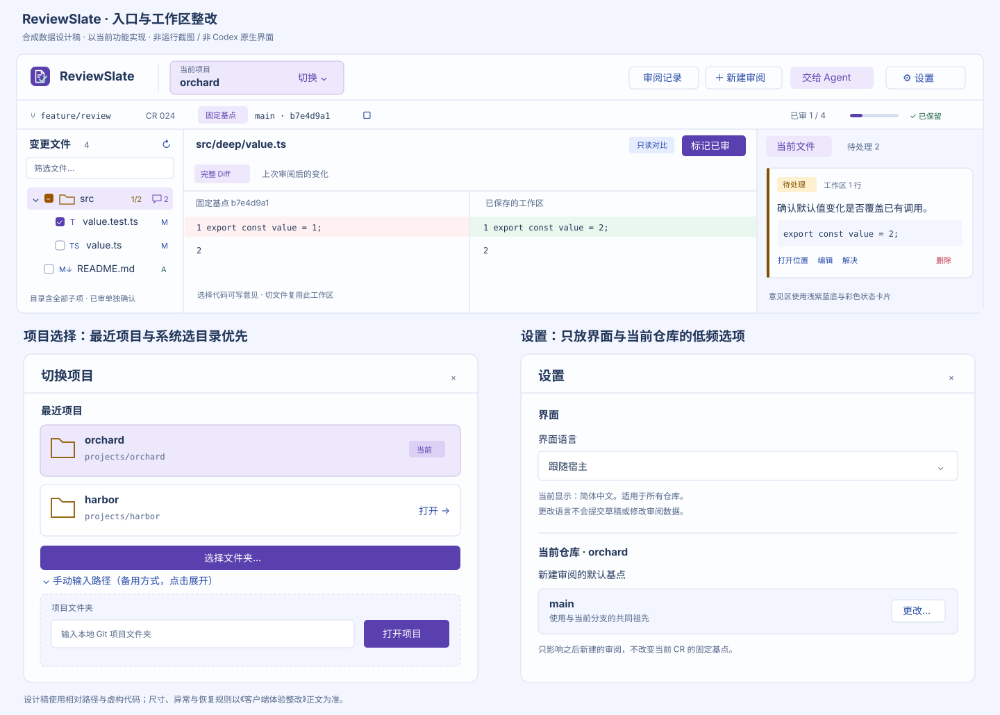
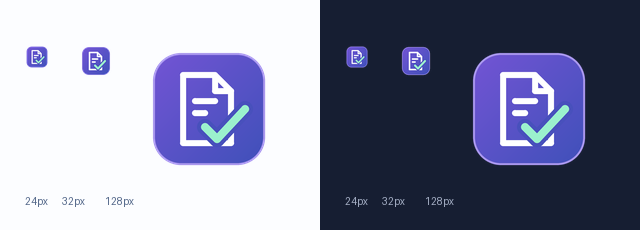

# 客户端入口与视觉整改

维护责任：设计负责人；最后核查：2026-11-03。状态：**0.1.1 简化入口及指定视觉修正已在独立测试宿主复验通过；真实 Codex 成品验收未完成**。范围为当前 `web/codex/` 的仓库入口、设置、审阅布局和状态表达，不改变 Git、CR、评论或权限语义，不新增跨宿主配置同步或代码编辑保存能力。依据：用户对语言设置、仓库选择和风格的反馈，当前产品 AC-01/AC-17，以及独立测试宿主中的实际页面。完整业务与连续性仍见 [Codex 工作区](Codex工作区.md)。

## 实际问题与本轮决定

设计通过 CUA 在 **ReviewSlate Client Test Host**（自有 AppKit / WKWebView，非 Codex）查看了当前审阅页、仓库对话框、展开的 `src/deep` 文件树。只操作 `artifacts/codex-gui-fixtures/orchard` 合成仓库的页面与导航，没有使用业务仓库。原型参考为本目录已预审的浅色紫蓝方案，其脚本与 CSS 指纹未变化。

| 实际问题 | 影响 | 本轮整改 |
| --- | --- | --- |
| 顶部混排仓库、新建、历史、Agent、刷新、默认基点及未显露字段标题的语言选择 | 用户无法区分当前项目、审阅动作和全局偏好；“跟随宿主”本身不解释在设置什么 | 顶部只保留品牌、明确的当前项目切换、审阅动作及“设置”；刷新移到文件树，语言与默认基点进入设置 |
| 仓库按钮仅写 `orchard`，无切换含义 | 看起来像普通标签，切换入口不明确 | 按钮常显“当前项目”、仓库名、“切换”及下拉箭头；可访问名称为“切换仓库，当前 orchard” |
| 仓库弹窗先要求完整路径且立即聚焦，最近仓库位于表单之后；名称与长路径居中混排 | 已用过的项目仍像首次设置，路径成主要阅读负担 | 最近项目优先，两行左对齐；“选择文件夹…”为主，手动路径为备用。已记录路径不重复输入 |
| 整个工作区几乎使用同一浅白底，目录/文件都无图标，测试文件与普通文件相同 | 虽有紫色按钮，信息层级仍显单薄；难以扫视对象与状态 | 恢复原型的紫蓝分区、金色目录、蓝色类型、测试图标、状态色与评论卡片边线，保持正文可读 |
| 无选中文件时主区空白过大，标题区放一整句开发状态 | 正常进入后缺少直接下一步，技术说明压过任务内容 | 文件头显示对象/状态，能力以小标签表达；空态提供“打开首个待审文件”，不自动改变已审 |

本轮按 `ui-design-presets` 的既有项目优先规则沿用 ReviewSlate 紫蓝基准；不采用 Element、不换框架、不新增设计库。参考设计稿使用合成信息，示意入口与密度，不代表正式运行截图：

## 1. 顶部按对象与任务分层

顶部高约 64 px，左右内边距 20 px，控件高 32 px，组间距 16–20 px。顺序为 `ReviewSlate | 当前项目切换 | 弹性空白 | 审阅记录 | 新建审阅 | 交给 Agent | 设置`。

- 品牌使用本页资产中的紫蓝审阅页与勾选图标，替换字母 R；名称 17 px，不放占大面积的装饰说明。
- 当前项目按钮宽约 200–240 px，两行显示 10–11 px 辅助标题“当前项目”和 13 px 半粗仓库名，右侧“切换 ⌄”。名称可省略，完整根路径在 tooltip 和仓库对话框可读；主工具栏不铺绝对路径。
- 新建、历史用中性/蓝色次按钮，Agent 用浅紫色；有活动 CR 时“标记已审”才是内容区的主要操作。未选 CR 时，新建入口可用紫色主按钮。
- “设置”采用齿轮加可见文字，不仅用无说明图标。语言下拉与默认基点按钮从顶栏移除，不能只隐藏仍留键盘焦点。
- 刷新放“变更文件”标题右侧，带 tooltip/可访问名“刷新已保存的工作区”。

第二行身份条高约 42 px，内容为 `分支 feature/review · CR … | 固定基点 main · c9d8f5c2 [复制]`；右侧为 `已审 0/4` 与细进度条、保存状态。固定基点必须有字段名，复制完整 SHA 使用独立图标按钮；默认基点与本轮固定基点不得混淆。归档、失败和未保存仍以准确状态显示，不用绿色成功统称。

## 2. 项目选择：最近项目或系统文件夹

用户最新确认“选择项目”是像访达一样选择一个本地文件夹。入口保持两条：点最近项目直接打开，或点“选择文件夹…”进入系统窗口；不增加设置、目录浏览页面或预先输入路径。对话框标题统一为“切换项目 / Switch project”，无当前项目时为“打开项目 / Open project”，与“当前项目”“最近项目”一致；宽约 540 px。有最近项目时，焦点进入标题或当前项目项，不进入隐藏的路径框。

最近项目每项至少 62 px 高，左侧本地仓库/目录图标，右侧两行：名称 13 px 半粗；根路径 11 px 等宽、辅助色、LTR、左对齐。当前项显示“当前”浅紫标签，其他项显示“打开”箭头；整行可点击。长路径允许最多两行，完整值可选择或在 tooltip 读取，不让路径挤压名称。不能把“最近”当作已获得权限。

列表之后提供唯一主要动作“选择文件夹… / Choose folder…”，调用随候选包提供的系统目录选择器。系统窗口使用标准文件夹浏览与侧栏，只选一个目录，标题“选择项目文件夹 / Choose project folder”，确认按钮“选择文件夹 / Choose folder”；初始位置用当前或最近有效目录。选定后沿现有仓库校验流程直接打开，不再增加“是否确定切换”的二次确认。这是用户明确新增要求，已进入 0.1.1 本地候选；独立测试宿主的运行证据不等同真实 Codex 兼容。

其下仅保留次级文字入口“手动输入路径 / Enter path manually”，展开带可见标签“项目文件夹”的路径框和“打开项目”按钮。无最近项目时突出系统选择，手动方式默认仍折叠。两种方式都允许 Git 仓库或其子目录，成功后展示归一化的项目根目录，不要求用户寻找隐藏的 `.git`。原生选择器只在点击时出现，技术与权限边界由客户端负责，不扩为后台扫描。

等待期间主按钮显示“选择文件夹中… / Choosing folder…”并防重复；验证与打开期间显示“正在打开…”。只有成功回执后才更新当前项目身份并关闭弹窗，依现有规则恢复该项目的 CR；无 CR 时进入新建，不自动 checkout 或初始化 Git。

| 返回或异常 | 用户看见的结果与下一步 | 连续性约束 |
| --- | --- | --- |
| 取消系统选择 | 回到原项目弹窗，按钮恢复；不显示错误或成功提示 | 不改变当前项目、CR、文件、草稿和最近记录；焦点回“选择文件夹…” |
| 关闭项目弹窗或原选择返回过迟 | 回原审阅区；迟到结果不打开项目 | 释放本次选择会话，后续打开弹窗不能误收旧路径 |
| 明确不是 Git 仓库 | “这个文件夹不是 Git 仓库，请重新选择项目文件夹。”；所选路径摘要和“重新选择文件夹…”就地可见 | 不自动展开手动路径，不创建仓库、不清空原审阅 |
| 不存在、无权限或无法读取 | 有明确依据时说明具体原因；广义失败用“无法打开这个项目，请确认文件夹仍存在且可以访问，或重新选择。” | 错误显示在选择按钮附近；手输错误留在字段旁，最近项目错误留在该行旁。保留原上下文，不伪造已打开 |
| 系统选择器无法启动 | 原弹窗提供重试，手动路径入口仍可用 | 不显示虚构路径或成功状态 |
| 原草稿保存失败或结果待核对 | 沿已有恢复入口说明先处理保存状态；可保留已选路径，不切项目 | 不跳过保存守卫、不将未知结果改成成功，不重复创建新操作 |

只按实际错误依据使用精确“非 Git”文案；通用 `REPOSITORY_UNAVAILABLE` 本身不证明目录不是 Git 仓库。各失败仍留在同一弹窗内重选，避免把系统选目录失败变成必须手工输路径。

项目选择页以“选择要审阅的 Git 项目文件夹。”说明用途，可保留一行首次保存提示，不堆权限或实现说明。首次保存位置和忽略规则仍在“启用并新建审阅”确认区说明。选择项目本身不新增提权或联网动作。

## 3. 独立设置收纳低频偏好

设置对话框宽约 480–520 px，只有本次需要的两个分区，不加侧边导航或额外设置首页。

| 分区 | 控件与文案 | 行为 |
| --- | --- | --- |
| 界面 | 可见标签“界面语言”；选项“跟随宿主 / 简体中文 / English”；辅助说明“当前显示：简体中文。适用于所有仓库。” | 保留现有产品的 locale 回退及本地偏好规则。改变后显示保存中；确认成功才切换，失败保留原语言并就地提示。界面更新不关闭弹窗、不跳对象、不清草稿 |
| 当前仓库 · orchard | “新建审阅的默认基点”，显示当前来源摘要和“更改…” | 无仓库时提示先选择仓库，按钮不可用。点击沿用现有基点选择器，标题“orchard 的默认基点”，明确“只影响以后新建，不改变当前 CR” |

不叠加两个模态窗口。“更改…”转到同一个对话框内的基点步骤，提供“返回设置”；保存成功返回设置并更新摘要，取消返回且不变更。语言即时保存与基点显式确认各自反馈，不增加一个含义不明的总“应用”按钮。

语言切换应覆盖打开中的标题、按钮、帮助与错误摘要；项目名、分支、SHA、路径、代码与评论保持原文。中文/英文选项使用各自语言名称，便于误切后找回。当前已支持的语言规则不因入口重排改变。

## 4. 复用原型的工作区密度与色彩

宽布局保持树 240–260 px、意见 336–360 px、Diff 占剩余空间。结构区用 `#fcfdff`，意见背景和局部提示用 `#f3f6ff`，当前项用 `#eee8fc`；边框 `#d6def0`，正文 `#22375a`，辅助字 `#536789`，主操作 `#5940ae`，链接/类型 `#284ba9`。颜色只是层级与状态，不给整个页面刷大面积高饱和色。

树每行至少 34 px，固定列顺序为 `展开 32 | 已审 32 | 类型 16 | 名称 flex | 数量/状态`，列间距 2 px，层级缩进 16 px。无子项的文件保留展开列空位，不绘制不可操作的圆点按钮。0.1.2 将箭头与 checkbox 的独立可点击区域均扩大到 32 × 32 px；悬停、焦点及动作语义统一见[目录操作热区](Codex工作区.md#目录操作热区)。

- 目录使用金色文件夹 SVG；部分已审显示中间态与琥珀 `n/m`，全部已审用绿；展开/收起热区位置一致。
- 普通文本文件使用本地类型图标；TS/JS 用蓝，Markdown 用蓝紫，配置文件用中性色。测试文件使用测试图标与“测试文件”提示，并按用户偏好加淡绿行底：浅色建议 `#edf6ec`，深色建议 `#203b32`。使用现有识别规则覆盖已识别的 `_test`/`.test` 等路径。选中紫底优先；未选中时读取失败/需复审的红橙提示优先于测试底色，状态文字和图标始终保留。
- 新增 A/＋用绿，修改 M 用蓝，删除 D/−用红；需复审用橙色图标与文字/tooltip，读取失败用红。已审由 checkbox 表达，避免每行重复“已审”文字。
- 评论使用紫色气泡和数量，目录聚合仍包括所有子项；仅评论对象不增加文件分母。文件名省略与类型图标分开，避免重复原型出现的 `M↓` 被裁切问题。
- 树标题显示变化文件数、“全部展开”“全部收起”和刷新，使用独立本地图标与可访问名称。全展开/收起只更新目录展开状态，保留当前对象、主区、已审、草稿和焦点；无目录时禁用。窄树标题可把工具组另起一行，不挤压计数。筛选框下面保留“全部 / 未完成”切换，筛选不改变总进度。

意见栏以浅紫蓝底衬白卡片；卡片 12 px 内边距、8 px 圆角、12 px 间距。待处理用琥珀标签/左边线，匹配回执待复核用紫，已解决用绿；正文和代码引述保持深蓝可读。主标签为“当前文件/当前目录”和“待处理 N”；待复核是未解决意见的子集，在列表摘要或卡片上说明，不在导航上堆两个长数字标题。

文件头展示路径、类型、变化统计/状态和“标记已审”。只读构建显示小标签“只读对比”，提示“显示已保存的工作区；代码保存后刷新查看”；不要把“尚未启用可靠的代码编辑保存”作为每个页面的大段开发说明。完整 Diff 与上次审阅后变化继续显式切换，来源标注不缩水。

无选中文件且存在变化时，主区用小型本地 Diff 图标、简短说明及“打开首个待审文件”按钮，显式导航且不标已审；有恢复上下文时优先接续原对象，不能用这个默认动作覆盖恢复。没有变化时保留基点与待处理入口。

## 5. 窄宽、键盘与反馈

沿用当前断点：1200 px 以下意见变侧面板，760 px 以下树也可收起。顶栏优先保留项目切换、当前对象和设置；新建/历史/Agent 在空间不足时收进有标签的“审阅操作”，不将设置塞回 Diff 工具栏。侧面板关闭回到触发按钮，草稿与滚动不丢。英文按钮更长时允许工具组换行，不能覆盖项目按钮或把语言下拉挤出屏幕。

最近项目、路径输入、语言、默认基点都要有可访问名称；弹窗 Escape 取消并回到原触发控件。路径验证失败焦点留在字段，语言保存失败焦点保留选择器。刷新不得重建聚焦的输入节点或抢走焦点；当前 5 秒刷新产生的 DOM 更新需由研发检查稳定性，但本轮 CUA 索引失效本身不直接判为用户点击缺陷。

保留客户端当前的上下文恢复入口，不收进设置：发生 `STALE_CONTEXT` 且无结果未知操作时，可“保留原 CR 草稿并打开当前分支”，只有原归属草稿确认保存后才能切换，失败留在原处。存在草稿的错误条保留“导出当前草稿…”；对话框说明未确认保存前勿关闭，展示完整归属和只读 JSON 供用户自行复制，不把展示当作已保存。归档或永久删除的原 CR 禁写，但仍可导出。布局改动保留既有增量 Diff 身份判断、默认基点选择回填与恢复守卫。

## 实施与最终复验

客户端按单一写入者修改 `web/codex/app.ts`、`workspace.css` 及相关词条/必要模型。本设计不修改源码，不要求增加框架、联网依赖、仓库发现或目录扫描。先落入口与设置，再完成树/卡片视觉；行为修复与布局可合并构建，但复验必须绑定同一包。

本轮基线为 `3dd7e30` 加当前未提交实现。预审时源指纹：`app.ts` 为 `c0336b6f64a54fdce8a18a6b24e6a252f27d7eb3f9ede10b410e602bbb30e9ab`；`workspace.css` 为 `e261472893130d2c0904ba53fb5b8f7d539637beda0bd2b047b61d90d6ded6f3`。这是源码定位，不把当前测试壳的加载字节与稍后的源码变更混为同一版本。

复验应使用重建后的实际包和同一独立测试壳，只操作 `orchard` / `harbor` 合成仓库：从顶部找到切换、最近项目一键打开、添加路径与失败重试、设置语言切换后草稿保留、修改默认基点不改变当前 SHA、树深层展开/类型/部分已审/意见聚合、宽/窄布局与焦点返回。输入路径、编辑评论和打开设置时跨过一次后台刷新周期，检查文字、光标、选中项和弹窗不被重置。设计检查实际页面，QA 另核对保存与恢复；测试壳结果仍不等同真实 Codex 集成。

### 2026-11-03 最终候选的实际设计复验

**本轮简化入口及指定视觉修正通过，范围限独立测试宿主。真实 Codex 面板及完整成品验收仍未完成。** 设计针对实际客户端复验，未凭 SVG、源码或旧原型判通过。

| 被检输入 | SHA-256 |
| --- | --- |
| 0.1.1 最终包 manifest | `25e39e5096c6d2d891342c3a78cfbf5916fe9703a1a2299f67f185411377b452` |
| 最终 ZIP | `49cb45d66b578b43ce37cf1a65dd21c4f6600704eb650a6772f98d72ed7ff013` |
| 包内 UI | `04afe56d176265b5e3058659aa8afa19a57a7137290c87e1f1c862ab3b6ef141` |
| UI `app.ts` | `12ff839b978952922f6e625214af27c3ee7bf8b236f4608d2a654cbbb261c776` |
| UI CSS | `3d15a9e5768a00ac57ed92ddb888b51b376ff38828d08d1a0fa8f949415e3f1f` |

QA 完成业务复验后，设计通过 CUA 独占自有 **ReviewSlate Client Test Host / AppKit / WKWebView**，操作合成 orchard。先正常 Cmd+Q，以应用清单确认退出，再重开读取最终包；从最近项目打开 orchard。环境为 QA 记录的 macOS 26.4.1 arm64，窗口约 1440 px 宽、浅色。实际截图在工具回传中查看，本次未另存设计截图。

| 复验项 | 实际观察与结果 |
| --- | --- |
| 简化项目入口 | **通过**：最近项目位于上方，项目名和路径分行；“选择文件夹…”是唯一主要按钮，手动路径保持折叠。点击最近 orchard 后恢复原 CR、value.ts、1/4、两条意见和未提交稿 |
| 主按钮悬停及焦点 | **通过**：从空白处拖入按钮、不触发选择，实际鼠标悬停仍为紫底白字；键盘 Tab 到“选择文件夹…”时可访问树确认聚焦，紫底白字及焦点环清楚。此前 QA 截图中白字浅底问题已关闭 |
| 全部展开 / 收起 | **通过**：实际点击全部收起后只保留顶层目录，当前 Diff、1/4 和意见/草稿不变；全部展开后 src/deep 与文件恢复 |
| 测试文件底色 | **通过**：未选中的 value.test.ts 为淡绿底与试管图标；点击后紫色选中底优先，返回 value.ts 后测试行恢复淡绿。未改变已审状态 |
| 英文默认基点说明 | **通过**：设置切 English，再进入 Change；完整 SHA 与英文说明位于对话框边界内，未再溢出。Escape 返回设置，恢复简体中文，没有保存基点变更 |
| 品牌及整体层级 | **通过**：header 的审阅页+勾选图标实际显示；紫蓝分区、金色目录、部分已审与评论聚合、琥珀待处理卡片和草稿区保持清楚，无三栏重叠 |

系统文件夹选择、原生取消、误选非 Git 后就地重选、关闭错误弹窗继续原审阅及真实保存，使用 QA 对 `a3bf4a5bfe78c6c13c303c96278e4ad9e1ed98003474bd84186f665a2c413b69` 包的独立 GUI 证据；设计回读了 `artifacts/codex-qa/0.1.1/cr09/` 的实际截图、AX 与输入指纹。最终包仅追加主按钮 CSS 修正，QA 已核对 app/store/服务未变，主负责人确认 native 未变，依据见[测试记录](../测试/验证记录.md#2026-11-03-codex-011-系统目录选择与视觉回归)。设计没有把 QA 的操作写成自己重做；本轮未重新启动 helper 或重复完整业务回归。

此前 manifest `0e1154f13a40604c08f78ff86d549ba9f1b959bb8d93f506a014095d19f63815` 中发现的英文溢出、测试淡底缺失和全展开/收起缺失均已在上述最终包关闭。该较早版本曾实看约 961 px 系统半屏，意见抽屉可开关；不将旧包的半屏结果升级为最终包全响应验收。

**未覆盖与交接：** 最终包的 ≤759 px、深色真实客户端、完整键盘遍历/输入法、高对比、长分支以及需复审/失败/待复核的完整视觉组合仍未验证。此前 CUA 窗口边缘拖动受限，本轮未绕用其他自动化。真实 Codex 置顶图标加载、面板、宿主生命周期与完整 AC 继续由目标宿主验收确认。结束时已恢复中文、浅色、原宽度、value.ts 和深层展开；原评论正文、状态、已审与草稿未改，UI 已释放给主负责人。

## 品牌资产与小尺寸检查

用户要求置顶入口有专属图标。本轮采用紫蓝圆角底、白色审阅页与薄荷绿勾选，复用既有“审阅文档/确认”语义；图形为本地原创，不使用字母 R 或默认环形。资产不含远程图片、字体、账号或路径。

- [矢量源](../../plugins/codex/assets/reviewslate.svg)：64 × 64 viewBox，四周 4 单位透明留白，供 UI header 复用。
- [composer-icon.png](../../plugins/codex/assets/composer-icon.png)：128 × 128 RGBA，供插件输入/置顶入口。
- [logo.png](../../plugins/codex/assets/logo.png)：512 × 512 RGBA，供插件详情展示。

PNG 用本地 Pillow 按同一矢量坐标绘制并抗锯齿缩放，未编辑用户截图。设计实际查看了下图的 24/32/128 px 浅深底对照，页面轮廓与勾选均可辨；该检查不等同 Codex 对 manifest 图标的实际加载。manifest 引用、构建复制和真实置顶刷新由主负责人核对，UI header 替换由客户端执行。

资产 SHA-256：SVG `1de8fb56b5d236ad3a9b0c1c66f4bae5dc2d6088ca985582a3f9109c018c3c5d`；composer PNG `426a818ab797965afac23901c8d3abc1208b12907cea25f643e95c0eb8e0de15`；logo PNG `a1b799751820b2d5dca5fcb2430f7f6133ebd6ba5a49be54750f7c5d73c3977f`。
